# Постановка задачи BC2: соударение пластин с керамикой B4C

Что физически моделирует e2e-тест: геометрия сборки, начальные и граничные условия,
регистрируемая величина и результат расчёта. Численная схема и уравнения — в
отдельном документе [05-e2e-math.md](05-e2e-math.md).

Все размеры и значения сняты с кода
([input.cpp:490-596](../src/input.cpp#L490-L596)), который тест воспроизводит.

---

## 1. Задача

Моделируется **плосковолновой ударный эксперимент** на керамике — стандартная схема
для определения динамической прочности хрупких материалов.

Лёгкий полиуретановый ударник, разогнанный до 2210 м/с, налетает на пакет из двух
пластин карбида бора, за которым установлено окно из фторида лития. Удар порождает
плоскую ударную волну, которая последовательно проходит через сборку. Регистрируется
история скорости на тыльной поверхности неподвижной керамической пластины — в
эксперименте эту величину снимают интерферометром (VISAR) через прозрачное окно;
окно LiF нужно именно для того, чтобы поверхность не разгружалась свободно и
измерение оставалось корректным.

Цель расчёта — воспроизвести форму этой скоростной кривой: амплитуду фронта,
длительность плато, момент и глубину спада. По ней судят о работе модели
керамики (JH-2: упрочнение, накопление повреждения, разупрочнение) и о качестве
численной схемы.

Расчёт **осесимметричный**: сборка — тела вращения вокруг оси $z$, по которой идёт
удар. Считается меридиональная полуплоскость $r > 0$, координаты
$x^0 \equiv r$, $x^1 \equiv z$.

---

## 2. Геометрия



Четыре тела, расположенные последовательно вдоль оси удара. Опорные плоскости:
$Z_1 = 6{,}000$, $Z_2 = 9{,}917$, $Z_3 = 18{,}950$, $Z_4 = 44{,}350$ мм.

| № | Роль | Материал | `itype` | $z$, мм | Толщина, мм | Радиус $R$, мм |
|---|---|---|---|---|---|---|
| 1 | ударник | полиуретан 626 | 8 | $0 \dots 6{,}000$ | 6,000 | 43,75 |
| 2 | керамика, летящая | B4C | 10 | $6{,}200 \dots 9{,}917$ | 3,717 | 34,60 |
| 3 | керамика, неподвижная | B4C | 10 | $10{,}717 \dots 19{,}750$ | 9,033 | 34,60 |
| 4 | окно | LiF | 5 | $19{,}950 \dots 45{,}150$ | 25,200 | 25,40 |

Ступенчатое убывание радиуса (43,75 → 34,60 → 25,40 мм) — не произвол: боковая
разгрузка от свободных краёв идёт со скоростью звука внутрь, и убывающий диаметр
удерживает центральную зону одномерной дольше, чем успевает прийти волна разгрузки.
Именно поэтому монитор ставится на радиусе 12,5 мм — в области, где течение ещё
плоское.

### Зазоры между телами

Тела разделены зазорами: **0,2 мм** (ударник — керамика 2), **0,8 мм**
(керамика 2 — керамика 3) и **0,2 мм** (керамика 3 — окно). В коде они заданы
кратными шагу дискретизации: $\Delta x$, $4\Delta x$ и $\Delta x$ соответственно.

Зазоры — не технический артефакт, а часть постановки: тела в начальный момент **не
соприкасаются**, и контакт должен установиться в ходе расчёта. Зазор 0,8 мм между
двумя керамическими пластинами закрывается примерно к $t \approx 1{,}45$ мкс.

### Дискретизация

Регулярная сетка с шагом $\Delta x$; частица с индексами $(i_r, i_z)$ ставится в

$$r = \left(i_r + \tfrac12\right)\Delta x,\qquad z = z_0 + i_z\,\Delta x,$$

смещение на полшага по $r$ удерживает все частицы строго внутри $r > 0$.

| Режим | $\Delta x$, мм | Число частиц | Монитор |
|---|---|---|---|
| полный | 0,2 | 34 163 | 12 973 |
| smoke (для CI) | 0,8 | 2 120 | 803 |

Распределение по телам в полном режиме: 6789 / 3287 / 7958 / 16 129.

---

## 3. Начальные условия

В момент $t = 0$ вся сборка ненапряжена и покоится, кроме ударника и летящей
керамики, которым задана скорость вдоль оси:

$$v_z = \begin{cases} 2210\ \text{м/с}, & \text{тела 1 и 2},\\ 0, & \text{тела 3 и 4},\end{cases}
\qquad v_r = 0 \ \text{всюду}.$$

Остальные поля для всех частиц:

| Величина | Значение |
|---|---|
| плотность $\varrho$ | $\varrho_0$ материала: 626 / 2510 / 2510 / 2638 кг/м³ |
| давление $p$ | 0 |
| удельная внутренняя энергия $e$ | 0 |
| девиатор напряжений $S^{\alpha\beta}$ | 0 |
| повреждение JH-2 $D$ | 0 (керамика не повреждена) |
| длина сглаживания $h$ | $2\Delta x$ |
| масса $m$ | $\varrho_0\,\Delta x^2$ |

Ударник и летящая керамика движутся как единое целое: между ними нет ни
относительной скорости, ни начального сжатия — они просто разогнаны вместе.

Масса задана по **плоской** формуле $\varrho\Delta x^2$, а не по кольцевой
$2\pi r\varrho\Delta x^2$; в исходном коде оба кольцевых варианта присутствуют
закомментированными ([input.cpp:516-517](../src/input.cpp#L516-L517)).

---

## 4. Граничные условия

**Ось симметрии $r = 0$.** Условие $v_r = 0$ на оси специально не накладывается: оно
должно выполняться само по симметрии задачи. Нехватку соседей со стороны $r < 0$
восполняют зеркальные (виртуальные) частицы: для каждой частицы с $r < 2h$ строится
образ с $r \to -r$, $v_r \to -v_r$, $S^{rz} \to -S^{rz}$
([virt_part.cpp](../src/virt_part.cpp), вызов —
[single_step.cpp](../src/single_step.cpp)). Без них приосевой столбец считается с
неполным носителем ядра, а осевой член $\varrho\,v_r/r$ ничем не уравновешен — это и
приводило к развалу счёта у оси (§5).

**Свободные поверхности** — боковые ($r = R$) и торцевые (левый торец ударника,
правый торец окна). Отдельно не обрабатываются: в SPH отсутствие соседей снаружи
само даёт близкое к нулю напряжение. Коррекция ядра у границы не применяется.

**Границы раздела тел.** При `contact_force_type = 0` отдельных условий на границах
нет: тела не различаются, взаимодействие определяется исключительно расстоянием между
частицами через общую SPH-сумму. Как только зазор закрывается и частицы соседних тел
попадают в носитель ядра, они начинают взаимодействовать так же, как частицы одного
тела. При `contact_force_type = 1..3` дополнительно включаются штрафные контактные
силы (ADR-007).

> **Ограничение, важное для этого кейса.** Признак контактной пары реализован как
> «разные материалы» (`itype[i] != itype[j]`, решение D2=A в
> [02-decisions.md](02-decisions.md)). Тела 2 и 3 — **оба B4C, `itype = 10`**, поэтому
> для контактного алгоритма они неразличимы, и главная граница задачи
> (керамика ↔ керамика) контактными силами не обслуживается. Контакт работает только
> на границах 1↔2 и 3↔4.

**Внешние поля** отсутствуют: тяжесть выключена (`self_gravity = false`), внешнего
давления нет. Расчётная область ничем не ограничена — вылет частиц за какие-либо
границы не отслеживается.

---

## 5. Регистрируемая величина и результат

Монитор — частица на **тыльной поверхности неподвижной керамической пластины**
(тело 3) на радиусе $r = 12{,}5$ мм. В полном режиме это индекс 12 973; тест
воспроизводит её геометрически, а не литералом, поэтому монитор корректен при любом
$\Delta x$.

Записывается история ([time_integration.cpp](../src/time_integration.cpp)):

```
время [с]    v_z [м/с]    itype
```

Пишется **осевая** компонента $v_z$ (`vx[1]`) — именно её измеряет интерферометр,
и именно она сопоставима с эталоном. Прежде в лог шла радиальная `vx[0]`, из-за чего
расчёт и измерение были несопоставимы в принципе; по той же причине старые
`Керамика/**/log_*.txt` с текущими результатами сравнивать нельзя.

### Результат расчёта



> График перестраивается командой `cmake --build build --target bc2_plot`: она
> выполняет полный прогон и записывает SVG из той же кривой, которую только что
> проверил компаратор, поэтому картинка не может разойтись с метриками ниже.
> В обычном прогоне тестов график не трогается — запись в дерево исходников
> включается только флагом `--emit-plot=<файл>`.

Прогон текущего кода: полный режим, $\Delta x = 0{,}2$ мм, 34 163 частицы,
**1575 шагов**, расчёт дошёл до $t_{\text{total}} = 3{,}5$ мкс. Сверка выполняется
компаратором теста на общей сетке из 200 узлов.

| Метрика | Значение | Допуск |
|---|---|---|
| покрытие окна эталона | 100 % | $\ge 80$ % ✔ |
| $\mathrm{rel}_{L_2}$ | 0,859 | $< 10^{-3}$ ✘ |
| $\max\lvert\Delta\rvert$ | 1001,8 м/с | $< 1$ м/с ✘ |

Что видно на графике:

1. **Волна приходит к монитору слишком рано.** Расчёт отрывается от нуля около
   $t \approx 0{,}7$ мкс и выходит на максимум 1001,8 м/с в $t = 1{,}53$ мкс. Прибор
   же начинает регистрировать движение только в $t = 1{,}87$ мкс, а максимума
   1317,5 м/с достигает в $t = 2{,}29$ мкс. Сдвиг — порядка 0,75 мкс, и именно он даёт
   наибольшее расхождение: в худшей точке расчёт показывает 1002 м/с там, где эталон
   ещё ровно нулевой.

2. **Амплитуда занижена примерно на четверть** (1002 против 1317 м/с).

3. **Фазы разошлись**: к моменту приборного максимума расчёт уже спадает,
   а к 2,5 мкс выходит на полку около 280 м/с, тогда как эксперимент в это время
   только начинает снижаться с 1200 м/с.

Форма кривой при этом качественно правильная: плавный фронт, один выраженный
максимум, спад — то есть модель воспроизводит характер процесса, но не его времена.

### Что это означает

Расхождение **не является погрешностью дискретизации**: $\mathrm{rel}_{L_2} = 0{,}86$
при допуске $10^{-3}$ — это разница в три порядка, её не закрыть измельчением сетки.
Речь идёт о расхождении модели с экспериментом по скорости распространения возмущения,
и его источник в этом отчёте не установлен.

Два обстоятельства, без которых интерпретировать цифры нельзя:

- **Допуски в тесте регрессионные** ($\mathrm{rel}_{L_2} < 10^{-3}$,
  $\max\lvert\Delta\rvert < 1$ м/с) и к приборной кривой неприменимы — об этом прямо
  сказано в шапке [эталона](../tests/data/bc2_reference.txt). Пока режим сверки не
  переведён в валидационный с осмысленными порогами, `e2e_bc2_full_test` будет падать
  всегда, и его FAIL сам по себе не несёт информации сверх приведённых метрик.
- **Начальный шаг по времени завышен.** Ревью показало, что
  `build_bc2_geometry` не инициализирует `sys.c`, поэтому стартовый CFL считается без
  скорости звука и превышен примерно впятеро. Насколько это влияет на времена прихода
  волны — не проверено; до устранения количественные выводы о фазовом сдвиге
  предварительны.


---

## 6. Что тест проверяет на этой постановке

| Проверка | Режим |
|---|---|
| Число частиц по телам и суммарно; положение монитора | оба |
| Отсутствие NaN/Inf в $x$, $v$, $\varrho$, $p$ на каждом кадре | оба |
| $\varrho > 0$, $m > 0$ на всех кадрах | оба |
| Расчёт дошёл до $t_{\text{total}}$, шаг не сколлапсировал | оба |
| Сверка кривой с эталоном ($\mathrm{rel}_{L_2}$, $\max|\Delta|$) | полный |
| Контакт B4C↔B4C не обнаруживается (фиксация ограничения §4) | полный |

В smoke-режиме $t_{\text{total}} = 3\cdot10^{-7}$ с — зазор между телами 2 и 3 ещё не
закрылся, скорость монитора тождественно нулевая, поэтому сверка формы кривой там
вырождена и тест об этом предупреждает. Smoke проверяет живучесть конвейера,
а не физику.
