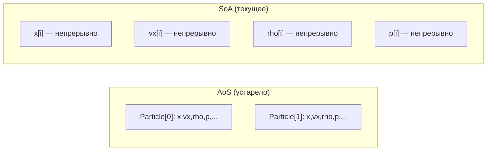

# Раскладка данных: SoA (Structure-of-Arrays)

## Постановка проблемы

Исторически данные частиц хранились как `std::vector<Particle>` (AoS —
Array-of-Structures). Доступ к полю `Elem[i].vx[d]` требовал **двойной
косвенности**: чтения указателя на `Particle`, затем чтения указателя на
внутренний буфер `vx`, что приводило к промахам кэша в горячих циклах по парам.

## Решение

Введён [`ParticleSystem`](../../../include/particle_system.hpp:35) — совокупность
плоских непрерывных массивов, по одному на каждое физическое поле:

Доступ `sys.rho[i]` — **одно разыменование**; данные смежных индексов лежат
подряд, что обеспечивает prefetch, векторную загрузку и доказательство
неалиасинга через `__restrict__`.

## Состав полей `ParticleSystem`

- **Кинематика:** `x[dim]`, `vx[dim]` (C-массивы размером `dim`);
- **Термодинамика/скаляры:** `mass`, `rho`, `rho_0`, `p`, `u`, `c`, `s`, `e`,
  `hsml`, `dp`, `e_pl`, `D`;
- **Девиатор напряжений:** `sxx`, `syy`, `szz`, `sxy`, `syz`, `sxz`;
- **Тензор скоростей деформаций:** `exx…eyz`;
- **Тензор скоростей поворота:** `rxy`, `rxz`, `ryz`;
- **Классификация:** `itype` (`size_t`), `axis` (`char`).

Размерность массивов `x[dim]`/`vx[dim]` определяется compile-time константой
[`dim`](../../../include/param.hpp:8) (см. [ADR-002](../decisions/adr-002-dim-constexpr.md)).

## Стратегия миграции

Миграция AoS→SoA выполнена поэтапно (Этап 4.3.3): `ParticleSystem` живёт всю
симуляцию рядом с `WorkBuffers`/`PairGraph` в `time_integration`; горячие циклы
работают на плоских массивах через `__restrict__`-указатели
(«мост AoS→SoA»). После завершения миграции `gather()`/`scatter()` упразднены,
`vector<Particle>` в production не используется.

## Последствия

**Плюсы:**

- Локальность данных → меньше промахов кэша;
- Возможность SIMD-векторизации и `__restrict__`;
- Единый контейнер состояния вместо множества глобальных массивов.

**Минусы:**

- Дублирование логики инициализации/вывода (`obnul_index`, `vuvod_index`);
- Более многословный интерфейс при добавлении нового поля (нужно править
  `resize()` и несколько методов).

## Связанные материалы

- [ADR-005: Размыкание зависимости EOS](../decisions/adr-005-eos-dependency-break.md)
- Файл: [`particle_system.hpp`](../../../include/particle_system.hpp:1)
