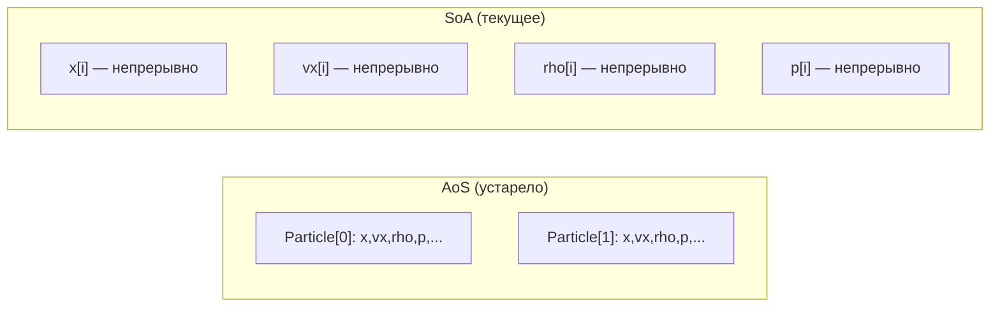

# Раскладка данных: SoA (Structure-of-Arrays)

## Постановка проблемы

Исторически данные частиц хранились как `std::vector<Particle>` (AoS —
Array-of-Structures). Доступ к полю `Elem[i].vx[d]` требовал **двойной
косвенности**: чтения указателя на `Particle`, затем чтения указателя на
внутренний буфер `vx`, что приводило к промахам кэша в горячих циклах по парам.

## Решение

Введён [`ParticleSystem`](../../../include/particle_system.hpp:35) — совокупность
плоских непрерывных массивов, по одному на каждое физическое поле:

Доступ `sys.rho[i]` — **одно разыменование**; данные смежных индексов лежат
подряд, что обеспечивает prefetch и векторную загрузку.

## Состав полей `ParticleSystem`

- **Кинематика:** `x[dim]`, `vx[dim]` (C-массивы из `std::vector<double>`
  размером `dim`);
- **Термодинамика/скаляры:** `mass`, `rho`, `rho_0`, `p`, `u`, `c`, `s`, `e`,
  `hsml`, `dp`, `e_pl`, `D`;
- **Модель Джонсона–Кука:** `T` (температура, К) и `edot` (эквивалентная скорость
  деформации, 1/с);
- **Начальный радиус** `r0` — начальная координата `x[0]` (в 2D-осесимметрии —
  начальный радиус); задаётся один раз
  (`init_reference_radius`) до цикла по времени и хранится в чекпоинте; нужна для
  физической массы кольца в учёте энергии
  ([`energy_mass()`](../../../include/particle_system.hpp:193), $2\pi r_0 m$ при
  `axis_sim` и `dim == 2`);
- **Девиатор напряжений:** `sxx`, `syy`, `szz`, `sxy`, `syz`, `sxz`;
- **Тензор скоростей деформаций:** `exx`, `eyy`, `ezz`, `exy`, `exz`, `eyz`;
- **Тензор скоростей поворота:** `rxy`, `rxz`, `ryz`;
- **Классификация:** `itype` (`std::vector<int>`, тип материала), `axis`
  (`std::vector<char>`, bool-семантика), `body` (`std::vector<int>`, номер тела
  `object_id`: PID из `.k` или `itype` у встроенных генераторов; по нему
  отбираются межтельные контактные пары и работает `sph_same_body_only`);
- `n` — актуальное число частиц, `resize(new_n)` меняет размер всех массивов.

Размерность массивов `x[dim]`/`vx[dim]` определяется compile-time константой
[`dim`](../../../include/param.hpp:16) (макрос `SPH_DIM`, см.
[ADR-002](../decisions/adr-002-dim-constexpr.md)). Из `x`/`vx` используются только
индексы `d < dim`, поэтому неактивные компоненты память не занимают.

`p`, `c` и компоненты `exx…eyz`, `rxy…ryz` пишутся в `sys` каждым шагом
`single_step` ради читателей `prochnost_cem_JH2` и `compute_cfl_timestep`
(физически они считаются в `SolidDerived`/`SolidFinal`, см.
[Обзор конвейера](pipeline-overview.md)). Виртуальные (зеркальные) частицы
в `sys` не дописываются: они живут только в `SolidExtended` на время шага.

## Данные нитей: `FiberState`, `FiberTopology`

Нити (`dim = 3`) хранятся по тому же принципу SoA в
[`fiber::FiberState`](../../../include/fiber/fiber_system.hpp): `x[dim]`,
`vx[dim]`, `mass`, `object_id` (номер нити; меняется при разрыве),
`material_id` (индекс материала, не меняется), `n`. Связи —
`FiberTopology`: `prev[]`/`next[]` (соседи по нити, `-1` на конце),
`bonds` (`FiberBond`: `i`, `j`, `l0`, `l_break`, `mat` (индекс материала связи: `-1` — материал бусины `i`,
`>= 0` — собственный материал стежка), внутреннее состояние закона
`BondState st`), `version` (растёт при изменении топологии). Свойства
материала — `FiberMaterial` (`E`, `nu`, `d`, `rho`, `eps_break`, `mu_ff`,
`mu_fs`, параметры неупругости). Всё вместе с `ParticleSystem` и зажимами
собирает [`fiber::Model`](../../../include/fiber/model.hpp). Суммируемое на
стадии reduce приращение бусины — `fiber::FiberDelta` (`dv[dim]`).

## Рабочие буферы шага

[`WorkBuffers`](../../../include/buffers.hpp) создаётся один раз на расчёт и
переиспользуется между шагами. В нём: `solid_ws` (рабочая память шага Solid,
`interactions::SolidStepWorkspace`: производные, виртуальные частицы, пары,
вклады, результаты reduce/finalize), диагностика контакта (`min_dt_contact`,
`contact_pair_count`, `contact_max_delta`) и, при `SPH_ENERGY_LOG`, массивы
лога энергии. Тензорные буферы `txx…tyz` (`ensure`/`clear_tensor`) остались от
физической вязкости, которая выключена (`visc` — constexpr `false`).
Производные прошлого шага для предиктор-корректора (`SolidRhsBuffers`,
`FiberRhsBuffers`) лежат в решателе
([`ode_solver.hpp`](../../../include/ode/ode_solver.hpp)).

## Хранилище

`ParticleSystem` — первичное хранилище, живёт всю симуляцию (внутри
`fiber::Model`). `Particle` (`param.hpp`) остался только как тип одной частицы
для `tests/test_particle_system.cpp`.

## Последствия

**Плюсы:**

- Локальность данных → меньше промахов кэша;
- Возможность SIMD-векторизации;
- Единый контейнер состояния вместо множества глобальных массивов.

**Минусы:**

- Дублирование логики инициализации/вывода (`obnul_index`, `vuvod_index`,
  `inzializ_2d_symm_index`);
- Более многословный интерфейс при добавлении нового поля (нужно править
  `resize()`, `obnul_index`, `inzializ_2d_symm_index`, чекпоинт и вывод).

## Связанные материалы

- [ADR-005: Размыкание зависимости EOS](../decisions/adr-005-eos-dependency-break.md)
- Файл: [`particle_system.hpp`](../../../include/particle_system.hpp:1)
