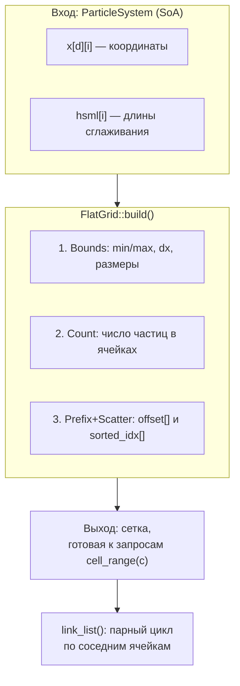
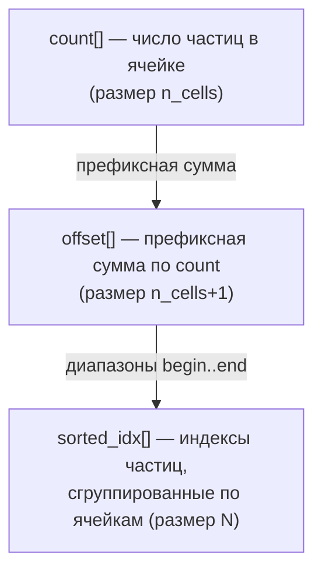
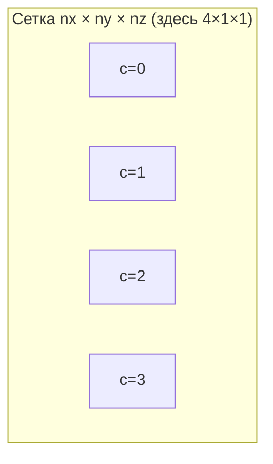
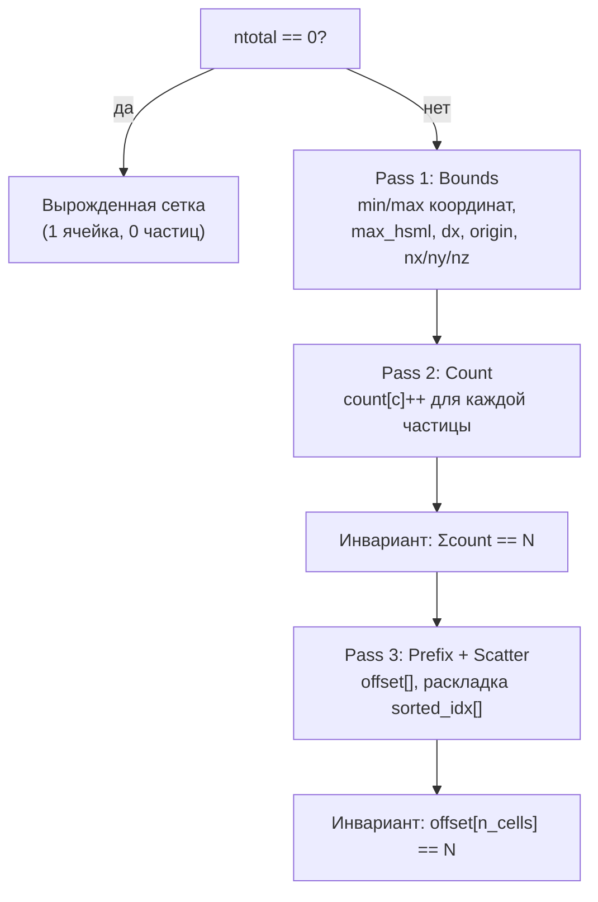
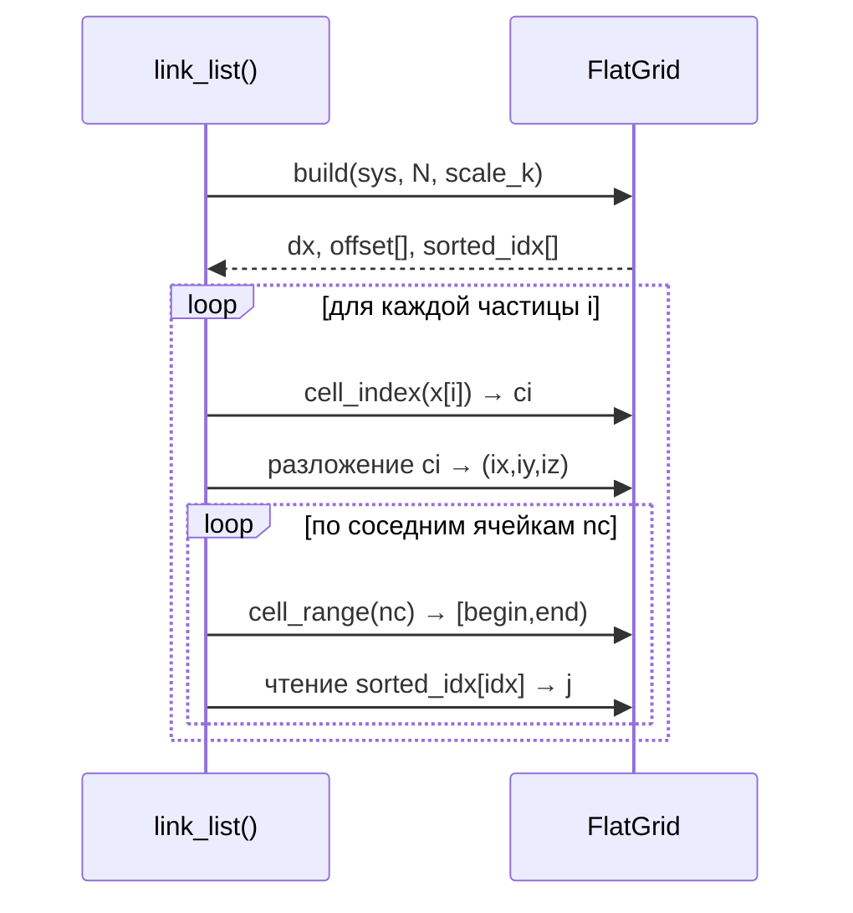

# Сетка `FlatGrid` — внутреннее устройство

[`FlatGrid`](../../../include/flat_grid.hpp:20) — пространственная сетка с **плотным
(прямым) индексированием ячеек**, построенная через **сортировку подсчётом**
(counting sort). Это служебная структура данных для метода поиска соседей
[`link_list()`](linked-list.md) (`nnps = 2`): она за $O(N)$ разбивает всё
пространство частиц на кубические ячейки и даёт доступ «по индексу ячейки →
список её частиц» за $O(1)$.

!!! info "Связь с другими разделами"
    Эта страница — углублённое описание структуры
    [`FlatGrid`](../../../include/flat_grid.hpp:20), которая используется на
    **Этапе 2** метода `nnps = 2`. Обзор всех методов поиска соседей — в разделе
    [Методы поиска соседей](neighbor-search.md), а полное описание парного цикла
    на сетке — в [Поиск соседей методом связного списка](linked-list.md).

---

## 1. Назначение и роль в конвейере

На каждом шаге симуляции [`link_list()`](../../../src/linked_list.cpp:32) должен
построить список пар взаимодействия частиц. Чтобы сравнивать частицу не со всеми
остальными ($O(N^2)$), а только с потенциальными соседями ($O(N)$), нужно знать,
**какие частицы лежат рядом**. Эту задачу решает `FlatGrid`:

1. Делит ограничивающий объём всех частиц на равные кубические ячейки размером
   порядка радиуса взаимодействия $\sim 2h$.
2. Для каждой ячейки формирует компактный список индексов попавших в неё частиц.
3. Позволяет за $O(1)$ получить все частицы любой ячейки (собственной и соседней).



`FlatGrid` живёт **локально**, только на время одного вызова `link_list()`
([`src/linked_list.cpp:50`](../../../src/linked_list.cpp:50)): строится заново
каждый шаг, так как частицы перемещаются.

---

## 2. Ключевая идея: плотная сетка вместо хеш-таблицы

Естественный способ «ячейка → частицы» — ассоциативный контейнер
`std::unordered_map<CellKey, std::vector<size_t>>`. Однако он проигрывает на
плотных, регулярно распределённых данных SPH:

| Аспект | `unordered_map` | `FlatGrid` (плотный массив) |
|---|---|---|
| Поиск ячейки | хеширование ключа, цепочки/пробы | прямой индекс в массив (`O(1)`, без хеша) |
| Память на структуру | узлы, бакеты, указатели | 3 плоских `std::vector` |
| Локальность кэша | случайно разбросано | сплошные блоки, prefetch |
| Аллокации | на каждую ячейку свой `vector` | один `sorted_idx` на все частицы |
| Расход памяти при пустых ячейках | не хранит пустые | хранит счётчик `0`, но не частицы |

`FlatGrid` «размазывает» все ячейки в **один плотный массив** по линейному
индексу $c = i_x + n_x \cdot (i_y + n_y \cdot i_z)$. Любая ячейка — это просто
диапазон `[offset[c], offset[c+1])` в общем массиве `sorted_idx`. Платой служит
память под счётчики пустых ячеек (`count[c]`), но для SPH-распределений число
ячеек $C$ того же порядка, что и $N$, поэтому издержки невелики.

---

## 3. Структура данных (поля `FlatGrid`)

Структура описана в [`include/flat_grid.hpp:20`](../../../include/flat_grid.hpp:20):

| Поле | Тип / размер | Назначение |
|---|---|---|
| [`nx, ny, nz`](../../../include/flat_grid.hpp:22) | `int` | Число ячеек по осям $x, y, z$. При `dim < 3` неиспользуемые оси равны `1` |
| [`dx`](../../../include/flat_grid.hpp:23) | `double` | Размер ячейки (одинаковый по всем осям): $\text{dx} = \text{scale\_k} \cdot h_{\max}$ |
| [`origin[3]`](../../../include/flat_grid.hpp:24) | `double[3]` | Сдвиг сетки: точка начала координат сетки = $(x_{\min}, y_{\min}, z_{\min})$ |
| [`count`](../../../include/flat_grid.hpp:26) | `std::vector<int>` длины `n_cells` | Число частиц в каждой ячейке |
| [`offset`](../../../include/flat_grid.hpp:27) | `std::vector<int>` длины `n_cells+1` | **Префиксная сумма** по `count`: `offset[c]` — начало ячейки `c` в `sorted_idx` |
| [`sorted_idx`](../../../include/flat_grid.hpp:28) | `std::vector<size_t>` длины `N` | Индексы частиц, **сгруппированные по ячейкам** |

### Вспомогательные методы

- [`n_cells()`](../../../include/flat_grid.hpp:31) — полное число ячеек
  $n_x \cdot n_y \cdot n_z$.
- [`cell_index(x, y, z)`](../../../include/flat_grid.hpp:39) — линейный индекс
  ячейки, в которую попадает точка.
- [`cell_range(c)`](../../../include/flat_grid.hpp:57) — полуинтервал индексов
  в `sorted_idx` для ячейки `c`.

### Связь трёх массивов

Три массива `count → offset → sorted_idx` жёстко согласованы и образуют
**CSR-подобное** (compressed sparse row) представление разбиения частиц по
ячейкам:



`offset[c]` — это **исключающая** префиксная сумма: `offset[0] = 0`, а
`offset[n_cells] = N` всегда. Благодаря «лишнему» элементу диапазон каждой
ячейки задаётся парой соседних значений без отдельной обработки последней
ячейки.

---

## 4. Линейная нумерация ячеек

Трёхмерный индекс ячейки $(i_x, i_y, i_z)$ сворачивается в один линейный индекс
по схеме **row-major (x — младший)**:

$$
c = i_x + n_x \cdot (i_y + n_y \cdot i_z), \qquad
0 \le i_x < n_x,\ 0 \le i_y < n_y,\ 0 \le i_z < n_z
$$



Такая схема выбрана, потому что $x$ — самая «длинная» и часто используемая ось
(в 1D-режиме вся сетка вырождается в одномерный массив `c == i_x`). Обратное
разложение `c → (i_x, i_y, i_z)`, которое нужно потребителю для обхода соседних
ячеек, выполняется целочисленным делением/остатком
([`src/linked_list.cpp:77`](../../../src/linked_list.cpp:77)):

$$
i_x = c \bmod n_x, \qquad
i_y = \left\lfloor \tfrac{c}{n_x} \right\rfloor \bmod n_y, \qquad
i_z = \left\lfloor \tfrac{c}{n_x \cdot n_y} \right\rfloor.
$$

---

## 5. `cell_index()` — индекс ячейки для точки

Функция [`cell_index(x, y, z)`](../../../include/flat_grid.hpp:39) определяет,
в какую ячейку попадает произвольная точка пространства:

```cpp
int ix = static_cast<int>(std::floor((x - origin[0]) / dx));
int iy = (dim >= 2) ? static_cast<int>(std::floor((y - origin[1]) / dx)) : 0;
int iz = (dim >= 3) ? static_cast<int>(std::floor((z - origin[2]) / dx)) : 0;

ix = std::clamp(ix, 0, nx - 1);
iy = std::clamp(iy, 0, ny - 1);
iz = std::clamp(iz, 0, nz - 1);

return ix + nx * (iy + ny * iz);
```

### Поэтапно

1. **Сдвиг на `origin`.** Вычитанием `origin[d]` точка переводится в систему
   координат сетки, где первая ячейка начинается в нуле. Это позволяет
   корректно работать с **отрицательными** координатами частиц.
2. **Деление на `dx` и `floor`.** `floor` гарантирует, что границы между
   ячейками трактуются «вниз»: точка с координатой ровно на границе попадает в
   нижнюю ячейку. Без `floor` (например, при простом приведении `int`) для
   отрицательных координат получилось бы неверное округление к нулю.
3. **Зависимость от `dim`.** При `dim == 1` оси $y, z$ игнорируются (`iy = iz = 0`),
   при `dim == 2` — только $z$. Массивы `x[1]`, `x[2]` в
   [`ParticleSystem`](../../../include/particle_system.hpp:38) имеют размер `dim`,
   поэтому обращения к ним идут с проверкой `dim >= 2` / `dim >= 3`.
4. **`clamp` в границы.** Частица, оказавшаяся за пределами расчётной области
   (из-за накопленной ошибки интегрирования, «улетевшая» виртуальная частица или
   ровно на правой границе), принудительно относится к крайней ячейке, а не
   вызывает выход индекса за пределы массива.

!!! note "Почему `floor`, а не приведение к `int`"
    `static_cast<int>(...)` для отрицательных дробных чисел округляет **к нулю**
    (например, `-1.7 → -1`), тогда как `std::floor` округляет **вниз**
    (`-1.7 → -2`). Только `floor` даёт корректное попадание в ячейку для
    отрицательных координат.

### Производные ограничения

Благодаря `clamp` функция **всегда** возвращает индекс из $[0, n_x n_y n_z - 1]$.
Поэтому её можно вызывать для любой точки — в том числе для тестовой проверки
«в какую ячейку попала бы точка» — без риска переполнения.

---

## 6. `cell_range()` — доступ к частицам ячейки

Метод [`cell_range(c)`](../../../include/flat_grid.hpp:57) возвращает
полуинтервал `[begin, end)` — диапазон индексов в `sorted_idx`, занятых частицами
ячейки `c`:

```cpp
std::pair<int, int> cell_range(int c) const
{
    return {offset[c], offset[c + 1]};
}
```

Перечислить все частицы ячейки `c` за $O(\text{count}[c])$:

```cpp
auto [begin, end] = grid.cell_range(c);
for (int idx = begin; idx < end; ++idx) {
    size_t j = grid.sorted_idx[idx];   // глобальный индекс частицы
    // ... работа с частицей j ...
}
```

Именно так потребитель `link_list()` обходит частицы соседних ячеек
([`src/linked_list.cpp:104`](../../../src/linked_list.cpp:104)). Для пустой
ячейки `begin == end`, и цикл не выполняется ни разу.

---

## 7. Построение сетки: `build()`

Основной метод [`build(sys, ntotal, scale_k)`](../../../include/flat_grid.hpp:74)
собирает сетку за **три линейных прохода** по частицам. Это классический
**counting sort**: ключ сортировки — индекс ячейки, значения — индексы частиц.



### Параметры

| Параметр | Что передаёт |
|---|---|
| `sys` | [`ParticleSystem`](../../../include/particle_system.hpp:35) (SoA): координаты `x[d][i]`, длины сглаживания `hsml[i]` |
| `ntotal` | Число частиц $N$ |
| `scale_k` | Множитель поддержки ядра (`2` для куб. сплайна, `3` для Гаусса/квинтики) — задаёт размер ячейки |

### 7.0. Вырожденный случай (`ntotal == 0`)

Если частиц нет, строится минимальная корректная сетка
([`include/flat_grid.hpp:76`](../../../include/flat_grid.hpp:76)):

- `nx = ny = nz = 1`, `dx = 1.0`, `origin = {0,0,0}`;
- `count = {0}`, `offset = {0, 0}`, `sorted_idx = {}`.

Это гарантирует, что любой последующий запрос (`cell_index`, `cell_range`,
`n_cells()`) остаётся осмысленным и не падает на пустых массивах.

### 7.1. Pass 1 — Bounds (габариты и параметры сетки)

Один проход по всем частицам
([`include/flat_grid.hpp:87`](../../../include/flat_grid.hpp:87)) находит:

- минимумы и максимумы координат $x_{\min}, x_{\max}$ (и, при `dim >= 2/3`,
  аналогично для $y, z$);
- максимальную длину сглаживания $h_{\max} = \max_i h_i$.

Отсюда вычисляются параметры сетки:

$$
\text{dx} = \text{scale\_k} \cdot h_{\max}, \qquad
\text{origin} = (x_{\min}, y_{\min}, z_{\min}),
$$

$$
n_k = \left\lceil \frac{x_{k,\max} - x_{k,\min}}{\text{dx}} \right\rceil + 1,
\qquad k \in \{x, y, z\}.
$$

#### Назначение каждой величины

- **`dx`** — сторона ячейки. Длина сглаживания $h_{\max}$ берётся именно
  **максимальная**, чтобы радиус взаимодействия даже самой «крупной» частицы
  укладывался в небольшое число соседних ячеек. Множитель `scale_k` связывает
  размер ячейки с радиусом поддержки ядра $r_{\text{cutoff}} = \text{scale\_k}\cdot h$.
- **`origin`** — точка отсчёта сетки, равная минимальным координатам. Сдвиг
  делает все относительные координаты неотрицательными и устраняет специальные
  случаи для отрицательных $x, y, z$.
- **`+1` в числе ячеек** — страхует от погрешностей округления: крайняя частица,
  лежащая точно на верхней границе $(x_{\max} - x_{\min})/\text{dx}$, всё равно
  попадает в разрешённый диапазон ячеек, а не «вылетает» за `nx - 1`.
- **Схлопывание осей** — при `dim < 3` неиспользуемые размерности получают
  $n_y = 1$ или $n_z = 1$, так что сетка физически остаётся 1D/2D.

#### Защита от нулевого `dx`

Если все $h_i = 0$ (или `max_hsml` оказалось $\le 0$), формула даёт `dx = 0`, что
привело бы к делению на ноль в `cell_index`. Поэтому стоит явная защита
([`include/flat_grid.hpp:147`](../../../include/flat_grid.hpp:147)):

```cpp
if (dx <= 0.0) dx = 1.0;
```

#### Выделение памяти

После Pass 1 выделяются три массива
([`include/flat_grid.hpp:163`](../../../include/flat_grid.hpp:163)):

- `count.assign(n_cells, 0)` — обнулённые счётчики;
- `offset.resize(n_cells + 1, 0)` — под префиксную сумму (на 1 длиннее);
- `sorted_idx.resize(ntotal)` — ровно под все частицы.

### 7.2. Pass 2 — Count (подсчёт частиц)

Второй проход ([`include/flat_grid.hpp:167`](../../../include/flat_grid.hpp:167))
для каждой частицы вычисляет индекс её ячейки и наращивает счётчик:

```cpp
for (size_t i = 0; i < ntotal; ++i) {
    int c = cell_index(sys.x[0][i],
                       (dim >= 2) ? sys.x[1][i] : 0.0,
                       (dim >= 3) ? sys.x[2][i] : 0.0);
    count[c]++;
}
```

#### Контрольный инвариант

Каждая частица увеличивает ровно один счётчик, поэтому сумма всех счётчиков
обязана равняться $N$. Это проверяется явно
([`include/flat_grid.hpp:178`](../../../include/flat_grid.hpp:178)):

```cpp
assert(total_counted == static_cast<int>(ntotal) &&
       "FlatGrid: сумма count[] не равна ntotal!");
```

Нарушение этого инварианта означало бы логическую ошибку (частица «потеряна»
или посчитана дважды) — `assert` ловит её на этапе отладки.

### 7.3. Pass 3 — Prefix sum + Scatter (раскладка)

**К началу Pass 3** мы знаем лишь **сколько** частиц в каждой ячейке — это массив
`count[]`, собранный в Pass 2. Но сам массив `sorted_idx[]` ещё пуст: частицы не
разложены по ячейкам. Цель Pass 3 — превратить «число частиц в ячейке» в
**готовый к запросам список**, чтобы по индексу ячейки $c$ за $O(1)$ возвращались
все её частицы.

Это достигается за два шага ([`include/flat_grid.hpp:186`](../../../include/flat_grid.hpp:186)):

| Шаг | Что строит | Суть превращения |
|---|---|---|
| **A. Prefix sum** | `offset[]` из `count[]` | «сколько частиц» → «с какой позиции в `sorted_idx` начинается ячейка» |
| **B. Scatter** | `sorted_idx[]` через `pos[]` | разложить индексы частиц по зарезервированным слотам |

#### Шаг A. Префиксная сумма: `count[]` → `offset[]`

Чтобы положить частицы ячейки $c$ в `sorted_idx`, нужно знать **свободное место**:
с какой позиции начинается «слот» этой ячейки. Его даёт **исключающая префиксная
сумма** по `count` — каждый элемент равен сумме размеров **всех предыдущих** ячеек:

```cpp
offset[0] = 0;
for (int c = 0; c < nc; ++c)
    offset[c + 1] = offset[c] + count[c];
```

Геометрически ячейки размещаются в `sorted_idx` подряд, как пакеты на конвейере:
ячейка 0 занимает позиции `[0, count[0])`, ячейка 1 — сразу за ней
`[count[0], count[0]+count[1])`, и так далее.

**Маленький пример.** Пусть `nc = 3` (ячейки 0, 1, 2) и `count = [2, 1, 0]`:

| $c$ | `count[c]` | вычисление `offset[c+1]` | `offset[c]` | слот ячейки в `sorted_idx` |
|---|---|---|---|---|
| 0 | 2 | `offset[1] = 0 + 2` | `0` | `[0, 2)` |
| 1 | 1 | `offset[2] = 2 + 1` | `2` | `[2, 3)` |
| 2 | 0 | `offset[3] = 3 + 0` | `3` | `[3, 3)` (пусто) |

Итог: `offset = [0, 2, 3, 3]`.

**Почему `offset` длиннее на 1 (`n_cells + 1`).** «Лишний» последний элемент —
это конец слота **последней** ячейки. Благодаря нему каждая ячейка $c$ описывается
парой соседних значений `[offset[c], offset[c+1])` **единообразно**, без
специального учёта правой границы. Побочный эффект: `offset[n_cells]` автоматически
равен сумме всех `count`, то есть $N$, — это и есть контрольный инвариант
([`include/flat_grid.hpp:194`](../../../include/flat_grid.hpp:194)):

```cpp
assert(offset[nc] == static_cast<int>(ntotal) &&
       "FlatGrid: offset[n_cells] != ntotal!");
```

#### Шаг B. Scatter (раскладка): заполнение `sorted_idx[]`

Слоты ячеек зарезервированы, но `sorted_idx` ещё пуст. Нужно пройти по частицам и
разложить их по своим слотам.

**В чём проблема прямого подхода.** `offset[c]` — это **старт** слота ячейки $c$,
и он один на ячейку. Если писать прямо в `offset[c]`, то вторая частица той же
ячейки **перезапишет** первую.

**Решение — отдельный «бегущий указатель записи» для каждой ячейки.** Его
получают копированием первых `n_cells` элементов `offset` в массив `pos`:

```cpp
std::vector<int> pos(offset.begin(), offset.begin() + nc);  // pos = старт каждой ячейки
for (size_t i = 0; i < ntotal; ++i) {
    int c = cell_index(sys.x[0][i], ...);   // в какой ячейке частица i
    sorted_idx[pos[c]] = i;                 // кладём её в текущий свободный слот
    ++pos[c];                               // и сдвигаем курсор ячейки вперёд
}
```

Курсор `pos[c]` стартует со `offset[c]` и при каждой записи частицы в ячейку $c$
увеличивается на 1. Так последовательные частицы одной ячейки ложатся рядом, не
затирая друг друга.

**Гарантия отсутствия переполнения.** Число записей в ячейку $c$ в точности равно
`count[c]` (его посчитали в Pass 2), а размер слота —
`offset[c+1] - offset[c] = count[c]`. Поэтому курсор `pos[c]` никогда не зайдёт в
чужую ячейку и к концу цикла окажется ровно на `offset[c+1]`.

**Продолжение примера** (`count = [2, 1, 0]`, `offset = [0, 2, 3, 3]`,
`pos = [0, 2, 3]`). Пусть 3 частицы попадают в ячейки так: частица 0 → ячейка 1,
частица 1 → ячейка 0, частица 2 → ячейка 0:

| шаг | частица $i$ | ячейка $c$ | курсор `pos[c]` до записи | запись | `pos[c]` после |
|---|---|---|---|---|---|
| 1 | 0 | 1 | 2 | `sorted_idx[2] = 0` | 3 |
| 2 | 1 | 0 | 0 | `sorted_idx[0] = 1` | 1 |
| 3 | 2 | 0 | 1 | `sorted_idx[1] = 2` | 2 |

Результат: `sorted_idx = [1, 2, 0]`. Проверка по слотам: ячейка 0 → `[0, 2)` →
`{1, 2}`, ячейка 1 → `[2, 3)` → `{0}`, ячейка 2 → `[3, 3)` → `{}`. Частицы
**сгруппированы по ячейкам** ✓.

**Порядок внутри ячейки.** Поскольку проход идёт по возрастанию $i$, частицы одной
ячейки попадают в `sorted_idx` в порядке исходных индексов (стабильная раскладка).
Алгоритму поиска соседей порядок безразличен — важен сам состав соседей.

??? tip "Почему `pos` — копия, а не сам `offset`"
    `offset` — «публичный» интерфейс структуры: через него работает `cell_range()`.
    Если бы scatter двигал сам `offset`, начала ячеек были бы потеряны уже после
    первой же записи. Поэтому рабочий курсор дублируется в `pos`, а `offset` хранит
    неизменные границы. Цена — дополнительные $C$ чисел `int` ($C$ — число ячеек).

---

## 8. Пошаговый пример

Рассмотрим [`test_basic_3_particles()`](../../../tests/test_flat_grid.cpp:19) из
`test_flat_grid.cpp` — 3 частицы в 1D (`dim = 1`):

| $i$ | $x_i$ | $h_i$ |
|---|---|---|
| 0 | 0.1 | 0.5 |
| 1 | 1.5 | 0.5 |
| 2 | 3.2 | 0.5 |

Параметр `scale_k = 2` (кубический сплайн).

### Pass 1 — Bounds

- $h_{\max} = 0.5$, $x_{\min} = 0.1$, $x_{\max} = 3.2$.
- $\text{dx} = 2 \cdot 0.5 = 1.0$.
- $\text{origin} = (0.1,\ 0,\ 0)$.
- $n_x = \lceil (3.2 - 0.1)/1.0 \rceil + 1 = \lceil 3.1 \rceil + 1 = 4 + 1 = 5$,
  $n_y = n_z = 1$. Итого `n_cells = 5`.

### Pass 2 — Count

Индексы ячеек: `floor((x - 0.1)/1.0)`:

| $i$ | $x_i - x_{\min}$ | $\text{floor}(\cdot)$ | ячейка $c$ |
|---|---|---|---|
| 0 | 0.0 | 0 | 0 |
| 1 | 1.4 | 1 | 1 |
| 2 | 3.1 | 3 | 3 |

`count = [1, 1, 0, 1, 0]`, $\sum = 3 = N$ ✓.

### Pass 3 — Prefix + Scatter

Префиксная сумма даёт `offset = [0, 1, 2, 2, 3, 3]` (длина `n_cells + 1 = 6`).
Начальный `pos = [0, 1, 2, 2, 3]` (копия первых 5 элементов `offset`).

Scatter по частицам:

| $i$ | ячейка $c$ | позиция записи `pos[c]` | `sorted_idx[pos[c]]` | новое `pos[c]` |
|---|---|---|---|---|
| 0 | 0 | 0 | 0 | 1 |
| 1 | 1 | 1 | 1 | 2 |
| 2 | 3 | 2 | 2 | 3 |

Результат: `sorted_idx = [0, 1, 2]`.

### Запросы `cell_range()`

| ячейка $c$ | диапазон `[offset[c], offset[c+1])` | частицы (`sorted_idx[...]`) |
|---|---|---|
| 0 | `[0, 1)` | `{0}` |
| 1 | `[1, 2)` | `{1}` |
| 2 | `[2, 2)` | `{}` (пусто) |
| 3 | `[2, 3)` | `{2}` |
| 4 | `[3, 3)` | `{}` (пусто) |

Любая частица своей ячейки и её соседей теперь доступна за $O(1)$.

---

## 9. Сложность и расход памяти

| Этап | Время | Память |
|---|---|---|
| Pass 1 (Bounds) | $O(N)$ | $O(1)$ |
| Pass 2 (Count) | $O(N)$ | $O(C)$ (`count`) |
| Pass 3 (Prefix) | $O(C)$ (префиксная сумма) | $O(C)$ (`offset`) + $O(C)$ (`pos`) |
| Pass 3 (Scatter) | $O(N)$ | $O(N)$ (`sorted_idx`) |
| **Итого `build()`** | $O(N + C)$ | $O(N + C)$ |

Здесь $C = n_x n_y n_z$ — число ячеек. Для равномерных SPH-распределений
$C \sim N$, поэтому построение остаётся **линейным по $N$**.

### Память под пустые ячейки

Плотная сетка тратит по одному `int` (`count[c]`) на каждую ячейку, в том числе
пустую. Это компромисс за прямой $O(1)$-доступ без хеширования. При сильно
разреженных данных (много пустых ячеек) выгоднее стала бы разреженная структура,
но для типичных SPH-объёмов заполнение достаточно плотное.

---

## 10. Граничные случаи и защиты

| Ситуация | Как обрабатывается |
|---|---|
| `ntotal == 0` | Вырожденная сетка 1×1×1, пустые массивы (см. раздел 7.0) |
| `max_hsml == 0` (все $h_i = 0$) | `dx` принудительно становится `1.0` |
| Частица за правой границей области | `+1` в $n_k$ + `clamp` относят её к крайней ячейке |
| Частица за любой границей (улетевшая) | `clamp` в `cell_index` удерживает индекс в $[0, n_k-1]$ |
| Отрицательные координаты | Сдвиг `origin = min` делает их относительными неотрицательными |
| `dim < 3` | Неиспользуемые оси схлопываются ($n_y = 1$, $n_z = 1`), обращения к `x[1]/x[2]` guarded `dim >= 2/3` |
| Несогласованность счётчиков | Два `assert`-инварианта ловят ошибку в debug-сборке |

!!! warning "`assert` проверяются только в debug"
    Инварианты $\sum\text{count} = N$ и `offset[n_cells] == N` — это `assert()`,
    которые отключаются в release-сборке (`NDEBUG`). Они предназначены для
    отладки логики `build()`, а не для восстановления после ошибок входных
    данных.

---

## 11. Связь с потребителем: парный цикл `link_list()`

`FlatGrid` — это **структура только для чтения** на этапе поиска пар. После
`build()` потребитель `link_list()` только читает её поля
([`src/linked_list.cpp:50`](../../../src/linked_list.cpp:50)):

1. Берёт `grid.dx` для вычисления радиуса обхода в ячейках
   ([`src/linked_list.cpp:81`](../../../src/linked_list.cpp:81)).
2. Для каждой частицы $i$ находит её ячейку через `cell_index()`
   ([`src/linked_list.cpp:71`](../../../src/linked_list.cpp:71)) и раскладывает
   индекс обратно в $(i_x, i_y, i_z)$.
3. Обходит куб соседних ячеек $(i_x \pm \text{fac}, \dots)$ и для каждой
   вызывает `cell_range(nc)`, перебирая частицы $j$ из `sorted_idx`
   ([`src/linked_list.cpp:104`](../../../src/linked_list.cpp:104)).



Подробно парный цикл, фильтр симметрии и параллелизм описаны в
[Поиск соседей методом связного списка](linked-list.md).

---

## 12. Тестирование

Корректность `FlatGrid` покрыта unit-тестами в
[`test_flat_grid.cpp`](../../../tests/test_flat_grid.cpp:1):

| Тест | Что проверяет |
|---|---|
| [`test_basic_3_particles()`](../../../tests/test_flat_grid.cpp:19) | Разложение 3 частиц по разным ячейкам; `dx`, `origin`, `nx`, инвариант `offset[n_cells] == N` |
| [`test_all_in_one_cell()`](../../../tests/test_flat_grid.cpp:91) | Все частицы в одной ячейке; корректность `cell_range()` (3 частицы в одной ячейке) |
| [`test_negative_coordinates()`](../../../tests/test_flat_grid.cpp:129) | Отрицательные координаты; сдвиг `origin`, неотрицательные индексы ячеек |
| [`test_empty()`](../../../tests/test_flat_grid.cpp:165) | `ntotal == 0`: вырожденная сетка 1×1×1, пустой `sorted_idx` |
| [`test_2d_case()`](../../../tests/test_flat_grid.cpp:182) | Корректная обработка нескольких частиц, сумма `count == N` |

---

## 13. Резюме

- `FlatGrid` — **плотная регулярная сетка** с прямым индексированием ячеек,
  заменившая медленный `unordered_map`.
- Построение — **counting sort за 3 прохода** ($O(N + C)$): габариты → подсчёт →
  префиксная сумма и раскладка.
- Доступ к частицам ячейки — за $O(1)$ через пару `cell_range(c) = [offset[c], offset[c+1])`.
- Согласованность трёх массивов (`count → offset → sorted_idx`) и целостность
  данных гарантируются двумя `assert`-инвариантами.
- Используется **только для чтения** парным циклом `link_list()` как служебная
  структура для ускорения поиска соседей до $O(N)$.

## Связанные материалы

- [Поиск соседей методом связного списка (`link_list`)](linked-list.md)
- [Методы поиска соседей (обзор)](neighbor-search.md)
- [Параллелизм и graph coloring](parallelism.md)
- Файлы: [`flat_grid.hpp`](../../../include/flat_grid.hpp:1),
  [`linked_list.hpp`](../../../include/linked_list.hpp:1),
  [`linked_list.cpp`](../../../src/linked_list.cpp:1),
  [`particle_system.hpp`](../../../include/particle_system.hpp:1),
  [`test_flat_grid.cpp`](../../../tests/test_flat_grid.cpp:1)
