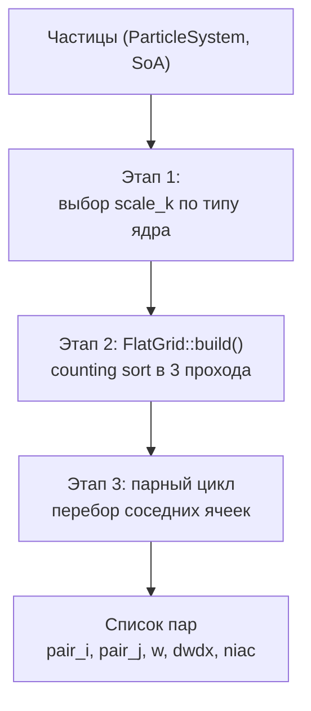
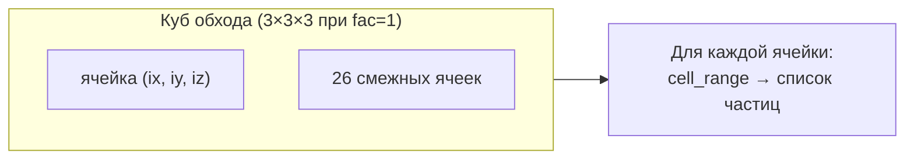

# Поиск соседей методом связного списка (`link_list`)

> **Устарело (fiber/PLAN.md, этап Ф4-B2).** Описанный ниже код удалён из
> продового пути: `linked_list()/link_list, direct_find()` больше не собираются и не вызываются
> (`ctest`-набор их тоже не содержит). Их заменил единый механизм
> `CpuExecutor` + `SpatialIndex<Dim>` + `ContributionWriter`/reduce по
> шардам — см. `fiber/SPH.md`, раздел «CPU», и
> [ADR-008](../decisions/adr-008-rhs-architecture-fiber.md). Текст ниже
> сохранён как описание прежнего устройства, а не текущего кода.

[`link_list()`](../../../include/linked_list.hpp:21) — метод поиска соседних
частиц на регулярной сетке (метод «связного списка» / *linked-list*), включается
параметром [`nnps = 2`](../../../src/single_step.cpp:116). В отличие от
[`direct_find()`](../../../src/direct_find.cpp:7) со сложностью $O(N^2)$, он
сводит поиск к **линейной** сложности $O(N)$ при равномерном распределении
частиц: каждая частица проверяет только соседей в близлежащих ячейках сетки.

!!! info "Связь с общим обзором"
    Это углублённое описание метода `nnps = 2` из раздела
    [Методы поиска соседей](neighbor-search.md). Здесь разбирается внутреннее
    устройство [`link_list()`](../../../src/linked_list.cpp:32) и сетки
    [`FlatGrid`](../../../include/flat_grid.hpp:20).

## Где используется

- Вызывается из [`single_step()`](../../../src/single_step.cpp:119) при
  `nnps == 2`, обрамлён замерами `time_elapsed()`.
- Результат — список пар взаимодействия (`pair_i`, `pair_j`, `w`, `dwdx`,
  `niac`) — далее используется всеми потребителями пар (`density`, `int_force`,
  `art_visc`, `av_vel`) и подаётся на вход [`PairGraph::build()`](../../../include/pair_graph.hpp:53).

## Суть метода

Идея связного списка: всё пространство делится на кубические ячейки размером
порядка радиуса ядра $2h$. Тогда соседи частицы гарантированно лежат в её
собственной ячейке и в смежных ячейках вокруг неё. Вместо сравнения частицы со
**всеми** прочими ($N^2$ сравнений) она сравнивается только с частицами малого
числа соседних ячеек — отсюда $O(N)$.

## Этап 1. Масштабный коэффициент ядра `scale_k`

Размер ячейки и радиус взаимодействия привязываются к типу ядра
[`cfg.skf`](../../../include/simulation_config.hpp:29). В начале
[`link_list()`](../../../src/linked_list.cpp:43) выбирается множитель поддержки
ядра:

| `skf` | Ядро | `scale_k` |
|---|---|---|
| `1` | Кубический сплайн | `2` |
| `2` | Гауссово | `3` |
| `3` | Квинтическое | `3` |

`scale_k` задаёт, во сколько раз радиус поддержки ядра больше длины сглаживания
$h$ ($r_{\text{cutoff}} = \text{scale\_k} \cdot h$).

## Этап 2. Построение сетки `FlatGrid`

Сетку строит [`FlatGrid::build()`](../../../include/flat_grid.hpp:74). Это
плотная сетка с прямым индексированием ячеек, реализованная через
**сортировку подсчётом** (counting sort) — взамен медленного
`std::unordered_map<CellKey, std::vector<size_t>>`. Построение выполняется за
три последовательных прохода:

!!! tip "Подробное описание `FlatGrid`"
    Здесь даётся краткое описание сетки, достаточное для понимания `link_list()`.
    Полное устройство структуры — поля, формула `cell_index()`, counting sort
    по проходам, пошаговый пример и тесты — вынесено в отдельный раздел
    [Сетка `FlatGrid` — внутреннее устройство](flat-grid.md).

### Поля `FlatGrid`

| Поле | Размер | Назначение |
|---|---|---|
| [`nx, ny, nz`](../../../include/flat_grid.hpp:22) | — | Число ячеек по каждой оси (зависит от `dim`) |
| [`dx`](../../../include/flat_grid.hpp:23) | — | Размер ячейки, $\text{dx} = \text{scale\_k} \cdot h_{\max}$ |
| [`origin[3]`](../../../include/flat_grid.hpp:24) | — | Сдвиг сетки $(x_{\min}, y_{\min}, z_{\min})$ |
| [`count`](../../../include/flat_grid.hpp:26) | `n_cells` | Число частиц в ячейке |
| [`offset`](../../../include/flat_grid.hpp:27) | `n_cells+1` | Префиксная сумма — начала ячеек |
| [`sorted_idx`](../../../include/flat_grid.hpp:28) | `N` | Индексы частиц, сгруппированные по ячейкам |

### Проходы построения

**Pass 1 — Bounds.** Один проход по частицам находит min/max координат и
$h_{\max}$. Отсюда:

$$
\text{dx} = \text{scale\_k} \cdot h_{\max}, \qquad
n_k = \left\lceil \frac{x_{k,\max} - x_{k,\min}}{\text{dx}} \right\rceil + 1
$$

`origin` = минимумы координат, `+1` гарантирует попадание крайней частицы.
При `dim < 3` неиспользуемые оси «схлопываются» ($n_y = 1$ или $n_z = 1$).

**Pass 2 — Count.** Для каждой частицы вычисляется линейный индекс ячейки через
[`cell_index()`](../../../include/flat_grid.hpp:39) и увеличивается
`count[c]`. Инвариант $\sum \text{count}[] = N$ проверяется `assert`-ом.

**Pass 3 — Prefix + Scatter.** Префиксная сумма даёт `offset[]` — начало каждой
ячейки в массиве `sorted_idx`. Затем второй проход по частицам «раскладывает» их
индексы в `sorted_idx` по позициям из `offset`. Контрольный инвариант:
`offset[n_cells] == ntotal`.

??? note "Линейный индекс ячейки"
    [`cell_index(x, y, z)`](../../../include/flat_grid.hpp:39) вычисляет индексы
    `ix, iy, iz` через `floor((coord - origin) / dx)`, ограничивает их `clamp`-ом
    в границы сетки и сворачивает в один индекс:

    $$c = i_x + n_x \cdot (i_y + n_y \cdot i_z)$$

### Доступ к частицам ячейки

[`cell_range(c)`](../../../include/flat_grid.hpp:57) возвращает полуинтервал
`[offset[c], offset[c+1])` — диапазон индексов в `sorted_idx`, принадлежащих
ячейке `c`. Это позволяет за $O(1)$ перечислить все частицы любой ячейки.

## Этап 3. Парный цикл поиска соседей

Основной цикл ([`src/linked_list.cpp:60`](../../../src/linked_list.cpp:60))
распараллелен через OpenMP (`#pragma omp parallel` + `#pragma omp for schedule(auto)`).
Для каждой частицы $i$:

### 3.1. Декомпозиция ячейки

Индекс ячейки частицы $i$ раскладывается обратно в тройку
$(i_x, i_y, i_z)$ ([`linked_list.cpp:77`](../../../src/linked_list.cpp:77)) —
это целевая ячейка, в которой живёт частица.

### 3.2. Радиус поиска ячеек

Вычисляется «радиус» обхода в ячейках:

$$
\text{fac} = \mathrm{round}\!\left(\frac{\text{scale\_k} \cdot h_i}{\text{dx}}\right)
$$

Поскольку $\text{dx} = \text{scale\_k} \cdot h_{\max}$, при одинаковом $h$ имеем
`fac = 1` → проверяются собственная ячейка и её соседи ($3^d$ ячеек).
Семантика `fac < 1` сохранена: обходится только собственная ячейка
([`linked_list.cpp:84`](../../../src/linked_list.cpp:84)).

### 3.3. Перебор соседних ячеек

Тройной цикл `kx, ky, kz ∈ [−rx, rx]` обходит куб ячеек вокруг целевой. Для
каждой ячейки берётся `cell_range(nc)`, и по частицам $j$ из неё:

1. **Фильтр симметрии** `j <= i` → `continue`: каждая пара учитывается один раз.
2. **Вектор расстояния** $\Delta_d = x_d[i] - x_d[j]$ и его квадрат
   $r^2 = \sum_d \Delta_d^2$ (записывается в thread-local буфер `dxiac`, без
   аллокации в цикле).
3. **Проверка радиуса**: усреднённая длина сглаживания
   $\bar h = \tfrac{1}{2}(h_i + h_j)$, отсечка $\text{cutoff} = \text{scale\_k} \cdot \bar h$.
   Пара учитывается, если расстояние меньше отсечки: $r^2 < (\text{scale\_k} \cdot \bar h)^2$.

### 3.4. Запись пары

Для прошедшей проверку пары:

- **Атомарный захват индекса** `niac` (`#pragma omp atomic capture`,
  [`linked_list.cpp:126`](../../../src/linked_list.cpp:126)) — каждый поток
  получает уникальную позицию записи `pidx`, что сохраняет корректность при
  параллельном заполнении.
- Вычисляется ядро [`kernel()`](../../../include/kernel.hpp:1) для $(r, \bar h)$:
  значение $W$ в `w[pidx]`, градиент $\nabla W$ в `dwdx[d][pidx]`.
- Индексы пары пишутся как 0-базовые: `pair_i[pidx] = i`, `pair_j[pidx] = j`.

## Параллелизм

Цикл поиска полностью параллелен по частицам $i$: потоки распределяются через
`#pragma omp for schedule(auto)`. Конкуренция возникает только при **записи**
пары — она устранена `atomic capture` для `niac`, после чего каждый поток пишет
в свой уникальный `pidx` без конфликтов.

!!! note "Сетку vs. потребителей"
    Построение сетки (`FlatGrid::build`) выполняется **последовательно** — это
    оптимально при $N \le 10^4$. Параллельная окраска конфликтов применяется не
    здесь, а позже — на этапе потребителей пар
    ([`PairGraph`](parallelism.md)), где `+=`-накопление требует защиты записи.

Thread-local буфер `dxiac` (`std::array<double, dim>`) создаётся один раз на
поток и переиспользуется — стековый буфер точного размера без аллокаций кучи в
горячем цикле.

## Сложность

| Этап | Сложность | Комментарий |
|---|---|---|
| Построение `FlatGrid` | $O(N + C)$ | $C$ — число ячеек; три прохода |
| Парный цикл | $O(N \cdot \bar n)$ | $\bar n$ — среднее число соседей |
| **Итого** | $O(N)$ | при равномерном распределении $\bar n \approx \text{const}$ |

Линейность держится, пока частицы распределены равномерно: тогда каждая ячейка
содержит $\approx \text{const}$ частиц и $\bar n$ не зависит от $N$. При сильной
неоднородности (адаптивное разрешение) эффективнее метод дерева (`nnps = 3`).

## Ограничения

- **`max_interaction`** — верхняя граница числа пар. Буферы
  `pair_i/pair_j/w/dwdx` выделяются под неё заранее
  ([`single_step.cpp:93`](../../../src/single_step.cpp:93)). При превышении
  ([`linked_list.cpp:131`](../../../src/linked_list.cpp:131)) пара
  **не записывается**, а в консоль выводится предупреждение «Превышен
  max_interaction». Для корректного расчёта значение должно превышать реальное
  число пар.
- Размер ячейки фиксирован по $h_{\max}$: при большом разбросе длин сглаживания
  «мелкие» частицы проверяют избыточно много соседей. Это известный компромисс
  регулярной сетки.

## Связанные материалы

- [Методы поиска соседей (обзор)](neighbor-search.md)
- [Сетка `FlatGrid` — внутреннее устройство](flat-grid.md)
- [Параллелизм и graph coloring](parallelism.md)
- Файлы: [`linked_list.hpp`](../../../include/linked_list.hpp:1),
  [`linked_list.cpp`](../../../src/linked_list.cpp:1),
  [`flat_grid.hpp`](../../../include/flat_grid.hpp:1)
