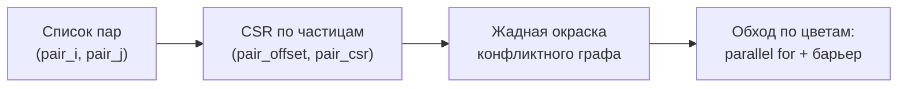
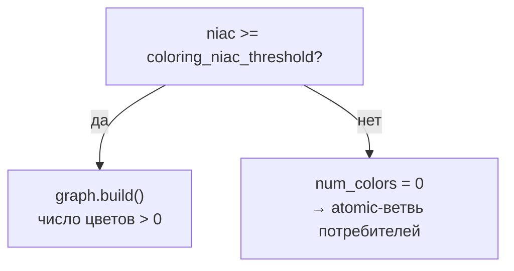

# Параллелизм: OpenMP и graph coloring

## Проблема конкурирующей записи

В парных циклах SPH накопление вкладов в поля частиц выполняется операцией
`+=` («прочитать-сложить-записать»). Разные пары $k$, обрабатываемые
одновременно разными потоками, могут ссылаться на одну частицу: пара
$k_1=(3,7)$ и пара $k_2=(3,9)$ обе пишут в `dvxdt[3]`. Операция `+=`
неатомарна — исторически она защищалась `#pragma omp atomic update`, что
создавало узкое место параллелизма (конкуренция за cache-line, блокировка SIMD).

## Решение: правильная раскраска графа

[`PairGraph`](../../../include/pair_graph.hpp:53) строит CSR-представление пар
по частицам и выполняет жадную окраску графа конфликтов:

Пары **одного цвета не имеют общих частиц** ⇒ каждый индекс модифицируется
ровно одной парой данного цвета ⇒ конкурентной записи нет ⇒ `atomic` не нужен.

## Условный путь atomic / coloring

Порог [`coloring_niac_threshold`](../../../include/simulation_config.hpp:33)
определяет активный путь (см. [`single_step()`](../../../src/single_step.cpp:135)):

Тело парного цикла пишется один раз (шаблонная лямбда) и инстанцируется для
двух аккумуляторов:

- `AccAtomic` — `#pragma omp atomic update` (малые `niac`, текущие кейсы);
- `AccPlain` — чистый `+=` (coloring: пары одного цвета не конфликтуют).

## Профилирование

При сборке с `-DSPH_PROFILE=ON` включаются замеры фаз `build` и параллельных
циклов (запись в `force_timing.csv`). Это позволяет оценивать число цветов и
накладные расходы построения графа.

## Настройка числа потоков

Число потоков OpenMP задаётся в
[`SimulationConfig::num_threads`](../../../include/simulation_config.hpp:48)
(по умолчанию 7) и устанавливается в [`main()`](../../../src/main.cpp:29) через
`omp_set_num_threads()`.

## Связанные материалы

- [ADR-006: Graph coloring](../decisions/adr-006-pair-graph-coloring.md)
- [Поиск соседних частиц](neighbor-search.md)
- Файл: [`pair_graph.hpp`](../../../include/pair_graph.hpp:1)
