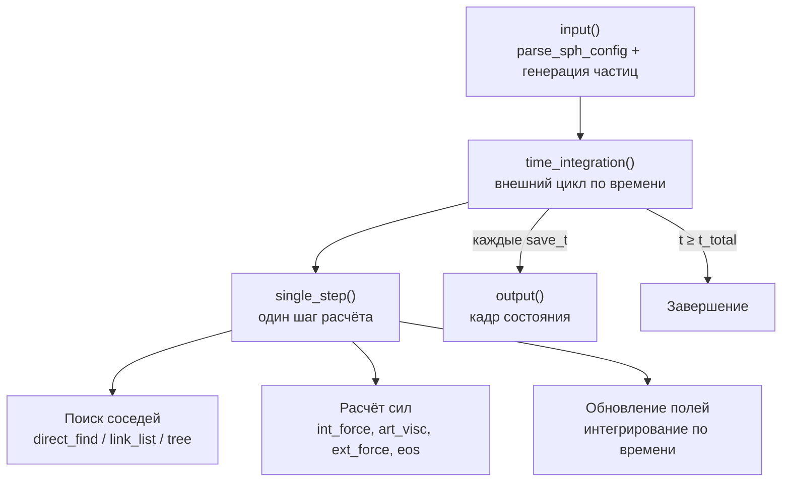
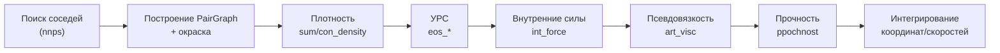

# Обзор расчётного конвейера

> **Устарело (fiber/PLAN.md, этап Ф4-B2).** Описанный ниже код удалён из
> продового пути: `density.cpp/int_force()/art_visc.cpp/av_vel.cpp/virt_part.cpp (старый парный цикл)` больше не собираются и не вызываются
> (`ctest`-набор их тоже не содержит). Их заменил единый механизм
> `CpuExecutor` + `SpatialIndex<Dim>` + `ContributionWriter`/reduce по
> шардам — см. `fiber/SPH.md`, раздел «CPU», и
> [ADR-008](../decisions/adr-008-rhs-architecture-fiber.md). Текст ниже
> сохранён как описание прежнего устройства, а не текущего кода.

Код SPH организован как линейный пайплайн с модульным разбиением, в котором
каждый этап соответствует физическому шагу метода сглаженных частиц.

## Высокоуровневая схема

## Точки входа

- [`main()`](../../../src/main.cpp:19) — создание [`SimulationConfig`](../../../include/simulation_config.hpp:25),
  применение умолчаний, настройка числа потоков OpenMP, инициализация
  [`ParticleSystem`](../../../include/particle_system.hpp:35), запуск конвейера.
- [`input()`](../../../src/input.cpp:626) — чтение
  [`Initial_Conditions.txt`](../../03-reference/config/initial-conditions.md) и
  генерация/загрузка начальной конфигурации.
- [`time_integration()`](../../../src/time_integration.cpp:30) — внешний цикл по
  времени; вызывает [`single_step()`](../../../src/single_step.cpp:72) на каждом шаге.

## Этапы одного шага (`single_step`)

| Этап | Модуль | Файл | Назначение |
|---|---|---|---|
| Поиск соседей | `direct_find` / `link_list` / `tree_search` | [`single_step.cpp`](../../../src/single_step.cpp:108) | Построение списка пар взаимодействия |
| Граф пар | `PairGraph::build()` | [`pair_graph.hpp`](../../../include/pair_graph.hpp:53) | CSR + окраска конфликтов |
| Плотность | `sum_density`, `con_density` | [`density.cpp`](../../../src/density.cpp) | Аппроксимация плотности |
| Уравнение состояния | `p_gas`, `eos_mi_grunaizen`, `eos_ua_teta`, `urs_cem_JH2` | [`eos.cpp`](../../../src/eos.cpp) | Давление и скорость звука |
| Силы давления | `int_force` | [`int_force.cpp`](../../../src/int_force.cpp) | Сила давления и тензор деформаций |
| Псевдовязкость | `art_visc` | [`art_visc.cpp`](../../../src/art_visc.cpp) | Стабилизация ударных волн |
| Прочность | `ppochnost` | [`ppochnost.cpp`](../../../src/ppochnost.cpp) | Модели прочности/повреждаемости |
| Внешние силы | `ext_force` | [`ext_force.cpp`](../../../src/ext_force.cpp) | Гравитация и др. |

## Поток данных

Основное состояние — [`ParticleSystem`](../../04-explanation/architecture/data-layout-soa.md)
(структура массивов SoA). Конфигурация передаётся по `const SimulationConfig&`
во все узлы расчёта, что устраняет неконстантное глобальное состояние. Пары
взаимодействия (`pair_i`, `pair_j`, `w`, `dwdx`) и граф `PairGraph`
переиспользуются всеми потребителями пар в пределах одного шага.

## Команды обхода

Полный список модулей и функций — в [справочнике API (Doxygen)](../../../_build/doxygen/html/).
