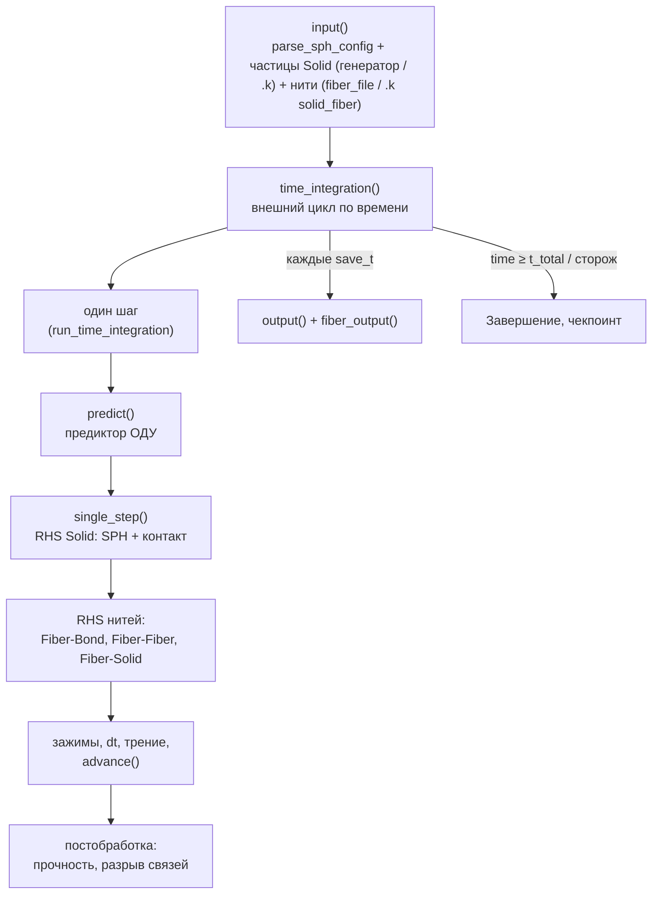
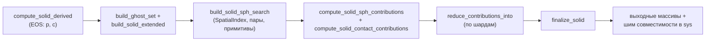

# Обзор расчётного конвейера

> Конвейер построен на `CpuExecutor` + `SpatialIndex<Dim>` + вкладах (`Contribution`)
> с reduce по шардам ([ADR-008](../decisions/adr-008-rhs-architecture-fiber.md)).

Код SPH организован как линейный конвейер: на каждом шаге по времени
вычисляется правая часть (RHS) для всех «compute-структур» — сплошной среды
(`Solid`, SPH-частицы [`ParticleSystem`](../../../include/particle_system.hpp:35)) и
нитей (`Fiber`, бусины [`FiberState`](../../../include/fiber/fiber_system.hpp)),
после чего решатель ОДУ продвигает состояние на шаг.

## Высокоуровневая схема

## Точки входа

- [`main()`](../../../src/main.cpp:42) → `run_sph()` ([`main.cpp:57`](../../../src/main.cpp:57)) —
  создание [`SimulationConfig`](../../../include/simulation_config.hpp:31),
  применение умолчаний, `omp_set_num_threads(cfg.num_threads)`, создание
  `fiber::Model` (Solid `model.solid` + нити + зажимы), вызов `input()`,
  запуск `time_integration()`.
- [`input()`](../../../src/input.cpp:946) — чтение
  [`Initial_Conditions.txt`](../../03-reference/config/initial-conditions.md)
  ([`parse_sph_config()`](../../../src/input.cpp:110)), генерация/загрузка частиц
  (встроенные генераторы или импорт `.k`, `k_file`) и нитей (`fiber_file` или
  `k_mode = solid_fiber`; два источника нитей одновременно запрещены). Маски
  зажимов (`model.clamps`) заполняют загрузчик нитей и импорт `.k`
  (`*BOUNDARY_SPC_*`, `CLAMP_BOX`).
- [`time_integration()`](../../../src/time_integration.cpp:1049) — перегрузка для
  `fiber::Model` (есть и тонкая перегрузка для одного `ParticleSystem`,
  [`:1020`](../../../src/time_integration.cpp:1020): нитей нет, весь Fiber-код в цикле — no-op).
  Обе — обёртки над единственным шаблоном
  [`detail::run_time_integration<Solver>`](../../../src/time_integration.cpp:116).
  Решатель выбирается ключом `ode_solver`: `0` —
  `ode::PredictorCorrectorSolver` (по умолчанию), `1` — `ode::EulerSolver`
  ([`ode_solver.hpp`](../../../include/ode/ode_solver.hpp:244)). Здесь же
  чекпоинты/рестарт (`checkpoint_*`/`restart_*`) и сторож времени/застоя
  (`RunGuard`, [`run_guard.hpp`](../../../include/run_guard.hpp)).

## Этапы одного шага

Порядок — по телу цикла `while (time < t_total)` в
[`run_time_integration`](../../../src/time_integration.cpp:116):

```mermaid
flowchart LR
    S1["1. predict()"] --> S2["2. single_step():<br/>Solid RHS"]
    S2 --> S3["3. update_smoothing_length<br/>(sle=1)"]
    S3 --> S4["4. RHS нитей<br/>(nfiber>0)"]
    S4 --> S5["5. [1] зажимы:<br/>проекция a"]
    S5 --> S6["6. dt = min(...)"]
    S6 --> S6p["6а. проекция нормального<br/>контакта (predictor=1)"]
    S6p --> S7["7. трение<br/>[2], [3]"]
    S7 --> S8["8. advance()"]
    S8 --> S9["9. постобработка"]
    S9 --> S10["10. вывод/монитор/<br/>сторож/чекпоинт"]
```

1. **`solver.predict()`** — предиктор: сохранение $y^n$ и полушаг по $f^{n-1}$
   (для `EulerSolver` и первого шага предиктор-корректора — нет-оп).
2. **[`single_step()`](../../../src/single_step.cpp:93)** — RHS Solid, пишет
   $f^n$ в `solver.solid_rhs` (подробно ниже).
3. **`interactions::update_smoothing_length`** (`sle = 1`:
   $h = \mathrm{fac}\,(m/\rho)^{1/\dim}$, [`postprocessing.hpp`](../../../include/interactions/postprocessing.hpp:159))
   — стоит именно здесь, между RHS и расчётом нового `dt` (обоснование — в шапке
   `postprocessing.hpp`); `sle = 2` — явная ошибка.
4. **RHS нитей** (только при `nfiber > 0`), в этом порядке:
   `compute_fiber_bond` (упругие связи) → `build_fiber_contact_search` +
   `compute_fiber_contact_contributions` (контакт нить–нить; сумма со связями
   в `fiber_rhs.dv`) → `compute_fiber_solid_contact` (контакт нить–Solid; вклад в
   `fiber_rhs.dv` и добавка в `solid_rhs.dvx`) → пределы шага
   `compute_fiber_bond_dt_limit`, `compute_fiber_contact_dt_limit`,
   `compute_fiber_solid_contact_dt_limit`. Предел связей и опорный шаг бусин берутся из кэша
   `FiberDtRefCache` (пересчёт только при смене топологии), поиск нить–нить идёт с отсечкой
   далёких пар (`cull_apart`, см. [Поиск соседей](neighbor-search.md)).
5. **[1] Закрепление (Clamp)** — только при непустом `clamps`: проекция
   $a_{i,d} \leftarrow 0$ (у Solid и XSPH-поправки `av`) для зажатых компонент
   ([`clamp.hpp`](../../../include/interactions/clamp.hpp)); реакция опоры
   накапливается.
6. **Шаг по времени:** `dt = min(CFL, min_dt_contact, fiber_dt_limit)`, затем
   `dt *= cfg.dt_scale` при `dt_scale < 1`. CFL —
   [`compute_cfl_timestep`](../../../src/time_integration.cpp:39):
   $\min_i \mathrm{CFL}\,h_i/(c_i+|v_i|)$.
   Если у вида контакта нитей `fiber_*_contact_predictor = 1` (законы 1–3), его ядро
   силы не даёт, а заполняет нормальные слоты, и предел шага от этого вида — `kNoLimit`.
   `L_max` (текущая максимальная длина связи) считается один раз за шаг для обоих поисков, поиск
   нить–нить идёт с отсечкой `cull_apart`.
   **Стадия 6а — проекция нормального контакта** (только при `predictor = 1`; код
   [`run_normal_projection`](../../../include/interactions/fiber_normal_projection.hpp), вызов в
   `run_time_integration`): стоит после выбора $\Delta t$ (нужен $h$) и до трения; применяет тёплый
   старт, считает счётчики $c_k$, $c_s$ (с зажимами), $K$ итераций Якоби, добавляет $\Delta v/h$ в
   `fiber_rhs.dv` и `solid_rhs.dvx`, повторно проецирует зажимы **[3]**, обновляет таблицу тёплого
   старта и заполняет слоты трения из нормальных ($N=P/h$). После трения считается диагностический
   остаток Синьорини. Подробно — [Контакт нитей, §7](../models/05-fiber-contact.md#7-нормальный-контакт-как-проекция-скорости).
7. **Стадия трения** (только при активных контактах с $\mu_{ff}>0$/$\mu_{fs}>0$):
   проекция на уровне скоростей, единым проходом Якоби для нить–нить и нить–Solid;
   внутри — **[2]** $c_k = c_s = 0$ у полностью зажатых и **[3]** повторная
   проекция зажимов (без XSPH).
8. **`solver.advance()`** — обновление $u,\rho,s,v,x$ (Solid; правила $u\ge0$,
   XSPH — внутри решателя) и $v,x$ (нити).
9. **Постобработка:** `apply_material_strength` (Мизес `itype` 3–9, JH-2 10–11,
   Джонсон–Кук 12–15), затем `run_fiber_topology_postprocessing` (внутренние
   переменные связей — пластика/Максвелл/повреждённость, затем поиск и
   применение разрывов связей, рост `topology.version`).
10. **Вывод** `output()` и `fiber::fiber_output()` каждые `save_t`, запись
    монитора (`log.txt`), `time += dt`, проверка `RunGuard`, чекпоинт.

## Внутри `single_step` (Solid)

Граф вычисления — в [`single_step()`](../../../src/single_step.cpp:93):

| Стадия | Функция | Файл | Назначение |
|---|---|---|---|
| Производные | `compute_solid_derived` | [`solid_sph.hpp`](../../../include/interactions/solid_sph.hpp:242) | EOS по `itype`, давление и скорость звука; проверка `rho`, `mass`, `itype` |
| Виртуальные частицы | `build_ghost_set`, `build_solid_extended` | [`solid_sph.hpp`](../../../include/interactions/solid_sph.hpp:296) | Зеркала у оси (`axis_sim` и `dim == 2`) только в `SolidExtended`, не в `sys` |
| Поиск | `build_solid_sph_search` | [`solid_sph.hpp`](../../../include/interactions/solid_sph.hpp:507) | Пары $i<j$ по `SpatialIndex`, примитивы Solid-SPH, `real_pairs`, `contact_pairs` — см. [Поиск соседей](neighbor-search.md) |
| Ядро Solid-SPH | `compute_solid_sph_contributions` | [`solid_sph.hpp`](../../../include/interactions/solid_sph.hpp:689) | Неразрывность, скорости деформаций/поворота, импульс и энергия, искусственная вязкость, XSPH → `SolidDelta` |
| Контакт Solid–Solid | `compute_solid_contact_contributions` | [`solid_contact.hpp`](../../../include/interactions/solid_contact.hpp:91) | Межтельные пары (`body[i] != body[j]`), при `contact_force_type != 0` — см. [контакт частица–частица](contact-particle-particle.md) |
| Reduce | `rhs::reduce_contributions_into` | [`contributions.hpp`](../../../include/rhs/contributions.hpp:377) | Сумма вкладов по частицам (сначала Solid-SPH, затем контакт) |
| Finalize | `finalize_solid` | [`solid_sph.hpp`](../../../include/interactions/solid_sph.hpp:1095) | `parallel_for` по реальным частицам: осевые члены, итоговые $\dot\rho,\dot u,\dot v,\dot s$ |
| Диагностика контакта | `compute_solid_contact_diagnostics` | [`solid_contact.hpp`](../../../include/interactions/solid_contact.hpp:178) | Каждый шаг при `contact_force_type != 0`: `wb.min_dt_contact`, `contact_pair_count`, `contact_max_delta` |

**Параллельность подготовительных стадий.** `build_solid_extended(exec, ...)` (копирование и зеркала),
максимум $h$ для радиуса поиска, `SpatialIndex::build(exec, ...)` и `Diagnostics::validate(exec, ...)`
идут через `CpuExecutor` и побитово равны последовательным; циклы `predict`/`correct`/`advance`
решателей тоже параллельны (в сборке `SPH_ENERGY_LOG` цикл со скалярными полями Solid серийный из-за
суммы `u_clamp_acc`) — см. [Параллелизм](parallelism.md).

Рабочая память шага — [`SolidStepWorkspace`](../../../include/interactions/solid_workspace.hpp)
(владелец — `WorkBuffers::solid_ws`, [`buffers.hpp`](../../../include/buffers.hpp));
создаётся при первом вызове и только растёт между шагами.

**Шим совместимости.** `single_step` по-прежнему пишет в `sys` давление `p`,
скорость звука `c`, скорости деформаций `exx…eyz` и поворота `rxy…ryz`: их читают
`prochnost_cem_JH2` ([`ppochnost.cpp`](../../../src/ppochnost.cpp)) и
`compute_cfl_timestep` (`sys.c`). Сигнатура `single_step` сохранила унаследованные
параметры (`itimestep`, `t`, `ds` — неиспользуемые).

## Устаревшие ключи конфигурации

Ключи `nnps` и `coloring_niac_threshold` ещё читаются парсером конфигурации
(`parse_sph_config`) и хранятся в `SimulationConfig` (и в чекпоинте), но **на
расчёт не влияют**: поиск соседей один (`SpatialIndex`), раскраски графа нет.
Тип ядра задаёт `skf`, метод давления — `pa_sph`, плотность — `density_method`
(неразрывность; `summation_density = false` — constexpr).

## Поток данных

Состояние Solid — [`ParticleSystem`](data-layout-soa.md) (SoA), нитей —
`fiber::FiberState` + `FiberTopology` + `FiberMaterial`; оба лежат в
`fiber::Model` ([`model.hpp`](../../../include/fiber/model.hpp)). `SimulationConfig`
передаётся по `const&` во все узлы. Взаимодействия не пишут в общий RHS
напрямую: ядро формирует типизированные вклады (`SolidDelta`, `FiberDelta`)
через `ContributionWriter`, а стадия reduce складывает их по частицам — см.
[Параллелизм](parallelism.md).

Производные прошлого шага $f^{n-1}$ (`SolidRhsBuffers`, `FiberRhsBuffers`) и
сохранённое $y^n$ живут внутри решателя `ode::PredictorCorrectorSolver`.

## Условия сборки

Необязательные диагностические подсистемы включаются макросами:
`SPH_ENERGY_LOG` (лог энергии, `include/energy_log.hpp`, в том числе диагностика мощности по
механизмам), `SPH_CONTACT_STATS` (диагностика контактов нитей,
`fiber_contact_stats.hpp`). В обычной сборке соответствующего кода нет
(CMake-опции по умолчанию `OFF`). Опция `SPH_PROFILE` в CMake осталась, но
блоков `#ifdef SPH_PROFILE` в коде больше нет.

## Команды обхода

Полный список модулей и функций — в [справочнике API (Doxygen)](../../../_build/doxygen/html/).
