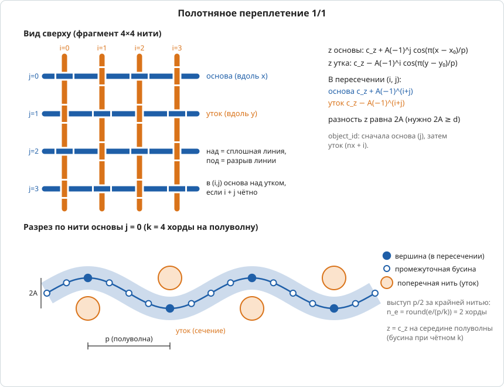
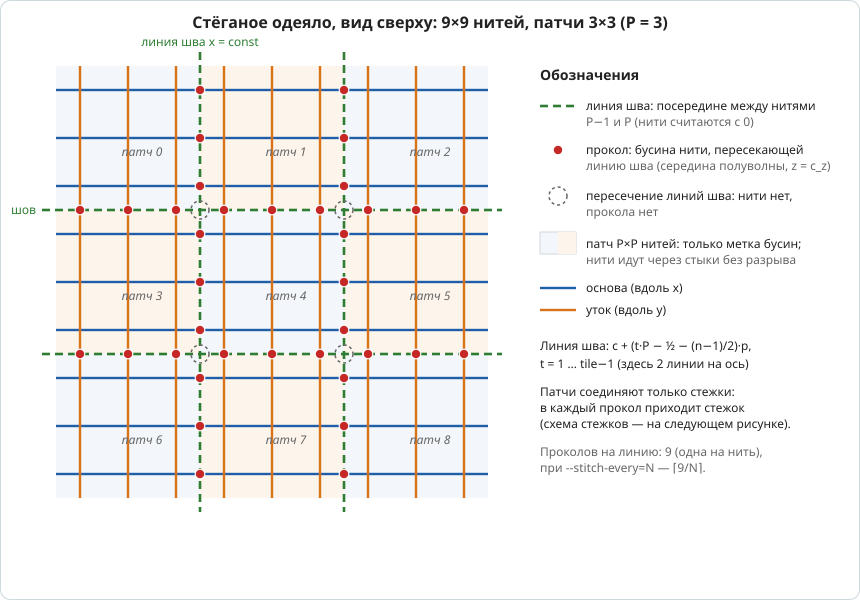
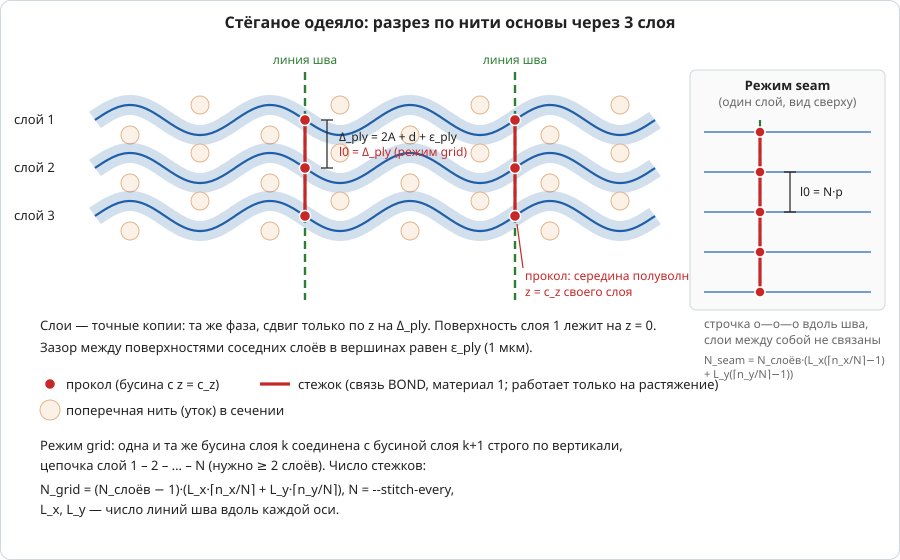
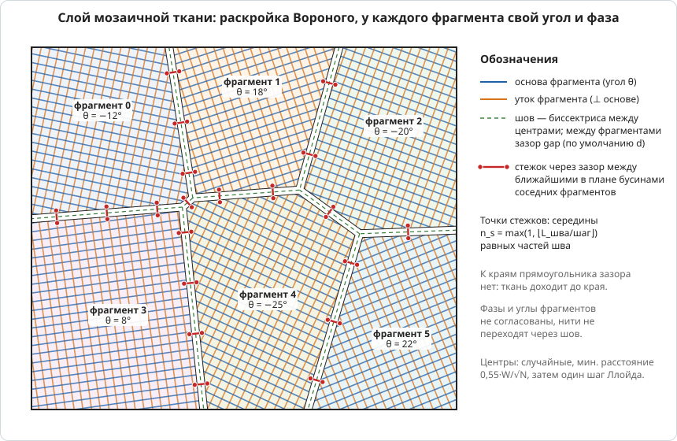
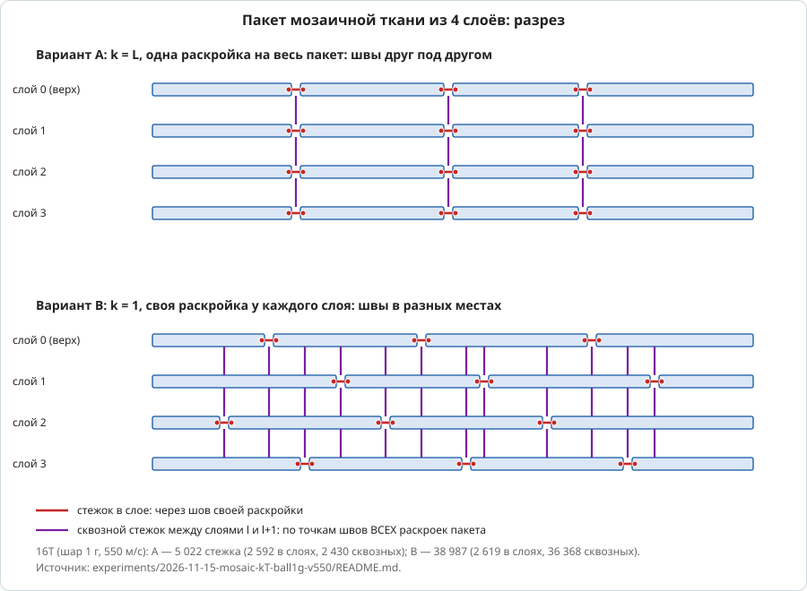

# Ткани: полотняное переплетение, стёганое одеяло и мозаика

Глава описывает, как в проекте строится ткань как набор нитей (`.fib`) и чем отличаются три её исполнения:
сплошное **полотно** 1/1, **стёганое одеяло** (полотно из слоёв, прошитое стежками по линиям шва) и **мозаика**
(слой, разрезанный на случайные фрагменты). Сами нити (бусины, связи, закон связи) описаны в
[04-fiber-mechanics.md](04-fiber-mechanics.md), контакт нитей — в [05-fiber-contact.md](05-fiber-contact.md).
Генераторы не входят в расчёт: они порождают входной файл. Практика (ключи, примеры запуска) —
в [руководстве по генератору](../../02-how-to/02-plain-weave-generator.md).

Обозначения: $d$ — диаметр нити, $p$ — шаг нитей, $A$ — амплитуда волнистости, $k$ — число хорд на полуволну,
$c_z$ — $z$ осевой линии слоя, $\Delta_\mathrm{ply}$ — шаг слоёв по $z$, $n_x,n_y$ — число нитей основы и утка.

## 1. Полотняное переплетение 1/1

*Рис. 1. Полотно 1/1: вид сверху (над/под — разрыв линии) и разрез по нити основы с бусинами при $k=4$.*

### 1.1. Раскладка и профиль

Плоскость ткани $xy$, толщина вдоль $z$. **Основа** $j=0,\dots,n_x-1$ идёт вдоль $x$ на
$y_j=c_y+(j-\tfrac{n_x-1}{2})p$; **уток** $i=0,\dots,n_y-1$ идёт вдоль $y$ на $x_i=c_x+(i-\tfrac{n_y-1}{2})p$.
Профиль волнистости (`PlainWeaveProfile`):

- `Cos`: основа $z=c_z+A(-1)^j\cos\!\big(\pi(x-x_0)/p\big)$, уток $z=c_z-A(-1)^i\cos\!\big(\pi(y-y_0)/p\big)$;
- `Arcs`: полуэллипсы с полуосями $p/2$ (вдоль нити) и $A$ (по $z$), на стыке $z=c_z$.

Вершины профиля — пересечения нитей. В пересечении $(i,j)$ основа лежит на $z=c_z+A(-1)^{i+j}$, уток — на
$c_z-A(-1)^{i+j}$: нити чередуют положение «над–под», разность $z$ равна $2A$ (при $2A\ge d$ нити не
проникают друг в друга; $p\ge d$ — соседние параллельные нити не перекрываются; нарушение — ошибка, с
`--allow-penetration` — предупреждение).

### 1.2. Бусины, `object_id`, выступы

Бусины стоят точно в каждой вершине, между вершинами — $k$ равных хорд (`seg`$=k\ge2$; длина хорды подбирается
стрельбой, профиль полуволны считается один раз и переиспользуется со сдвигом и знаком). Выступ $e$ за крайней
поперечной нитью делится на $n_e=\max(1,\mathrm{round}(e/(p/k)))$ хорд ($e=0$ — выступа нет; по умолчанию
$e=p/2$). Порядок бусин в нити: выступ, вершины с промежуточными бусинами, выступ. При **чётном $k$** середина
полуволны — бусина с $z=c_z$; на этом держатся проколы стёжки (раздел 3). Нумерация `object_id`: сначала основа
(по $j$), затем уток ($n_x+i$); индекс бусины сквозной по блокам `FIBER`.

### 1.3. Зажим и пресет

Опция `clamp = X|Y|XY` с границей $c_e$ записывает два `CLAMP_BOX` на зажимаемую ось: $[c+c_e,\ \mathrm{hi}]$ и
$[\mathrm{lo},\ c-c_e]$; закрепляются только нити, идущие вдоль этой оси, допустимо
$c_e\in[y_l+d/2,\ y_l+e]$, где $y_l=(n_x-1)p/2$ — координата крайней нити. Пресет `twaron_ct717`: $d=0{,}39$ мм, $p=1{,}18$ мм, $A=0{,}5d$, $102\times102$ нити,
$k=4$, $E=8{,}5\cdot10^{10}$ Па, $\rho=1440$ кг/м³, $\varepsilon_b=0{,}03$, выступ $e_y=5$ мм, зажим по $Y$ с
$c_e=60$ мм. Остальные проверки и сводка — в [04-fiber-mechanics.md](04-fiber-mechanics.md#6-геометрия-полотняного-переплетения).

## 2. Пакет из $k$ слоёв (kT)

Пакет `<k>T` ($k=1,\dots,64$) — $c_z$-сдвинутые **точные копии** одного слоя (та же фаза, без сдвига и поворота в
плане). Слой с номером $m=0,1,\dots$ в коде (слой $m{+}1$ в нумерации выстрела) имеет
$c_{z,m}=c_{z,0}-m\,\Delta_\mathrm{ply}$ (`build_fabric_stack`; $c_z$ считается умножением, без накопления суммы), где

$$
\Delta_\mathrm{ply}=2A+d+\varepsilon_\mathrm{ply},\qquad c_{z,0}=-(A+d/2),
$$

так что **лицевая поверхность слоя 1 лежит на $z=0$**, и по ней бьёт шар. В сцене Guo $A=0{,}6d$,
$\varepsilon_\mathrm{ply}=1$ мкм (`kEpsPly`); для базового уровня $\Delta_\mathrm{ply}=0{,}468+0{,}39+0{,}001=0{,}859$ мм.
Зазор между поверхностями соседних слоёв в вершинах равен $\varepsilon_\mathrm{ply}$ (проверка `ply_vertex_gaps`).
Глобальный `object_id` $=(m)(n_x+n_y)+$ локальный, то есть слои идут подряд, внутри слоя — основа, затем уток.

## 3. Стёганое одеяло

!!! note "Главное"
    Нити **непрерывны через стыки патчей**: одеяло — обычная ткань с $n_x=t_y P_x,\ n_y=t_x P_y$
    (`build_plain_weave_quilt` просто вызывает `build_plain_weave`). **Патч — только метка** бусин
    (`bead_patch`, файл `.patches.txt`) и координаты линий шва. Зазоров между патчами нет; патчи и слои
    соединяют **только стежки** — дополнительные связи `BOND i j 1` между бусинами на линиях шва.

*Рис. 2. Вид сверху: 9×9 нитей, патчи 3×3, линии шва пунктиром между нитями, проколы — на нитях, пересекающих линию.*

### 3.1. Линии шва

**`--stitch-tile=N`** (функция `quilt_seams`): $N\times N$ патчей, $n_x$ и $n_y$ делятся на $N$ (проверяет сцена).
Линия $t$ ($t=1,\dots,N-1$) стоит посередине между нитями $tP-1$ и $tP$:

$$
s_t=c+\Big(tP-\tfrac12-\tfrac{n-1}{2}\Big)p,
$$

где $n$ — число нитей, **лежащих поперёк** линии и задающих её положение (для $x=\mathrm{const}$ это нити утка,
$n=n_y$, $P=n_y/N$; для $y=\mathrm{const}$ — нити основы, $n=n_x$, $P=n_x/N$). Саму линию $x=\mathrm{const}$
**прокалывают** нити основы (их $n_x$, раздел 3.2), а $n_y$ определяет только её координату. Пример smoke:
12 нитей, $N=4$ — патчи по 3 нити.

**`--stitch-patch=P`** (функция `centered_patch_seams`): кусочки по $P$ нитей симметрично от центра, у краёв
остаток. В удвоенных индексах $2s=(n-1)+[P,\ \text{если } n-P \text{ чётно, иначе } 0]+2jP$, $0<s<n-1$,
координата $c+(s-\tfrac{n-1}{2})p$. Если $n-P$ чётно — полный кусочек стоит по центру; $n$ чётно, $P$ нечётно —
линия шва через центр; $n$ нечётно и $P$ чётно — ошибка (код 2). Требуется $P<n$. `--stitch-patch` и `--stitch-tile` взаимно исключаются.

| $n$ нитей | $P$ | Кусочки | Линий на ось |
|---|---|---|---|
| 43 | 5 | $4+7\cdot5+4$ | 8 |
| 43 | 9 | $8+9+9+9+8$ | 4 |
| 12 | 3 | $3+3+3+3$ (то же, что `tile=4`) | 3 |
| 11 | 5 | $3+5+3$ | 2 |

### 3.2. Прокол

Линию $x=s$ прокалывают нити основы, линию $y=s$ — нити утка. **Прокол** — бусина нити с $\lvert\text{координата}-s\rvert<10^{-9}p$:
середина полуволны между двумя поперечными нитями, $z=c_z$ слоя. Нужен чётный $k$ (иначе бусины на линии нет —
ошибка). В пересечении двух линий шва нити нет, поэтому прокола нет. `--stitch-every=N` оставляет нити с
`index % N == 0` (индекс считается от края $j=0$, а не от центра: при чётном $n$ и $N>1$ раскладка несимметрична).
`--stitch-lines=x|y|xy` выбирает линии шва: `x` — только линии $x=s$ (проколы на нитях основы), `y` — только $y=s$ (проколы на нитях утка), `xy` — обе.

*Рис. 3. Схема плетения и соединения нитей: разрез по нити основы через три слоя; слева — режим `grid`, справа — `seam`.*

### 3.3. Режим `grid`: стежки между слоями

Стежок соединяет **одну и ту же бусину** слоёв $m$ и $m+1$ — строго вертикальную пару (слои обязаны совпадать в
плане до $10^{-12}p$, иначе исключение). Образуется цепочка слой 1 – 2 – … – $N_\mathrm{pl}$; длина в
ненагруженной конфигурации $l_0=\Delta_\mathrm{ply}$. Нужно не менее 2 слоёв. Число стежков

$$
N_\mathrm{grid}=(N_\mathrm{pl}-1)\Big(L_x\Big\lceil\frac{n_x}{N}\Big\rceil+L_y\Big\lceil\frac{n_y}{N}\Big\rceil\Big),
$$

$N_\mathrm{pl}$ — число слоёв, $L_x,L_y$ — число линий шва, $N$ — `--stitch-every`.

### 3.4. Режим `seam`: строчка в слое

В каждом слое проколы одной линии сортируются вдоль неё, соседние соединяются горизонтальной связью
(строчка o—o—o, $l_0=N p$, обе бусины на $z=c_z$). Слои между собой не связаны; подходит любое число слоёв,
в том числе 1T:

$$
N_\mathrm{seam}=N_\mathrm{pl}\Big(L_x\Big(\Big\lceil\frac{n_x}{N}\Big\rceil-1\Big)+L_y\Big(\Big\lceil\frac{n_y}{N}\Big\rceil-1\Big)\Big).
$$

### 3.5. Материал стежка

Материал 1 (`StitchSpec`): $E=8{,}5\cdot10^{10}$ Па, $d=0{,}2$ мм, $\nu=0{,}3$, $\rho=1440$ кг/м³,
$\varepsilon_b=0{,}03$; работает **только на растяжение**. Из командной строки меняются только $E$
(`--stitch-E`), $d$ (`--stitch-d`) и $\varepsilon_b$ (`--stitch-eps-break`); `--eps-break`, `--fiber-E`,
`--fiber-inelastic` относятся к материалу 0, поэтому стежок остаётся упругим.

### 3.6. Ограничения и сверка чисел

- $n$ делится на $N$ при `--stitch-tile`; при `--stitch-patch` — условие чётности из 3.1.
- Нечётный патч при $\mathrm{tile}>1$ в `plain_weave_gen` — ошибка (соседний патч оказался бы зеркальным, а не
  сдвинутым); флаг `allow_odd_patch` превращает её в предупреждение.
- $k$ чётное; `grid` требует $\ge2$ слоёв.
- `plain_weave_gen --patch/--tile` пишет один слой **без стежков**; стежки в `.fib` создаёт `guo2019_shot`
  (линии шва он считает сам: `quilt_seams` либо `centered_patch_seams`).
- Мозаика (`--random-cut`) несовместима с `--stitch=grid|seam`.

Пересчёт по формуле $N_\mathrm{grid}$ ($\lceil n/N\rceil=n$ при $N=1$):

| Случай | $n$ | $L_x=L_y$ | $N_\mathrm{pl}$ | Расчёт | Источник |
|---|---|---|---|---|---|
| 3T smoke, tile 4 | 12 | 3 | 3 | $2\cdot(3\cdot12+3\cdot12)=144$ | `stitch_kt_cli_test.sh` |
| 11 нитей, $P=5$ | 11 | 2 | 3 | $2\cdot(2\cdot11+2\cdot11)=88$ | `stitch_kt_cli_test.sh` |
| w50, $P=5$, 18T | 43 | 8 | 18 | $17\cdot(8\cdot43+8\cdot43)=11\,696$ | README w50 |
| w50, $P=9$, 19T | 43 | 4 | 19 | $18\cdot(4\cdot43+4\cdot43)=6\,192$ | README w50 |

Числа 144 и 88 проверяет тест `stitch_kt_cli_test.sh`; 11 696 и 6 192 приведены в README эксперимента `experiments/2026-11-14-fabric-kT-w50-ball1g-v550` (тестом не проверяются).

## 4. Мозаичная ткань

*Рис. 4. Слой мозаики: фрагменты Вороного с разными $\theta$ и фазой, зазор вдоль швов, стежки через зазор.*

Мозаика (`--random-cut=N`, [plain_weave_random_cut.hpp](../../../include/fiber/plain_weave_random_cut.hpp))
**режет нити**: прямоугольник $W\times H$ делится по Вороному, в каждый фрагмент вписано своё повёрнутое и
сдвинутое по фазе полотно, фрагменты разделены зазором и сшиты стежками. Общих нитей у фрагментов нет.

### 4.1. Раскройка

Генератор `mt19937_64(seed)`, равномерные числа берутся вручную как $(g\gg11)\cdot2^{-53}$ (не зависят от
стандартной библиотеки). Центры равномерно в прямоугольнике с минимальным расстоянием $0{,}55\,W/\sqrt N$ (по $W$);
после $10^4$ подряд отказов оно умножается на $0{,}97$. Затем один шаг Ллойда: центр переносится в центроид
ячейки. Ячейка — прямоугольник, обрезанный биссектрисами; для полигона каждая биссектриса сдвинута внутрь на
$\mathrm{gap}/2$, **края прямоугольника не сдвигаются** (ткань доходит до края). После всех ячеек для фрагмента
берутся три числа: $\theta=(2u-1)\,\theta_\mathrm{max}$, фаза $f_x,f_y\in[0,1)$. Шов — общий отрезок биссектрисы,
обрезанный прямоугольником и остальными несжатыми биссектрисами; шов учитывается, если длина $>10^{-9}$ м.

### 4.2. Ткань во фрагменте

Пусть $c$ — центр, $\mathbf u=(\cos\theta,\sin\theta)$, $\mathbf v=(-\sin\theta,\cos\theta)$:

$$
\text{основа } j:\ c+(j+f_x)\,p\,\mathbf v+t\,\mathbf u,\qquad \text{уток } i:\ c+(i+f_y)\,p\,\mathbf u+t\,\mathbf v .
$$

Нить обрезается по полигону; отбрасывается, если пуста или короче $h/4$ ($h=p/k$). Координата $z$ и знаки в
пересечении — как у полотна (разность ровно $2A$), хорды равны; выступов нет; нити не центрируются. Концевая
бусина ставится точно на границу полигона, только если 3D-хорда до соседа $\ge0{,}2h$; нить из менее чем двух
бусин отбрасывается. Генератор проверяет зазор: минимальное расстояние в плане между бусинами разных
фрагментов $\ge\mathrm{gap}-10^{-9}p$, иначе ошибка. По умолчанию $\mathrm{gap}=d$, $\theta_\mathrm{max}=25^\circ$.

### 4.3. Слои и группы

Слой $l$ имеет $c_{z,l}=c_z-l\,\Delta_\mathrm{ply}$; **слой 0 — верхний**. Раскройка слоя — номер
$g=\lfloor l/\texttt{layers\_per\_cut}\rfloor$; всего $\lceil L/k_\mathrm{cut}\rceil$ раскроек (последняя группа
может быть короче). Шаг слоёв по умолчанию $\Delta_\mathrm{ply}=2A+d+1$ мкм (в сцене Guo — тот же $\Delta_\mathrm{ply}$,
что у пакета kT); при $\Delta_\mathrm{ply}<2A+d$ — ошибка (с `--allow-penetration` предупреждение). Слои одной группы — точные копии со сдвигом по $z$. Раскройки строятся одним потоком RNG
по порядку, поэтому при $L=1$ результат совпадает с однослойным.

*Рис. 5. Пакет из 4 слоёв: вариант A — одна раскройка, сквозные стежки вертикальны; вариант B — своя раскройка у слоя, сквозные стежки по всем швам.*

### 4.4. Стежки

Всё — связи `BOND` материала 1, только растяжение. Точки стежков на шве — середины $n_s=\max(1,\lfloor L_\mathrm{шва}/\text{шаг}\rfloor)$
равных частей. Каждой точке сопоставляется ближайшая **в плане** бусина фрагмента по каждую сторону шва.

- **В слое:** для каждого слоя — по швам **его** раскройки.
- **Сквозные:** для каждой пары соседних слоёв $(l,l+1)$ и каждой точки швов **всех раскроек** пакета —
  ближайшая в плане бусина любого фрагмента слоя $l$ и слоя $l+1$. При общей раскройке стежки строго вертикальны.

Дубликаты убираются; порядок: сначала все в слое, затем сквозные. В сцене Guo шаг по умолчанию равен $p$ (прокол на
каждой нити), в `plain_weave_gen` — 2,4 мм; шаг 0 — без стежков. Раскройки, диапазоны и стежки пишутся в
[`.cut.json`](../../03-reference/file-formats/cut-json.md).

| Вариант | Группа | Эксперимент | Стежков | В слоях / сквозных |
|---|---|---|---|---|
| A | $k=L$ (одна раскройка) | 16T, шар 1 г, 550 м/с | 5 022 | 2 592 / 2 430 |
| B | $k=1$ (раскройка на слой) | 16T, то же | 38 987 | 2 619 / 36 368 |
| 2T (k=2, 30 фрагментов) | одна раскройка | 147 м/с | 2 744 | 1 830 / 914 |
| 2T (k=1) | две раскройки | 147 м/с | 3 618 | 1 811 / 1 807 |

Источники: `experiments/2026-11-15-mosaic-kT-ball1g-v550/README.md`, `experiments/2026-11-14-guo2019-2t-mosaic/README.md`.

### 4.5. Зажим и сцена Guo

Зажим (при `clamp ≠ None`) — боксы по габариту бусин $\pm d$: для $y$ — $[c_y+c_e,\ \mathrm{hi}]$ и
$[\mathrm{lo},\ c_y-c_e]$. Закрепляются **все бусины** бокса независимо от направления нити
($|y|\ge c_e$). Диапазон $c_e$ не проверяется, ошибка — только если ничего не закреплено.

В сцене `guo2019_shot`: база — пресет `twaron_ct717` с $A=0{,}6d$, зажим по $Y$; поле по умолчанию
$W=(n_y-1)p+p$, $H=(n_x-1)p+2e_y$ (для базового уровня $120{,}36\times129{,}18$ мм), требуется $c_e<H/2$;
своё поле — `--cut-size=WxH`, граница — `--cut-clamp-edge`; шаг стежков — $p$; **материал стежка берётся из
`StitchSpec`** (E 8,5e10, d 0,2 мм, ε_b 0,03), а не из «заглушек» генератора (`stitch_E` 5e9 и т. д.).

## 5. Сравнение

| | Одеяло | Мозаика |
|---|---|---|
| Нити | непрерывны через стыки | разрезаны, у каждого фрагмента свои $\theta$ и фаза |
| Швы | прямые линии посередине между нитями | биссектрисы Вороного |
| Зазор | нет | $\mathrm{gap}\ge d$ вдоль швов |
| Стежки | `grid` (между слоями, вертикальные) или `seam` (строчка в слое) | в слое и сквозные, по ближайшим в плане бусинам |
| Зажим | $c_e$ по нитям вдоль оси | все бусины $\lvert y\rvert\ge c_e$ |
| Ключи CLI | `--stitch=grid\|seam`, `--stitch-tile`, `--stitch-patch`, `--stitch-lines`, `--stitch-every` | `--random-cut`, `--cut-seed`, `--layers-per-cut`, `--cut-gap`, `--cut-rot-max`, `--cut-stitch-step`, `--cut-size`, `--cut-clamp-edge` |
| Материал стежка | `--stitch-E`, `--stitch-d`, `--stitch-eps-break` | те же |
| Генератор | `build_plain_weave_quilt` (один слой, без стежков), сцена Guo | `build_plain_weave_random_cut` |
| Совместимость | не сочетается с `--random-cut` | не сочетается с `--stitch=grid\|seam` |

## 6. Стежок в ядре

- `FiberBond::mat`: $-1$ — материал бусины $i$ (цепочка, побитово прежнее поведение); $\ge0$ — собственный
  материал связи. Выбор — `bond_material_id` (сила, предел по $\Delta t$, разрыв, энергия, вывод, импорт `.k`).
- `is_chain_bond(b)` истинно, если `next[i]==j` и `prev[j]==i`; иначе связь — стежок.
- Сила — только растяжение: $F=EA\max(l/l_0-1,0)$ с $E$ и $A=\pi d^2/4$ материала связи.
- Стежок входит в предел шага `compute_fiber_bond_dt_limit` и в `compute_fiber_bead_dt_ref`.
- Разрыв при $l>(1+\varepsilon_b)l_0$; связь вне цепочки только удаляется из `bonds` (`prev`, `next`, `object_id`
  не меняются), `topology.version` растёт.
- Стежок **не сегмент контакта** (сегменты строятся по `prev/next`) и не входит в $L_\mathrm{max}$ (`fiber_max_current_bond_length` пропускает связи с `mat >= 0`, [fiber_contact_common.hpp](../../../include/interactions/fiber_contact_common.hpp)); исключения
  контакта для прошитых бусин нет — обычный фильтр `object_id[i] != object_id[j]`.
- Масса швейной нити бусинам **не добавляется**.
- Чекпоинт хранит `mat`; формат версии 6. `.fib`: `BOND <i> <j> <material_id>`, глобальные индексы с 0.

## 7. Реализация в коде

| Модель | Файл | Функция / структура |
|---|---|---|
| Полотно, бусины, зажим, пресет | [plain_weave.hpp](../../../include/fiber/plain_weave.hpp) | `build_plain_weave`, `write_plain_weave_fib`, `apply_plain_weave_preset` |
| Одеяло: патчи, линии шва | [plain_weave_quilt.hpp](../../../include/fiber/plain_weave_quilt.hpp) | `build_plain_weave_quilt`, `quilt_seams`, `centered_patch_seams` |
| Стежки `grid` и `seam` | [plain_weave_quilt.hpp](../../../include/fiber/plain_weave_quilt.hpp) | `build_quilt_stitches`, `build_quilt_seam_stitches` |
| Мозаика | [plain_weave_random_cut.hpp](../../../include/fiber/plain_weave_random_cut.hpp) | `build_plain_weave_random_cut` |
| Пакет слоёв, `.fib` со стежками | [guo2019_scene.hpp](../../../cases/guo2019/experiment/guo2019_scene.hpp) | `build_fabric_stack`, `write_fabric_stack_fib`, `StitchSpec`, `MosaicSpec` |
| Связь, материал стежка | [fiber_system.hpp](../../../include/fiber/fiber_system.hpp) | `FiberBond::mat`, `bond_material_id`, `is_chain_bond` |
| Сила стежка | [fiber_bond.hpp](../../../include/interactions/fiber_bond.hpp) | `compute_fiber_bond_contributions` |
| Разрыв стежка | [postprocessing.hpp](../../../include/interactions/postprocessing.hpp) | `find_fiber_break_events`, `apply_fiber_break_events` |
| Разбор `BOND` | [fiber_input.cpp](../../../src/fiber_input.cpp) | `load_fiber_file` |

Практика: [генератор ткани](../../02-how-to/02-plain-weave-generator.md#одеяло-из-патчей),
[случайная раскройка](../../02-how-to/02-plain-weave-generator.md#случайная-раскройка).
