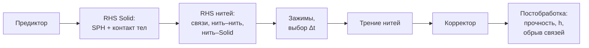

# Математические модели

Раздел описывает математические модели всех взаимодействий в расчётном коде:
уравнения, их дискретизацию и то, как они реализованы. Источник истины — код ветки
`fiber_new` (сверка — 2026-11-14). Каждая глава заканчивается таблицей
«модель → файл → функция».

| Глава | Что охватывает |
|---|---|
| [1. Ядро SPH-расчёта](01-sph-core.md) | Ядра сглаживания (кубическое, гауссово, квинтическое), неразрывность (`density_method`), уравнения движения и энергии (`pa_sph`), скорость деформации и вихрь, искусственная вязкость Монагана, XSPH (`xsph_mode`), длина сглаживания (`sle`), 1D/2D-осесимметрия/3D |
| [2. Определяющие соотношения](02-constitutive.md) | УРС (газ, вода, УА Тэта, Ми–Грюнайзен, Linear, Shock, JH-2), закон Гука в скоростях с производной Яуманна, пластичность Мизеса, керамика JH-2, Джонсон–Кук (упрочнение, температура, разрушение) |
| [3. Контакт SPH-тел и закрепления](03-solid-contact.md) | Штрафной контакт тело–тело (типы 1–3: пинбол Белицко, Свигл, импульсный), выбор контактных пар по `body`, ограничитель шага, зажимы (Clamp), прочие граничные условия |
| [4. Механика нитей](04-fiber-mechanics.md) | Дискретизация нити бусинами и связями, упругая/неупругая осевая связь (пластика, вязкоупругость, повреждённость), обрыв, устойчивость явной схемы, геометрия полотняного переплетения |
| [5. Контакт нитей](05-fiber-contact.md) | Нить–нить (сегмент–сегмент), нить–SPH-частица, законы нормальной силы 0–4 (Герц, пинбол, Свигл, импульсный, Герц+демпфер, режим push), трение проекцией скоростей, статистика контактов |
| [6. Интегрирование по времени](06-time-integration.md) | Предиктор–корректор и Эйлер, порядок операций шага и сборка правой части, выбор $\Delta t$ (CFL, контакты, связи, `dt_scale`), постобработка, журнал энергии, сторож расчёта |

## Единые обозначения

| Символ | Смысл |
|---|---|
| $i, j$ | SPH-частицы; $a, b$ — бусины (узлы) и сегменты нитей |
| $\alpha, \beta$ | декартовы компоненты (верхние индексы), суммирование по повторяющимся |
| $m_j,\ \rho_i,\ p_i,\ e_i$ | масса, плотность, давление, удельная внутренняя энергия |
| $\mathbf x_i,\ \mathbf v_i,\ h_i,\ c_i$ | положение, скорость, длина сглаживания, скорость звука |
| $\mathbf x_{ij}=\mathbf x_i-\mathbf x_j,\ r_{ij}=\lvert\mathbf x_{ij}\rvert,\ \mathbf v_{ij}=\mathbf v_i-\mathbf v_j$ | парные разности |
| $h_{ij}=(h_i+h_j)/2,\ W_{ij}=W(r_{ij},h_{ij})$ | парная длина сглаживания и ядро |
| $\sigma^{\alpha\beta}=-p\,\delta^{\alpha\beta}+s^{\alpha\beta}$ | тензор напряжений, $s^{\alpha\beta}$ — девиатор |
| $\dot\varepsilon^{\alpha\beta},\ \omega^{\alpha\beta}$ | скорость деформации и тензор вихря |
| $d$ | размерность задачи (`dim`, задаётся `SPH_DIM` при сборке) |
| $\mathbf n,\ \delta,\ k,\ \mu$ | нормаль контакта, проникание ($>0$ при перекрытии), жёсткость штрафа, коэффициент трения |
| $\Delta t$ | шаг по времени |

## Как устроен шаг расчёта (кратко)

Подробный порядок — в главе [6](06-time-integration.md#3-порядок-операций-одного-шага-и-сборка-rhs)
и в [обзоре конвейера](../architecture/pipeline-overview.md).

## Замечания к коду, найденные при описании

При сверке формул с кодом отмечены места, которые выглядят как ошибки или
ограничения. Код в рамках работы над документацией не менялся. Подробности —
в соответствующих главах (врезки «warning»).

| Место | Наблюдение | Глава |
|---|---|---|
| [`ppochnost.cpp`](../../../src/ppochnost.cpp), JH-2 | булкинг, упругая часть ($G$ вместо $2G$) и плоский `sigma_i` **исправлены** (ветка `fiber_johnson_holmquist`); скоростной член по умолчанию как в J&H 1999 (без отсечки снизу, флаг `jh2_clamp_low_rate`); константы Al₂O₃ не проверены | [2](02-constitutive.md) |
| `jc::j2_of_deviator` при $d=2$ без осесимметрии | $J_2=s_{xx}^2+s_{xy}^2$ вместо полной формы; ветка сейчас недостижима (`axis_sim` — `constexpr true`) | [2](02-constitutive.md) |
| [`h_upgrade.cpp`](../../../src/h_upgrade.cpp), `sle = 2` | знак $\mathrm dh/\mathrm dt$ противоположен физическому; ветка недостижима — `update_smoothing_length` бросает исключение | [1](01-sph-core.md) |
| Осесимметрия, hoop-члены | деление на $x_j$ без защиты от нуля; ghost-частицы строятся по порогу $2h$ при носителе $3h$ для `skf = 2, 3` | [1](01-sph-core.md) |
| Предел шага нить–Solid, закон 0 | приведённая масса по якорной бусине без учёта $\lambda$, в отличие от остальных законов | [5](05-fiber-contact.md) |
| Трение нить–нить | момент импульса строго не сохраняется (точки приложения разнесены на $D\,\mathbf n$) | [5](05-fiber-contact.md) |
| Обрыв по `SIGMA_U` | вязкий член Кельвина в критерий не входит | [4](04-fiber-mechanics.md) |
| [`diagnostics.hpp`](../../../include/diagnostics.hpp) | комментарий обещает адаптивное уменьшение $\Delta t$; фактически только печать NaN/Inf | [6](06-time-integration.md) |
