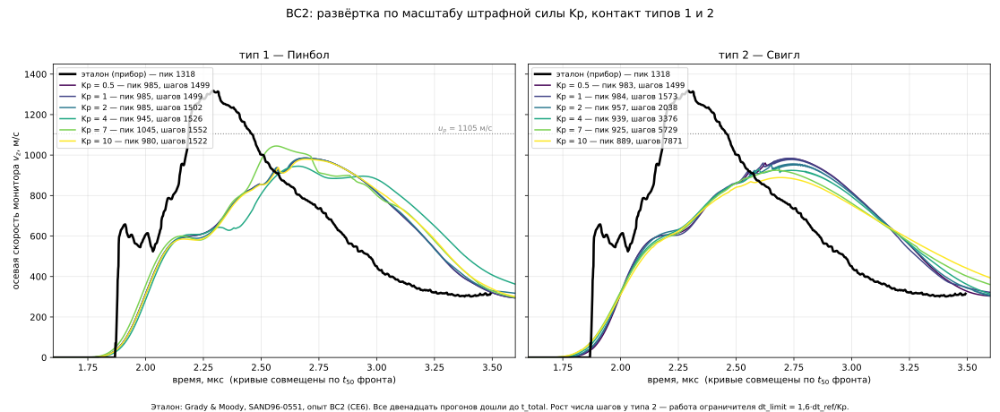

# BC2: развёртка по масштабу штрафной контактной силы Kp

| | |
|---|---|
| **Дата** | 2026-09-22 |
| **Кейс** | BC2 — Grady & Moody, SAND96-0551, опыт CE6 |
| **Ветка / коммит** | `BC6` / `3962a5e` (+ временная заплата, см. [REPRO.md](REPRO.md)) |
| **Прогонов** | 12 (типы контакта 1 и 2 × Kp = 0,5; 1; 2; 4; 7; 10) |
| **Статус** | завершён; все 12 прогонов дошли до `t_total` |
| **Воспроизведение** | [REPRO.md](REPRO.md) |

---

## Вопрос

Параметр `contact_penalty_scale` (в формулах — `Kp`) был отключён владельцем
(`cfbef76`) и по требованию возвращён в расчёт. Вопрос: как `Kp` влияет на
профиль и амплитуду кривой монитора и способен ли он приблизить расчёт к
приборному эталону, пик которого — **1317,5 м/с**, тогда как расчёт даёт
**985,0 м/с** (0,748 эталона).

## Постановка

**Что менялось:** `Kp` ∈ {0,5; 1; 2; 4; 7; 10} и `contact_force_type` ∈ {1, 2}.
Тип 1 — пинбол Белицко, тип 2 — штрафная сила Свигла. Типы 0 (контакт выключен)
и 3 (импульсный) в развёртку не входят: у типа 0 `Kp` не участвует в расчёте,
тип 3 владельцем не запрашивался.

**Что держалось постоянным:** геометрия и постановка BC2 без изменений
(`tests/data/bc2_initial_conditions.txt`, четырёхслойная сборка встык
полиуретан / летящая B4C 3,917 мм / покоящаяся B4C 9,033 мм / окно LiF 25,4 мм),
`delta_x = 2·10⁻⁴` м, `epsilon = 0,25`, CFL по умолчанию, монитор — последний
z-узел покоящейся керамики на оси (граница керамика/окно).

**Что измерялось** по кривой `--emit-curve`: пик `v_z`, число шагов, длительность
фронта по уровням 0,1–0,9 от пика, время спада до 0,7 пика, высота упругого
предвестника (значение через 0,15 мкс после `t10`).

**Существенное по коду.** В вязких ветвях типов 1 и 2 действует ограничитель
шага `dt_limit = 1,6·dt_ref / Kp`, то есть рост `Kp` пропорционально режет шаг
**всего** расчёта, а не только контактных пар. Контакт видит только пары с
разным `itype` (решение D2=A), поэтому граница B4C/B4C для него невидима и вся
работа `Kp` сосредоточена на границе керамика/окно LiF.

## Результат

Эталон: пик **1317,5 м/с**, фронт 10–90 **0,3196 мкс**, спад до 0,7 пика
**0,2632 мкс**, предвестник ≈ 630 м/с.

| Тип | Kp | Шагов | Пик, м/с | Доля эталона | Фронт 10–90, мкс | Спад 70 %, мкс | Предвестник, м/с |
|---|---|---|---|---|---|---|---|
| 1 | 0,5 | 1499 | 985,0 | 0,748 | 0,6228 | 0,4300 | 490 |
| 1 | 1   | 1499 | 985,0 | 0,748 | 0,6228 | 0,4300 | 490 |
| 1 | 2   | 1502 | 985,3 | 0,748 | 0,6191 | 0,4395 | 493 |
| 1 | 4   | 1526 | 945,1 | 0,717 | 0,6040 | 0,5777 | 488 |
| 1 | 7   | 1552 | 1044,8 | 0,793 | 0,5807 | 0,5469 | 499 |
| 1 | 10  | 1522 | 979,7 | 0,744 | 0,6239 | 0,4636 | 489 |
| 2 | 0,5 | 1499 | 983,4 | 0,746 | 0,6189 | 0,3879 | 491 |
| 2 | 1   | 1573 | 983,8 | 0,747 | 0,6169 | 0,3890 | 481 |
| 2 | 2   | 2038 | 956,5 | 0,726 | 0,5916 | 0,3935 | 456 |
| 2 | 4   | 3376 | 939,3 | 0,713 | 0,5757 | 0,4602 | 424 |
| 2 | 7   | 5729 | 924,8 | 0,702 | 0,5798 | 0,4751 | 397 |
| 2 | 10  | **7871** | **889,0** | **0,675** | 0,5588 | 0,5015 | **377** |

Для сравнения, тот же расчёт с выключенным контактом (тип 0): пик 985,0 м/с,
доля 0,748 — совпадает с типами 1 и 2 при `Kp ≤ 2`.

## График

Два поля: слева тип 1 (пинбол), справа тип 2 (Свигл). Шесть кривых `Kp` в каждом
(шкала viridis: тёмное — малые `Kp`, светлое — большие), эталон чёрным.
Кривые совмещены по `t50` фронта, потому что абсолютное время прихода волны
расходится с эталоном по отдельной причине, разобранной в
[2026-09-19-bc2-discrepancy](../2026-09-19-bc2-discrepancy/); здесь сравнивается
форма, а не фаза. Серая пунктирная линия — `u_p = 1105 м/с`, скорость
поршня симметричного удара B4C/B4C.

Что видно на графике:

* **Справа (тип 2) кривые расходятся веером вниз** по мере роста `Kp` — и по
  пику, и по полке предвестника. Порядок кривых точно соответствует порядку `Kp`.
* **Слева (тип 1) кривые лежат почти одна на другой**, выбиваются только `Kp = 4`
  (вниз) и `Kp = 7` (вверх), причём без порядка по `Kp`.
* **Ни одна из двенадцати кривых не приближается к чёрной.** Расстояние по
  амплитуде до эталона не сокращается ни в одном прогоне.
* Фронт у всех кривых вдвое шире эталонного, и `Kp` этого не меняет: 0,56–0,62 мкс
  против 0,32 мкс.

## Вывод

**`Kp` приблизить расчёт к эталону не может — он только отдаляет.**

**Тип 2 (Свигл): зависимость есть, монотонная, в минус.** С ростом `Kp` от 1 до 10
пик падает с 983,8 до 889,0 м/с, то есть с 0,747 до 0,675 эталона, а упругий
предвестник — с 481 до 377 м/с (−22 % при эталонных ≈ 630). Механизм прозрачен:
на потолке сила Свигла вязкая, `F = c_d·ṗ`, и `Kp` есть коэффициент демпфирования
на границе с окном LiF. Контакт работает как дополнительный демпфер ровно в том
месте, где волна и без того теряет амплитуду. Платится за это временем: число
шагов растёт с 1573 до 7871, впятеро, из-за `dt_limit = 1,6·dt_ref/Kp`.
`Kp = 10` стоит впятеро дороже и даёт результат на 10 % хуже.

Ожидание, что произведение `F·dt` окажется от `Kp` независимым (ограничитель
режет шаг ровно настолько, насколько растёт сила), **не подтвердилось**:
компенсация неполная, остаток уходит в диссипацию.

**Тип 1 (пинбол): `Kp` практически не входит в решение.** Пик гуляет в пределах
0,717–0,793 без направления, предвестник стоит на месте (490 ± 5 м/с), число
шагов почти не меняется (1499 → 1552) — то есть контактный ограничитель шага
почти не срабатывает, а значит и сама сила мала. Разброс ±5 % — это
чувствительность решения к малому возмущению на границе LiF, а не тренд по `Kp`.

**Лучшее значение развёртки — `Kp ≤ 1`**, при котором результат совпадает с
выключенным контактом. Уже записанное в конфигурацию значение 2,5 для типа 2
заметно хуже единицы (≈ 0,72 против 0,747) и вдвое дороже по шагам.

Это согласуется с остальными измерениями: недобор 25 % сосредоточен в передаче
волны через границу B4C/LiF (см.
[2026-09-22-bc2-resolution-scheme](../2026-09-22-bc2-resolution-scheme/)), а
штрафной контакт такую передачу не моделирует — он умеет только отталкивать при
проникании и демпфировать сближение. Добавляя его, добавляем диссипацию, тогда
как нужен корректный коэффициент прохождения `2·Z₁/(Z₁+Z₂)`.

## Что осталось неясным

* **Немонотонность типа 1** не объяснена. `Kp = 7` даёт пик выше всех остальных
  прогонов развёртки (1044,8), и это не выброс одного шага — кривая гладкая.
  Отличить «сила изредка срабатывает и подбрасывает границу» от «решение
  чувствительно к любому малому возмущению» на имеющихся данных нельзя: нужен
  счётчик сработавших контактных пар по шагам, которого в развёртке не писали.
* **Тип 3 (импульсный) не проверялся** — владелец ограничил развёртку типами 1 и 2.
* **Шаг развёртки крупный** (0,5; 1; 2; 4; 7; 10). Для типа 2 этого достаточно:
  зависимость монотонна и плавна. Для типа 1 разброс может скрывать структуру,
  видимую только на мелком шаге.
* **BC6 не затрагивался** — по прямому указанию владельца.
