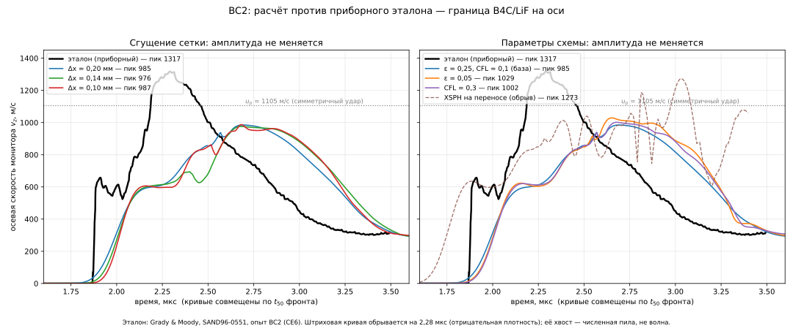

# BC2: разрешение сетки и ключи схемы против недобора амплитуды

| | |
|---|---|
| **Дата** | 2026-09-22 |
| **Кейс** | BC2, базовый прогон (`contact_force_type = 0`) |
| **Ветка / коммит** | `BC6` / `3962a5e` (+ временные заплаты, см. ниже) |
| **Прогонов** | 7 (3 по разрешению, 4 по ключам схемы) |
| **Статус** | завершён; результат отрицательный и решающий |
| **Воспроизведение** | REPRO.md нет — правило введено начиная со следующего эксперимента |

## Вопрос

Расчёт даёт пик 985,0 м/с против эталонных 1317,5 (0,748). Документ
[contact/08-phase-shift.md](../../contact/08-phase-shift.md) §4 объяснял недобор
недостатком разрешения и предсказывал (§6, следствие 1), что при Δx = 0,1 мм
пик вырастет, а фронт сократится примерно вдвое. Вопрос: правда ли это
дискретизационная ошибка, и вытягивается ли амплитуда настройками схемы?

## Постановка

**Разрешение:** Δx = 0,20 / 0,14 / 0,10 мм при неизменной постановке. Задавалось
временной заплатой `SPH_BC2_DELTA_X` в `case_delta_x` (`tests/test_e2e_bc2.cpp`),
откаченной после снятия данных.

**Ключи схемы** при Δx = 0,20 мм: коэффициент XSPH `epsilon` = 0,25 (база) /
0,05 / 0; CFL = 0,1 (база) / 0,3; и отдельно — перенос XSPH-поправки из скорости
в координату. Задавалось временной правкой `tests/data/bc2_initial_conditions.txt`
с восстановлением из резервной копии.

**Почему проверялся именно XSPH.** В `src/time_integration.cpp` поправка
применяется **прямо к скорости**, без домножения на `dt`:
`sys.vx[d][i] = v_min[d][i] + dt*dvx[d][i] + av[d][i]`. Это соглашение Liu & Liu,
и оно делает XSPH пошаговым демпфером: чем больше шагов, тем сильнее затухание.
Отсюда и гипотеза, что измельчение сетки не поможет — выигрыш от разрешения
съедается ростом числа шагов.

## Результат

### Разрешение

| Δx, мм | Шагов | Пик, м/с | Доля эталона | Фронт 10–90, мкс |
|---|---|---|---|---|
| 0,20 | 1499 | 985,0 | 0,748 | 0,6228 |
| 0,14 | 2165 | 975,9 | 0,741 | 0,6408 |
| 0,10 | 3057 | 987,1 | 0,749 | 0,6269 |

Разброс по пику — 1,1 %, по фронту — 2,9 %, без направления. При Δx = 0,20 мм
расчёт содержит 33 944 частицы; при 0,10 мм — вчетверо больше и вдвое больше
шагов, результат тот же.

### Ключи схемы (Δx = 0,20 мм)

| Вариант | Пик, м/с | Доля эталона | Фронт 10–90, мкс | Исход |
|---|---|---|---|---|
| ε = 0,25, CFL = 0,1 (база) | 985,0 | 0,748 | 0,6228 | дошёл |
| ε = 0,05 | 1029,0 | 0,781 | 0,6474 | дошёл |
| CFL = 0,3 | 1001,7 | 0,760 | 0,6096 | дошёл |
| ε = 0 | — | — | — | **обрыв**, ρ < 0 |
| ε = 0, CFL = 0,3 | — | — | — | **обрыв** |
| XSPH перенесён в координату | — | — | — | **обрыв**, ρ < 0 при t ≈ 2,3 мкс |

## График

Слева — три разрешения, справа — ключи схемы; всюду эталон чёрным, кривые
совмещены по `t50` фронта. Левое поле — суть результата: три кривые практически
неразличимы и все три лежат на треть ниже эталона.

Фигура пересобирается из архива за секунду: `python scripts/fig.py` по кривым
из `data/`, пересчёта не требуется.

## Вывод

**Схема сходится по сетке — и сходится к 0,748 эталона.** Значит недобор
амплитуды не дискретизационная ошибка, а ошибка модели. Предсказание
`08-phase-shift.md` §6 (следствие 1) **опровергнуто**, и объяснение «не хватает
разрешения» из §4 того же документа снимается.

Ключи схемы двигают ответ в пределах 0,748–0,781, то есть на единицы процентов
при нужных 34 %. Ни один из них не является решением.

**Снижать XSPH нельзя без замены стабилизатора.** При ε = 0 и при переносе
поправки в координату расчёт разваливается по отрицательной плотности. То есть
член XSPH сейчас несёт нагрузку стабилизатора, а не только сглаживателя, и его
демпфирование — цена устойчивости, а не отдельно стоящий дефект.

Куда смотреть дальше: измеренный профиль пика по глубине на оси даёт
1130 (z = 16,64 мм) → 1054 (z = 18,65) → **984,6 (монитор, z = 18,85)** →
969,9 (первая частица LiF). На границе B4C/LiF ожидается **усиление**
`2·Z₁/(Z₁+Z₂)` ≈ 1,13–1,27, а получается ослабление ×0,9. Это и есть основная
доля дефицита.

## Что осталось неясным

* **Заявление, снятое по ходу работы.** Прогон с ε = 0 сначала был доложен как
  прорыв («пик 985 → 1194 м/с»). При проверке формы кривая оказалась пилой после
  1,5 мкс (935 → 1044 → 814 → 1034 → 849 → 1097) с последующим обрывом при
  ρ = −55,5. Число недействительно, и то же самое повторилось с прогоном
  «XSPH в координате» (кажущийся пик 1273,3). **Пик оборвавшегося расчёта
  измерять нельзя** — это артефакт разваливающегося решения.
* Чем заменить XSPH как стабилизатор, не проверялось.
* Почему на границе B4C/LiF вместо усиления получается ослабление — вопрос
  открыт; это главное, что осталось.
