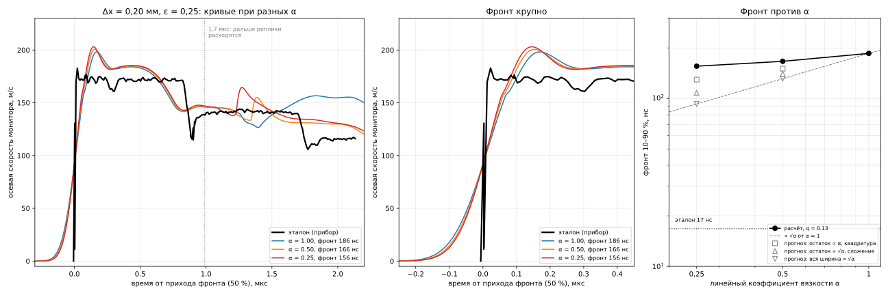

# BC6: искусственная вязкость и ширина фронта

| | |
|---|---|
| **Дата** | 2026-09-23 |
| **Кейс** | BC6 — откольный опыт на B4C (ударник и окно PMMA), `contact_force_type = 0` |
| **Ветка / коммит** | `BC6` / `0e18976` — «Эксперимент: BC6, число частиц против плавности переходов» |
| **Прогонов** | 2 (α = 0,5 и 0,25); кривая α = 1,0 взята из stage A |
| **Статус** | завершён. Гипотеза «основную ширину фронта задаёт α» **не подтвердилась**: фронт ∝ α^0,13, α = 0,25 укорачивает его лишь на 16 %; счёт при этом устойчив |
| **Воспроизведение** | [REPRO.md](REPRO.md) + [repro-diff.zip](repro-diff.zip) (заплата 01 обязательна) |
| **Предыдущие** | [stage A — сетка](../2026-09-23-bc6-resolution/), [stage B — XSPH](../2026-09-23-bc6-xsph/) |

## Вопрос

Stage A и B показали, что ни сетка, ни XSPH основную ширину фронта не задают:
без XSPH остаётся ≈ 153 нс из 186 (оценка), и этот остаток убывает с сеткой
как Δx^0,47. Показатель около 0,5 — подпись диффузионного размытия упругой
волны на пути по образцу, которое даёт линейный член искусственной вязкости
(вязкость ∝ α·h·c, ширина ∝ √(α·h·L)). **Задаёт ли искусственная вязкость
основную ширину фронта — убывает ли фронт при уменьшении α как √α?**

## Постановка

**Что меняется:** только линейный коэффициент искусственной вязкости α —
1,0 (штатный) / 0,5 / 0,25.

| α | Тег | Статус |
|---|---|---|
| 1,0 | `a100_dx020` | есть — копия кривой `dx020` из stage A |
| 0,5 | `a050_dx020` | прогон |
| 0,25 | `a025_dx020` | прогон |

**Что держится постоянным:** Δx = 0,2 мм (44 638 частиц), ε (XSPH) = 0,25,
β = 1, `etq` = 0,01, тип контакта 0, CFL = 0,1, `sle = 1`, геометрия и
правило раскладки, `t_total` = 4,3 мкс. Полная таблица штатных параметров —
в [stage A](../2026-09-23-bc6-resolution/README.md), «Постановка».

**Где α в коде.** Искусственная вязкость Монагана,
[src/art_visc.cpp:59](../../src/art_visc.cpp#L59):
Π = (β·μ² − α·c̄·μ)/ρ̄, только для сближающихся пар. α — линейный член,
пропорциональный скорости звука; β — квадратичный, работает на сильных
скачках. β не трогается, чтобы менять один механизм.

**Как задаётся α.** Временной заплатой в `tests/test_e2e_bc6.cpp`: α
берётся из переменной окружения `SPH_BC6_ALPHA` (патч 01 в архиве), по
образцу `SPH_BC6_EPSILON` из stage B. В репозиторий не коммитится;
`scripts/one.sh` сверяет значение из лога с заданным как число и без
совпадения помечает кривую `INVALID_`.

**Метрики — только ранние, до ≈ 1,7 мкс** (позже расчёт недетерминирован):
фронт 10–90 % по фиксированному уровню — плато 1 кривой α = 1,0; сдвиг t50;
выброс и звон за фронтом; уровень плато 1; момент отхода от α = 1,0. Те же
определения, что в stage B (`scripts/fig.py`).

**Прогнозы и решающее правило — записаны до получения результатов.**
Фронт при α = 1,0 — 185,5 нс. Оценка stage B: без XSPH остаток ≈ 153,4 нс,
вклад XSPH в квадратуре ≈ √(185,5² − 153,4²).

| Модель | α = 0,5, нс | α = 0,25, нс |
|---|---|---|
| остаток после XSPH целиком от α, диффузия (ширина² ∝ α) | ≈ 150 | ≈ 130 |
| то же, ширины складываются линейно (остаток ∝ √α) | ≈ 140 | ≈ 108 |
| вся ширина ∝ √α | ≈ 131 | ≈ 93 |
| α на ширину не влияет | ≈ 185 | ≈ 185 |

| Исход | Вывод |
|---|---|
| фронт в полосе 108–150 нс при α = 0,25 и монотонно по α | гипотеза подтверждена: основную ширину задаёт линейный член вязкости |
| фронт почти не меняется (≥ 175 нс) | гипотеза опровергнута; источник — не α (остаются β, монитор, сама схема) |
| фронт короче 108 нс | α действует сильнее, чем диффузия остатка; вклад XSPH оценён неверно |
| обрыв (ρ < 0) до 1,7 мкс | точка теряется для метрик после отхода; фронт берётся, если отход — после него |

## Результат

Прогоны — 2026-09-23, 23:25–23:35, заплата 01 наложена, по 6 потоков, два
одновременно. Оба дошли до `t_total` без обрыва. Числа — из
`data/summary.txt` (`scripts/fig.py`).

### Фронт укорачивается, но слабо: q = 0,13 вместо 0,5

| α | Шагов | Фронт 10–90 %, нс | Доля от α = 1 | Сдвиг t50, нс | Выброс за фронтом, м/с | Размах выброса, м/с | Плато (t50 + 0,15…0,30), м/с |
|---|---|---|---|---|---|---|---|
| 1,00 | 1615 | 185,5 | 1,000 | 0,0 | 198,2 | 16,1 | 190,2 |
| 0,50 | 1616 | 166,5 | 0,897 | +6,1 | 200,6 | 18,5 | 187,4 |
| 0,25 | 1618 | 155,7 | 0,839 | +9,6 | 203,1 | 21,4 | 185,8 |
| эталон | | 16,8 | | | 182,8 | | 171,5 |

Фронт по фиксированному уровню 183,4 м/с (плато 1 кривой α = 1,0). Подгонка
фронт ∝ α^q по трём точкам: **q = 0,13** (закон √α дал бы 0,5).

**Сравнение с прогнозами, записанными до прогонов:**

| Модель | α = 0,5, нс | α = 0,25, нс |
|---|---|---|
| остаток после XSPH целиком от α, квадратура | 150 | 130 |
| то же, линейное сложение | 140 | 108 |
| вся ширина ∝ √α | 131 | 93 |
| α не влияет | 185 | 185 |
| **измерено** | **166,5** | **155,7** |

Измерение не попало ни в одну из заранее записанных полос: при α = 0,25 фронт
155,7 нс — выше верхней границы полосы «гипотеза подтверждена» (150 нс) и
ниже порога «α не влияет» (175 нс). Ближе всего к измерению — промежуточный
случай, которого решающее правило не предусматривало: α влияет, но слабо.

Экстраполяция к α = 0 (оценка по трём точкам): 146 нс, если фронт линеен по
α, и 125 нс, если линеен по √α. Вклад α при штатном α = 1 — 40–60 нс из 186.

### После фронта α почти ничего не меняет

* **Устойчивость.** Обрывов нет, число шагов то же (1615–1618). В отличие от
  XSPH (stage B), α можно уменьшать вчетверо без потери устойчивости.
* **Выброс и звон за фронтом** растут слабо: размах 16,1 → 18,5 → 21,4 м/с
  (при ε = 0,05 в stage B — 34,5).
* **Плато 1 и провал 1** — те же: длительность плато 0,668 / 0,676 / 0,682
  мкс, провал 1 при α = 1,0 и 0,5 — 0,814 / 0,825 мкс, 141,9 / 141,5 м/с.
  При α = 0,25 экстрактор провал 1 не находит: минимум в окне поиска
  смещается на поздний спад около t50 + 1,2 мкс, уже в зоне недетерминизма.
* **Отход от α = 1,0** больше чем на 10 м/с — только при t50 + 1,35 и 1,24 мкс,
  то есть после 1,7 мкс по абсолютному времени, где реплики одной сетки
  расходятся и без изменения α (stage A). Это не действие α.

## График

**Слева** — кривые при трёх α с эталоном, совмещённые по t50. До 1,7 мкс они
почти совпадают; расхождение после — зона недетерминизма.
**В центре** — фронт крупно: при меньшем α фронт чуть круче и чуть позже,
выброс чуть выше, но «подошва» фронта (от −0,2 мкс) у всех трёх одна и та же.
**Справа** — фронт против α в логарифмическом масштабе: чёрная линия
измерения почти горизонтальна; пунктир — закон √α; пустые значки — прогнозы.

`python scripts/fig.py` пересобирает таблицы и фигуру из `data/` за секунду.

## Вывод

**1. Гипотеза «основную ширину фронта задаёт линейный член искусственной
вязкости» не подтвердилась.** Фронт ∝ α^0,13, а не α^0,5; при уменьшении α
вчетверо он укорачивается лишь на 16 % (185,5 → 155,7 нс). Вклад α при
штатном значении — 40–60 нс (оценка), сопоставимо с вкладом XSPH (≈ 30 нс,
stage B), но не основная часть.

**2. Три проверенных механизма вместе не объясняют ширину фронта.** Сетка
(stage A) убывает как Δx^0,4, XSPH даёт ≈ 30 нс, линейная вязкость — 40–60 нс.
Если вклады складываются, без XSPH и без α осталось бы порядка 100 нс (грубая
оценка) — при эталоне 17 нс. Основной источник плавности не найден.

**3. α — безопасный рычаг, но слабый.** В отличие от ε, уменьшение α не
разрушает счёт. Если уменьшать сглаживание, то α, а не ε, — но выигрыш
ограничен ≈ 16 % при α = 0,25.

**4. Подсказка к следующему шагу.** На центральной панели «подошва» фронта —
пологий подъём от −0,2 мкс — у всех α одинакова; α меняет только верхнюю
часть фронта. Это похоже на то, что плавность рождается не на пути волны по
образцу (там бы действовала вязкость), а раньше — на плоскости удара, где
нагрузка в B4C нарастает с темпом, заданным медленной волной в ударнике PMMA
(c ≈ 2,7 км/с против 14,1 в B4C) на ширине ядра. Это гипотеза.

## Что осталось неясным

* **Где рождается ширина фронта** — на плоскости удара или на пути по
  образцу. Проверяется профилем скорости по глубине образца в одном прогоне
  (кадры, `--keep-workdir`): если подъём первого слоя B4C у плоскости удара
  уже ≈ 150 нс, то путь по образцу ни при чём. Шаг кадров 50 нс для этого
  грубоват — понадобится `save_t` мельче.
* **Квадратичный член вязкости β** не варьировался. На упругой волне в B4C он
  мал, но на ударной волне в PMMA-ударнике может задавать темп нагрузки.
* **Разброс реплик при α < 1** не измерялся; при α = 1 до 1,7 мкс его нет.
* Решающее правило, записанное до прогонов, не предусмотрело промежуточного
  исхода «влияет, но слабо»; результат описан как есть, а не притянут к
  ближайшей строке.
