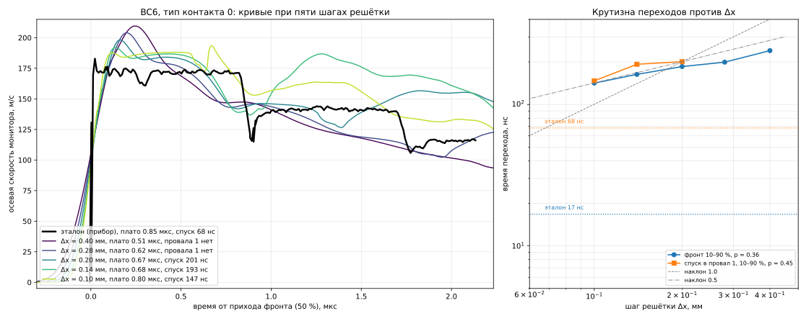

# BC6: число частиц против плавности переходов

| | |
|---|---|
| **Дата** | 2026-09-23 |
| **Кейс** | BC6 — откольный опыт на B4C (ударник и окно PMMA), `contact_force_type = 0` |
| **Ветка / коммит** | `BC6` / `e65b132` — «Журнал экспериментов: каталог experiments с шестью карточками» |
| **Прогонов** | 7 в этой серии (пять шагов решётки + два повтора при Δx = 0,2 мм) и кривая цели `bc6_plot` как третий повтор |
| **Статус** | завершён для Δx = 0,40…0,10 мм; ступень 0,05 мм подготовлена (`scripts/run_dx005.sh`), но не считалась — нужна машина мощнее. Гипотеза подтверждена по направлению и опровергнута как достаточное объяснение |
| **Воспроизведение** | [REPRO.md](REPRO.md) + [repro-diff.zip](repro-diff.zip) |

## Вопрос

Расчётная кривая монитора плавнее эталонной: фронт, уход с плато и спуск в
провал растянуты по времени. Задаёт ли эту плавность число частиц, и
приближается ли кривая к эталону при измельчении сетки?

## Постановка

**Штатная постановка и что изменено.** Штатная — это то, что считает цель
`bc6_plot` и тест `e2e_bc6_full_*`: `tests/bc6_case.hpp` плюс
`tests/data/bc6_initial_conditions.txt`.

| Параметр | Штатная постановка | Этот эксперимент |
|---|---|---|
| **шаг решётки Δx** | **0,2 мм** (`kDxFull`), 44 638 частиц | **0,40 / 0,28 / 0,20 / 0,14 / 0,10 мм** через `--delta-x`, 11 303 … 177 645 частиц |
| тип контакта | 0, 1, 2, 3 — четыре прогона | только 0 |
| потоки OpenMP | не задаются: по умолчанию все 12 | 6 на прогон, два прогона одновременно |
| бюджет времени прогона | 1800 с (`SPH_BC6_RUN_TIME_LIMIT`) | 21 600 с (`--time-limit`), иначе 0,14 и 0,10 мм не успели бы |
| сохранение кадров | нет | нет; одна реплика — с `--keep-workdir` для разбора D |
| проверки §2.4 и §6 | выполняются | тест при `--delta-x` их пропускает; метрики считает `scripts/fig.py` |
| геометрия: тела, толщины, радиусы, ρ₀, `itype`, 913 м/с, сборка встык | `tests/bc6_case.hpp` | **без изменений** |
| правило раскладки `n = floor(T/Δx) + 1` | — | **без изменений** (см. ниже о дрейфе толщины) |
| `pa_sph = 2`, `nnps = 2`, `sle = 1`, `skf = 1` | конфигурация | **без изменений** |
| CFL = 0,1; α = β = 1; `etq` = 0,01; ε (XSPH) = 0,25 | конфигурация | **без изменений** |
| `t_total` = 4,3 мкс; `save_t` = 50 нс | конфигурация | **без изменений** |
| `contact_impulse_gamma` = 0,5; `contact_penalty_scale` закомментирован | конфигурация | без изменений (при типе 0 не читаются) |
| код решателя и теста | `ed4cd3d` (позже коммиты код не меняли) | **без изменений**, патчей нет |

**Что меняли:** шаг решётки Δx = 0,40 / 0,28 / 0,20 / 0,14 / 0,10 мм, то есть
от 11 303 до 177 645 частиц, с удвоением на каждой ступени. Шаг задавался штатным
ключом `--delta-x` теста `test_e2e_bc6`; код не правился.

**Что держали постоянным:** все параметры решателя из
`tests/data/bc6_initial_conditions.txt` (CFL = 0,1, α = β = 1, ε = 0,25,
`sle = 1`), тип контакта 0, `t_total` = 4,3 мкс. Длина сглаживания
масштабируется с сеткой сама: `sle = 1` на первом шаге ставит h = 1,3·Δx.

**Что меняется вместе с Δx помимо разрешения — и не устранялось:**

* **Толщина тел.** Штатное правило раскладки `n = floor(T/Δx) + 1` даёт
  ударнику эффективную толщину n·Δx = 2,400 / 2,240 / 2,200 / 2,100 / 2,100 мм
  против номинальных 2,004. Геометрия не менялась по ограничению владельца
  («не менять постановку задачи и геометрию»). Влияние оценено по результату,
  см. «Вывод», п. 4.
* **Число шагов** растёт как 1/Δx (807 → 3232), а XSPH-поправка прибавляется к
  скорости без множителя `dt`, то есть её суммарный вклад растёт вместе с числом
  шагов. Отдельно не варьировалась.
* **Радиус осевого монитора** — r = Δx/2, от 0,20 до 0,05 мм.

**Реплики.** По ходу обнаружилось, что расчёт недетерминирован (см.
«Результат»). Поэтому при Δx = 0,2 мм, кроме основного прогона, есть ещё три:
повтор на тех же 6 потоках, повтор с сохранением кадров (`--keep-workdir`, по
ним разобрано повреждение) и кривая цели `bc6_plot` из `build/bc6_curves`.
Все восемь кривых посчитаны одним и тем же бинарём `build/test_e2e_bc6.exe`
(собран 2026-09-23 в 12:51) с одной и той же конфигурацией. Кривая `bc6_plot`
получена в 13:36 — до коммита `ed4cd3d` (14:39), но из тех же исходников:
его файлы, входящие в сборку теста, в последний раз менялись не позже
12:51, а после `ed4cd3d` исходники, тесты и CMake не менялись вовсе.
Конфигурация `tests/data/bc6_initial_conditions.txt` последний раз правилась
в 13:27, до всех прогонов, и совпадает с закоммиченной.

**Метрики** (определения — в `scripts/fig.py`, все кривые совмещены по моменту
t50, когда скорость достигает 50 % пика):

* *фронт 10–90* — время подъёма от 10 до 90 % уровня плато 1;
* *длительность плато 1* — от t50 до первого падения ниже 0,9 уровня плато 1;
* *спуск 10–90* — время спуска с плато 1 в провал 1;
* *провал* засчитывается, только если минимум лежит внутри окна поиска
  (фронт + 0,6…1,2 мкс), а не на его краю, то есть это не монотонный спад;
  *возврат* — подъём после дна в пределах 0,3 мкс;
* *RMS* — отклонение от эталона на всей эталонной записи (2,13 мкс после фронта).

## Результат

### Число частиц

Посчитано функцией `bc6::plan_geometry` из `tests/bc6_geometry.hpp` — той же,
которой тест раскладывает частицы ([scripts/particles.cpp](scripts/particles.cpp) →
[data/particles.txt](data/particles.txt)). Отдельный расчёт нужен потому, что
оборванный прогон 0,10 мм отчёт о геометрии в лог не печатает. На четырёх
остальных уровнях числа совпадают со строками «всего частиц» в
`data/run_*.log`, вплоть до номеров мониторов.

| Δx, мм | Всего | Пена, n_r × n_z | Ударник, n_r × n_z | Образец B4C, n_r × n_z | Окно, n_r × n_z | Рост к предыдущему | Монитор (индекс с нуля), r |
|---|---|---|---|---|---|---|---|
| 0,40 | **11 303** | 109 × 21 = 2289 | 109 × 6 = 654 | 95 × 27 = 2565 | 95 × 61 = 5795 | — | #2969, 0,200 мм |
| 0,28 | **22 772** | 156 × 29 = 4524 | 156 × 8 = 1248 | 136 × 38 = 5168 | 136 × 87 = 11 832 | ×2,01 | #5809, 0,140 мм |
| 0,20 | **44 638** | 219 × 41 = 8979 | 219 × 11 = 2409 | 190 × 53 = 10 070 | 190 × 122 = 23 180 | ×1,96 | #11440, 0,100 мм |
| 0,14 | **90 577** | 313 × 58 = 18 154 | 313 × 15 = 4695 | 272 × 76 = 20 672 | 272 × 173 = 47 056 | ×2,03 | #22924, 0,070 мм |
| 0,10 | **177 645** | 438 × 81 = 35 478 | 438 × 21 = 9198 | 381 × 106 = 40 386 | 381 × 243 = 92 583 | ×1,96 | #44781, 0,050 мм |
| 0,05 ² | **706 406** | 875 × 161 = 140 875 | 875 × 41 = 35 875 | 761 × 211 = 160 571 | 761 × 485 = 369 085 | ×3,98 | #176960, 0,025 мм |

² **Подготовлено, не считалось.** На машине этой серии (15,2 ГБ ОЗУ, свободно 4,6)
не хватает памяти: буфер пар 140·N·40 Б — около 4 ГБ, выделяется заново на
каждом шаге; всего ≈ 5 ГБ (оценка по рабочему набору 1,2 ГБ при 0,10 мм).
Время — порядка 10 ч на 6 потоках (оценка). Запуск: `scripts/run_dx005.sh`,
см. [REPRO.md](REPRO.md), §7.

n_r — столбцов по радиусу, n_z — слоёв по толщине. По толщине ударника
приходится от 6 до 21 слоя, по толщине образца — от 27 до 106. Ширина ядра
при `sle = 1` — h = 1,3·Δx, поэтому зона сглаживания (≈ 2h) занимает от 43 %
толщины ударника при 0,40 мм до 13 % при 0,10 мм (оценка по номинальным 2,004 мм).

### Лестница по Δx

| Δx, мм | Частиц | Шагов | Время, с | Пик, м/с | Плато 1, м/с | Длит. плато 1, мкс | Фронт 10–90, нс | Спуск 10–90, нс | Провал 1: t, мкс / v, м/с | Возврат, м/с | Плато 2, м/с | Отн. 1→2 | RMS, м/с |
|---|---|---|---|---|---|---|---|---|---|---|---|---|---|
| **эталон** | — | — | — | 182,8 | 171,5 | **0,853** | 16,8 | **68,2** | 0,903 / 114,9 | 27,3 | 141,7 | 0,826 | — |
| 0,40 | 11 303 | 807 | 87 | 209,6 | 186,6 | 0,512 | 240,5 | нет провала | нет | — | 122,1 | 0,654 | 23,50 |
| 0,28 | 22 772 | 1154 | 299 | 204,0 | 179,8 | 0,622 | 199,3 | нет провала | нет | — | 124,1 | 0,690 | 21,18 |
| 0,20 | 44 638 | 1615 | 679 | 198,2 | 183,4 | 0,668 | 185,5 | 200,9 | 0,814 / 141,9 | 4,4 | 137,0 | 0,747 | 24,93 |
| 0,14 | 90 577 | 2310 | 1961 | 192,0 | 185,7 | 0,683 | 163,3 | 192,6 | 0,884 / 136,9 | 43,4 | 181,1 | 0,976 | 33,03 |
| 0,10 | 177 645 | 3232 ¹ | 4726 | 193,5 | 187,3 | 0,799 | 141,7 | 147,0 | 0,908 / 153,0 | 10,0 | 163,1 | 0,871 | 21,15 |

Доли от эталона при Δx = 0,20 → 0,10 мм: пик 1,084 → 1,059; плато 1
1,069 → 1,092; длительность плато 1 0,78 → 0,94; фронт ×11,0 → ×8,4; спуск
×2,95 → ×2,16.

¹ Прогон 0,10 мм **оборвался** на шаге 3232 при t = 4,288 мкс (99,7 %
расчёта): отрицательная плотность частицы B4C #44737. Если номер в сообщении
конвейера — индекс с нуля, как у монитора, то это осевой столбец образца
(i_r = 0), слой i_z = 61 из 106, то есть середина образца по толщине: образец
начинается с индекса 44 676 (`data/particles.txt`). До 3,0 мкс кривая чистая
(СКО ряби 0,02 м/с), после 3,0 мкс рябь растёт до 0,7–1,0 м/с, в последние
90 нс — до 11 м/с. Все метрики таблицы, включая окно RMS (до ≈ 2,85 мкс),
берутся из чистой части; хвост после 3,0 мкс не используется.

Время — стенное, 6 потоков OpenMP. Все прогоны, кроме 0,40 мм, шли
параллельно с другим прогоном и делили с ним машину (12 логических ядер),
поэтому их время завышено относительно одиночного прогона.

**Подгонка время перехода ∝ Δx^p** (`scripts/fig.py`):

| Величина | p | Точек | Δx, при котором достигается эталон (экстраполяция) |
|---|---|---|---|
| фронт 10–90 | 0,36 | 5 | 0,00027 мм — недостижимо |
| спуск в провал 1 | 0,45 | 3 (0,20 / 0,14 / 0,10) | 0,016 мм |

Оценка стоимости при Δx = 0,016 мм: около 6,6 млн частиц (N ∝ Δx⁻²).
Стенное время растёт как Δx^−2,8 (679 → 4726 с при переходе 0,2 → 0,1 мм),
отсюда порядка 10⁶ с, то есть более недели на прогон. Это оценка, не измерение.

### Воспроизводимость (Δx = 0,2 мм)

| Реплика | Пик / плато 1 / фронт / спуск / провал 1 | Плато 2, м/с | RMS, м/с | Расхождение с основным: начало; RMS разности 1–2 / 2–3 / 3–4,3 мкс; максимум |
|---|---|---|---|---|
| основной, 6 потоков | 198,2 / 183,4 / 185,5 / 200,9 / 141,9 | 137,0 | 24,93 | — |
| повтор, 6 потоков | **то же** | 141,5 | 19,04 | 1,726 мкс; 0,14 / 22,48 / 29,43 м/с; 33,7 м/с |
| повтор с кадрами, 6 потоков | **то же** | 141,3 | 19,04 | 1,715 мкс; 0,16 / 22,51 / 30,35 м/с; 32,8 м/с |
| цель `bc6_plot` | **то же** | 138,4 | 24,40 | 1,718 мкс; 0,34 / 2,20 / 5,36 м/с; 14,3 м/с |

До ≈ 1,7 мкс все четыре кривые совпадают с точностью печати, и все ранние
метрики совпадают до десятых. После этого реплики расходятся и после ≈ 2,1 мкс
распадаются на две ветви: при 3,5 мкс 106,5 и 108,1 м/с (основной и
`bc6_plot`) против 77,7 и 77,2 м/с (оба повтора). **Расчёт недетерминирован** даже при одинаковом
числе потоков.

### Повреждение в образце (реплика с кадрами, [data/damage_dx020.txt](data/damage_dx020.txt))

| t, мкс | Частиц B4C с D ≥ 0,99 (из 10 070) | D монитора | D частицы на слой глубже | Где |
|---|---|---|---|---|
| 0,10 | 194 | 0,00 | 0,00 | слой на плоскости удара, по всему радиусу |
| 0,80 | 458 | **1,00** | 0,00 | + весь тыльный слой (граница с окном), **включая монитор** |
| 1,30 | 5068 | 1,00 | 0,00 | слой на глубине 2,1–6,3 мм — целиком по радиусу |
| 2,00 | 6458 | 1,00 | 0,00 | передние 6,3 мм образца полностью |
| 2,20 | 6524 | 1,00 | **1,00** | разрушение доходит до монитора изнутри, вдоль оси |
| 4,20 | 7733 | 1,00 | 1,00 | у оси (r < 2 мм) — всё; на r = 10–30 мм тыльная часть почти цела |

**Монитор разрушен (D = 1) с 0,7–0,8 мкс** — с прихода фронта (t50 = 0,72 мкс),
то есть на протяжении всей полезной записи. То же происходит со всем слоем на
плоскости удара, уже к 0,1 мкс. Оба слоя граничат с другим материалом (PMMA).

Расхождение реплик начинается при 1,7 мкс и ветвится около 2,1–2,2 мкс —
тогда, когда разрушение изнутри образца доходит до слоя под монитором (D этой
частицы 0 → 1 между 2,1 и 2,2 мкс) и до зоны вокруг него (r < 2 мм, 2 мм от
тыла: 10 → 37 разрушенных из 100 между 1,9 и 2,2 мкс). На ветви «повтор» в этот
же момент на кривой скачок.

*Поправка по ходу работы.* Колонка `N` в кадре нумерует частицы с единицы, а
номер монитора в логе теста (#11440) — с нуля. В первой версии разбора монитором
по ошибке считалась частица N = 11440, то есть соседняя на слой глубже, и из
этого был сделан вывод «монитор цел до 2,2 мкс». Он снят: сам монитор — это
N = 11441, и он разрушен с 0,8 мкс.

## График

**Слева** — пять кривых и эталон, совмещённые по t50. Плато 1 при измельчении
заметно удлиняется: при 0,40 мм кривая начинает спадать через 0,25 мкс после
фронта и уходит монотонно, провала нет; при 0,10 мм держится до 0,55 мкс, затем
резкий спад и пик. Эталонное плато ровное и держится до 0,85 мкс. После
≈ 1,0 мкс от фронта кривые при разных Δx расходятся без порядка — это та же
область, где расходятся и реплики одной сетки.

**Справа** — фронт и спуск в провал в логарифмическом масштабе с
направляющими наклона 0,5 и 1,0. Обе величины падают, насыщения на отрезке
0,40–0,10 мм нет, но наклон ниже 0,5. Пунктирные уровни эталона остаются
далеко внизу.

Фигура пересобирается из `data/` за секунду: `python scripts/fig.py`.

## Вывод

**1. Число частиц влияет на плавность, и заметно — в отличие от BC2.** На
отрезке 0,40 → 0,10 мм, то есть при 16-кратном росте числа частиц, фронт
укорачивается с 240 до 142 нс, плато 1 удлиняется с 0,51 до 0,80 мкс
(эталон 0,85), а провал 1 появляется только при Δx ≤ 0,20 мм. Его момент
сходится к эталону: 0,814 → 0,884 → 0,908 мкс против 0,903. Насыщения нет.
В BC2 фронт при измельчении 0,20 → 0,10 мм не изменился
([2026-09-22-bc2-resolution-scheme](../2026-09-22-bc2-resolution-scheme/)); в
BC6 он сокращается.

**2. Но сходимость медленная, и числом частиц эталон не достигается.**
Показатель p = 0,36 для фронта и 0,45 для спуска в провал. Спуск эталонной
крутизны (68 нс) по экстраполяции требует Δx ≈ 0,016 мм — около 6,6 млн
частиц и больше недели на прогон (оценка). Фронт эталона (17 нс) недостижим
вовсе. Реалистичный предел этой машины — 0,10 мм — даёт спуск 147 нс, вдвое
положе эталона.

**3. Всё, что позже ≈ 1,7 мкс, по одному прогону не интерпретируется.**
Реплики одной сетки расходятся до 33,7 м/с. Расхождение совпадает по времени с
тем, как разрушение по JH-2 доходит изнутри образца до зоны монитора, и
развивается скачками: переход D из 0 в 1 пороговый, и от ошибок округления
зависит, какая частица разрушится первой. Поэтому плато 2, отношение ступеней, провал 2, возврат
после провала 1 и RMS от эталона между сетками не сравнимы: отношение 1→2 при
измельчении прыгает 0,654 / 0,690 / 0,747 / 0,976 / 0,871, RMS — 23,5 / 21,2 /
24,9 / 33,0 / 21,2 м/с, а у реплик одной сетки RMS лежит в 19,0–24,9 м/с.
**Общее согласие с эталоном при измельчении не улучшается.** Второй провал не
появился ни при одном Δx.

**4. Дрейф толщины ударника результат не определяет.** При 0,14 и 0,10 мм
эффективная толщина ударника одинакова (2,100 мм), а момент провала 1
отличается (0,884 и 0,908 мкс). На всей лестнице провал 1 сдвигается позже,
хотя ударник становится тоньше, то есть в обратную сторону от того, чего ждали
бы от толщины. Столбец `t_пр1·2.004/h` в `data/summary.txt` — пересчёт в
предположении, что момент провала пропорционален толщине ударника, — этим
опровергается и оставлен только как запись проверки.

**5. Уровни от разрешения не зависят и остаются выше эталона.** Плато 1
держится на 180–187 м/с при эталонных 171,5, то есть на 5–9 % выше, и с
измельчением не уходит вниз. Это согласуется с §5.4 постановки: уровень
задаётся ударными адиабатами, а не сеткой. Пик сходится к эталону сверху:
209,6 → 193,5 м/с при эталонных 182,8.

## Что осталось неясным

* **Причина недетерминизма в деталях.** Установлено совпадение по времени с
  приходом разрушения в зону монитора, но какая именно операция вносит разницу, не
  выделялось. Вероятный путь — порядок суммирования в параллельных циклах
  OpenMP, но это не проверено.
* **Разброс реплик при 0,14 и 0,10 мм** не измерялся. Выраженность провала 1
  (43,4 м/с при 0,14 мм против 10,0 при 0,10) и подъём кривой 0,14 мм до
  181 м/с после провала могут быть одной реализацией из нескольких.
* **Вклад XSPH** в оставшуюся плавность не отделён. Серия с ε = 0,05 при
  0,20 и 0,10 мм планировалась как следующая ступень.
* **Монитор разрушен с прихода фронта.** Тыльный слой образца, граничащий с
  окном, и слой на плоскости удара, граничащий с ударником, получают D = 1
  при первом же нагружении — в режиме, который постановка называет упругим
  (≈ 3,6 ГПа, ниже HEL). Похоже на краевой артефакт на границе материалов,
  того же семейства, что угловая частица из §7.4 отчёта, но здесь это не
  разбиралось. Если это артефакт, то вся измеряемая кривая снята с
  разрушенной частицы. **Это отдельный вопрос и, по-видимому, более важный,
  чем разрешение.**
* **Масштаб разрушения в объёме.** К 2,0 мкс полностью разрушены передние
  6,3 мм образца. Правдоподобно ли это, не разбиралось; возможно, именно здесь
  главная причина отсутствия второго провала.
* **Обрыв прогона 0,10 мм** при 4,288 мкс (ρ < 0 у частицы B4C #44737) не
  разбирался. По номеру это, вероятно, осевой столбец в середине образца, то
  есть зона, где к этому времени всё разрушено (D = 1), но это вывод из
  нумерации, а не из кадров.
