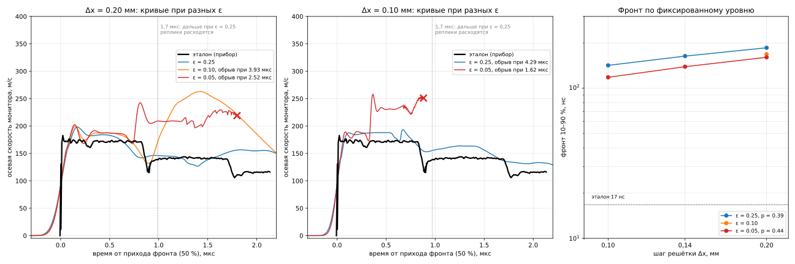

# BC6: вклад XSPH в плавность переходов

| | |
|---|---|
| **Дата** | 2026-09-23 (подготовка и прогоны — в один день) |
| **Кейс** | BC6 — откольный опыт на B4C (ударник и окно PMMA), `contact_force_type = 0` |
| **Ветка / коммит** | `BC6` / `0e18976` — «Эксперимент: BC6, число частиц против плавности переходов» |
| **Прогонов** | 4 из 5 запланированных, все четыре оборвались по ρ < 0; 3 кривые с ε = 0,25 взяты из stage A; ступень Δx = 0,05 мм не запускалась |
| **Статус** | завершён для Δx = 0,20…0,10 мм; **результат отрицательный и решающий**: XSPH в этом кейсе — стабилизатор, снижать ε нельзя. Ступень Δx = 0,05 мм подготовлена (`scripts/run_e005_dx005.sh`), **не запускать** на машине серии |
| **Воспроизведение** | [REPRO.md](REPRO.md) + [repro-diff.zip](repro-diff.zip) (заплата 01 обязательна) |
| **Предыдущий** | [2026-09-23-bc6-resolution](../2026-09-23-bc6-resolution/) — stage A, лестница по Δx при ε = 0,25 |

## Вопрос

Stage A показал, что при измельчении сетки переходы становятся круче, но
медленно: время перехода убывает как Δx^0,4, а не как Δx¹. Съедает ли часть
выигрыша от разрешения XSPH-сглаживание? Станут ли переходы круче при меньшем
ε, и вырастет ли показатель p?

**Почему подозревается XSPH.** Поправка `av` прибавляется к скорости без
множителя `dt`, причём дважды за шаг — в предикторе и в корректоре
([src/time_integration.cpp:195](../../src/time_integration.cpp#L195),
[:255](../../src/time_integration.cpp#L255)). Значит, её суммарное сглаживающее
действие за время расчёта растёт с числом шагов, а шагов при измельчении
больше: 1615 при 0,20 мм, 3232 при 0,10 мм. Выигрыш от разрешения частично
съедается ростом числа шагов — та же гипотеза, что проверялась на BC2
([2026-09-22-bc2-resolution-scheme](../2026-09-22-bc2-resolution-scheme/)).

## Постановка

**Что меняется:** коэффициент XSPH ε и шаг решётки Δx. Больше ничего.

| Серия | ε | Δx, мм | Тег | Частиц | Статус |
|---|---|---|---|---|---|
| сравнение (stage A) | 0,25 | 0,20 | `e025_dx020` | 44 638 | есть — копия кривой `dx020` |
| сравнение (stage A) | 0,25 | 0,14 | `e025_dx014` | 90 577 | есть — копия кривой `dx014` |
| сравнение (stage A) | 0,25 | 0,10 | `e025_dx010` | 177 645 | есть — копия кривой `dx010` (оборван на 99,7 %, метрики из чистой части) |
| **B1: доза** | 0,10 | 0,20 | `e010_dx020` | 44 638 | посчитан, обрыв при 3,93 мкс |
| **B1 + B2** | 0,05 | 0,20 | `e005_dx020` | 44 638 | посчитан, обрыв при 2,53 мкс |
| **B2: лестница** | 0,05 | 0,14 | `e005_dx014` | 90 577 | посчитан, обрыв при 1,93 мкс |
| **B2: лестница** | 0,05 | 0,10 | `e005_dx010` | 177 645 | посчитан, обрыв при 1,62 мкс |
| **B2: лестница** | 0,05 | **0,05** | `e005_dx005` | **706 406** | **НЕ ЗАПУСКАТЬ** на машине серии — только на более мощной системе |

* **B1 — доза при одной сетке** (Δx = 0,20 мм, ε = 0,25 / 0,10 / 0,05):
  насколько ε сам по себе меняет крутизну переходов.
* **B2 — лестница при малом ε** (ε = 0,05, Δx = 0,20 / 0,14 / 0,10 мм):
  показатель p при ε = 0,05 против p при ε = 0,25 по тем же трём Δx.

**Ступень Δx = 0,05 мм.** Внесена в план по указанию владельца, но на машине
серии (15,2 ГБ ОЗУ, свободно около 4,6) не запускается: буфер пар —
140·N·40 Б ≈ 4 ГБ, выделяется заново на каждом шаге; всего ≈ 5 ГБ, время
порядка 10 ч на 6 потоках (оценки). Её пара при ε = 0,25 лежит в stage A
(`scripts/run_dx005.sh` там) и тоже не посчитана. Скрипт
`scripts/run_e005_dx005.sh` без `SPH_RUN_HEAVY=1` отказывается работать, а в
`scripts/run_all.sh` и `data/todo.txt` эта ступень не входит.

**Штатная постановка и что изменено.** Штатная — это то, что считает цель
`bc6_plot`: `tests/bc6_case.hpp` плюс `tests/data/bc6_initial_conditions.txt`.

| Параметр | Штатная постановка | Эта серия |
|---|---|---|
| **коэффициент XSPH ε** | **0,25** | **0,25 / 0,10 / 0,05** (0,25 — кривые stage A) |
| **шаг решётки Δx** | **0,2 мм**, 44 638 частиц | **0,20 / 0,14 / 0,10 мм**, 44 638 … 177 645 частиц; 0,05 мм подготовлен, не запускался |
| способ задать ε | строка `epsilon = 0.25` в конфигурации | переменная `SPH_BC6_EPSILON` через временную заплату 01; после серии снята |
| тип контакта | 0, 1, 2, 3 | только 0 |
| потоки OpenMP | по умолчанию, все 12 | 6 на прогон, два прогона одновременно |
| бюджет времени прогона | 1800 с (`SPH_BC6_RUN_TIME_LIMIT`) | 21 600 с (`--time-limit`) |
| геометрия: тела, толщины, радиусы, ρ₀, `itype`, 913 м/с, сборка встык, правило раскладки | `tests/bc6_case.hpp` | **без изменений** |
| `pa_sph = 2`, `nnps = 2`, `sle = 1`, `skf = 1` | конфигурация | **без изменений** |
| CFL = 0,1; α = β = 1; `etq` = 0,01 | конфигурация | **без изменений** |
| `t_total` = 4,3 мкс; `save_t` = 50 нс | конфигурация | **без изменений** |
| `contact_impulse_gamma` = 0,5; `contact_penalty_scale` закомментирован | конфигурация | без изменений (при типе 0 не читаются) |
| код решателя | — | **без изменений** |

Вместе с Δx, как и в stage A, меняются h = 1,3·Δx, число шагов, радиус
осевого монитора (Δx/2) и эффективная толщина ударника (n·Δx) — см.
[stage A](../2026-09-23-bc6-resolution/README.md), «Постановка». От ε больше
ничего не зависит.

**Как меняется ε.** В штатной конфигурации
`tests/data/bc6_initial_conditions.txt` стоит `epsilon = 0.25`, и её читают все
прогоны. Чтобы параллельные прогоны с разным ε не правили общий файл, ε
берётся из переменной окружения `SPH_BC6_EPSILON` — временной заплатой в
`tests/test_e2e_bc6.cpp` (патч 01 в архиве). В репозиторий заплата не
коммитится. `src/input.cpp` не трогается. `scripts/one.sh` после каждого
прогона проверяет, что в логе есть строка о переопределении ε; без неё кривая
помечается `INVALID_` — иначе прогон без заплаты молча посчитался бы с ε = 0,25.

**ε — ключ численной схемы, не физики.** Постановку задачи он не меняет, и
на BC2 его уже варьировали. Но это единственное место серии, где выходим за
штатную конфигурацию.

**Метрики — только ранние, до ≈ 1,7 мкс:** подъём фронта 10–90 %,
длительность плато 1, спуск в провал 1 (10–90 %), момент провала 1, пик,
уровень плато 1. Определения — те же, что в stage A (`scripts/fig.py`). Плато 2,
отношение ступеней, провал 2 и RMS от эталона **не сравниваются**: после
1,7 мкс расчёт недетерминирован, реплики одной сетки расходятся до 34 м/с
(stage A, «Воспроизводимость»).

**Как читать результат** (решающее правило записано до прогонов):

| Исход | Вывод |
|---|---|
| p при ε = 0,05 заметно больше, чем при 0,25 (например 0,7–1 против 0,4) | XSPH маскировал выигрыш от разрешения; следующий шаг — ε, зависящий от Δx или от числа шагов |
| p примерно тот же, но все переходы круче | XSPH даёт постоянное, не зависящее от сетки размытие |
| ничего не изменилось | остаток плавности задаёт не XSPH: остаются искусственная вязкость (α, β) и разрушенный монитор |
| обрыв (ρ < 0) до 1,7 мкс | точка потеряна и так и записывается; в BC2 при ε = 0 расчёт обрывался, при ε = 0,05 — нет |

**Сравнительные значения при ε = 0,25** (посчитаны `scripts/fig.py` по
скопированным кривым, совпадают со stage A):

| Δx, мм | Пик, м/с | Плато 1, м/с | Длит. плато 1, мкс | Фронт 10–90, нс | Спуск 10–90, нс | Провал 1, мкс |
|---|---|---|---|---|---|---|
| эталон | 182,8 | 171,5 | 0,853 | 16,8 | 68,2 | 0,903 |
| 0,20 | 198,2 | 183,4 | 0,668 | 185,5 | 200,9 | 0,814 |
| 0,14 | 192,0 | 185,7 | 0,683 | 163,3 | 192,6 | 0,884 |
| 0,10 | 193,5 | 187,3 | 0,799 | 141,7 | 147,0 | 0,908 |

p по этим трём Δx: фронт 0,39, спуск 0,45. (В stage A для фронта 0,36 — там
подгонка по пяти Δx, включая 0,40 и 0,28; здесь по трём, общим для обоих ε.)

## Результат

Прогоны — 2026-09-23, 17:08–17:36, заплата 01 наложена, 6 потоков на прогон.
Числа — из `data/summary.txt` (`scripts/fig.py`).

### Все прогоны с ε < 0,25 оборвались

| ε | Δx, мм | Шагов | Обрыв при t, мкс | Доля расчёта | Частица с ρ < 0 (индекс с нуля) | Где | Стенное время, с |
|---|---|---|---|---|---|---|---|
| 0,25 | 0,20 | 1615 | не оборвался | 100 % | — | — | 679 (stage A) |
| 0,25 | 0,14 | 2310 | не оборвался | 100 % | — | — | 1961 (stage A) |
| 0,25 | 0,10 | 3232 | 4,288 | 99,7 % | #44737 | ось, середина образца | 4726 (stage A) |
| 0,10 | 0,20 | 1480 | **3,930** | 91,4 % | #11417 | ось, слой 29 из 53 | 485 |
| 0,05 | 0,20 | 954 | **2,525** | 58,7 % | #11411 | ось, слой 23 из 53 | 329 |
| 0,05 | 0,14 | 1047 | **1,928** | 44,8 % | #22852 | ось, слой 3 из 76 | 678 |
| 0,05 | 0,10 | 1236 | **1,618** | 37,6 % | #44678 | ось, слой 2 из 106 | 1635 |

Место частицы — по номеру из сообщения конвейера и `data/particles.txt`
stage A, в предположении, что номер — индекс с нуля, как у монитора. Все пять
обрывов — осевой столбец образца B4C. Чем меньше ε и чем мельче сетка, тем
раньше обрыв; при ε = 0,05 и Δx ≤ 0,14 мм — у самой плоскости удара.

### Фронт: круче на 14–17 %, показатель p прежний

Фронт 10–90 % строится по фиксированному уровню — плато 1 кривой с ε = 0,25 на
той же сетке (почему не по своему плато — см. «Отступления от плана»).

| Δx, мм | Фронт при ε = 0,25, нс | ε = 0,10, нс | ε = 0,05, нс | ε 0,05 / ε 0,25 | Сдвиг t50 при ε = 0,05, нс |
|---|---|---|---|---|---|
| 0,20 | 185,5 | 168,1 | 160,3 | 0,864 | +13,6 |
| 0,14 | 163,3 | — | 138,8 | 0,850 | +10,3 |
| 0,10 | 141,7 | — | 118,0 | 0,833 | +7,9 |
| эталон | 16,8 | | | | |

Показатель p (фронт ∝ Δx^p) по трём Δx: **0,39 при ε = 0,25 и 0,44 при
ε = 0,05**. Впятеро меньший коэффициент XSPH укорачивает фронт на 14–17 % на
каждой сетке и почти не меняет скорость, с которой фронт укорачивается при
измельчении. Лучшее значение серии — 118 нс — в семь раз длиннее эталона.

### После выхода на плато решение при ε < 0,25 разваливается

Кривые совмещены по t50 и сравниваются с ε = 0,25 на той же сетке. При
ε = 0,25 реплики одной сетки до 1,7 мкс совпадают с точностью печати
(stage A), поэтому отход раньше этого — действие ε, а не шум.

| ε | Δx, мм | Макс. \|Δv\| на плато 1 (t50 + 0,15…0,5 мкс), м/с | Отход > 10 м/с, мкс от t50 | Отход > 20 м/с, мкс от t50 | Макс. скорость монитора, м/с |
|---|---|---|---|---|---|
| 0,10 | 0,20 | 13,8 | 0,195 | 0,982 | 263,0 |
| 0,05 | 0,20 | 22,0 | 0,180 | 0,204 | 242,5 |
| 0,05 | 0,14 | 14,7 | 0,151 | 0,536 | 374,7 |
| 0,05 | 0,10 | 70,2 | 0,308 | 0,342 | 257,9 |

Для сравнения: эталонный пик — 182,8 м/с, при ε = 0,25 — 192–198 м/с.
Там, где при ε = 0,25 кривая уходит в провал 1 (разгрузка и растяжение), при
малом ε вместо провала — всплеск вверх: до 242 м/с при Δx = 0,20 мм, до
375 м/с при 0,14 мм, до 258 м/с при 0,10 мм. После всплеска — обрыв по ρ < 0.
Длительность плато, спуск в провал и момент провала при ε < 0,25 не
определены: провала нет, есть развал.

### Отступления от плана

* **Метрики.** План брал определения stage A, где пик и уровень плато 1
  считаются по самой кривой. При ε < 0,25 это дало бессмыслицу (пик 375 м/с,
  «фронт» 396 нс, «p = −1,26» — первый вывод `fig.py`, до переделки), потому
  что опорные уровни брались из развалившейся части. Метрики заменены на
  фронт по фиксированному уровню и момент отхода от ε = 0,25; метрики stage A
  считаются только для ε = 0,25.
* **Точка ε = 0,05, Δx = 0,10 мм.** Оборвалась при 1,618 мкс — раньше 1,7, и
  по правилу, записанному до прогонов, точка потеряна. Правило нарушено
  сознательно и только для фронта: фронт лежит на 0,6–0,9 мкс, а отход от
  ε = 0,25 больше чем на 10 м/с начинается при t50 + 0,31 мкс ≈ 1,04 мкс,
  то есть после фронта. Всё, что позже, эта точка не даёт.
* **Проверка заплаты в `one.sh`.** Первая версия сравнивала ε со строкой лога
  как текст: `0.10` против напечатанного через `%g` значения `0.1`. Прогон
  `e010_dx020`, стартовавший с этой версией, был помечен `INVALID_`, хотя в
  его логе стоит `SPH_BC6_EPSILON = 0.1`. После сверки лога кривой возвращено
  имя. `e005_dx010` тоже шёл со старой версией, но прошёл её: 0,05 печатается
  как `0.05` и совпал текстом. `e005_dx020` и `e005_dx014` стартовали уже с
  исправленной проверкой (сравнение как чисел), до этого проверенной на копиях
  логов `e010_dx020` и `e005_dx010`.

## График

**Слева и в центре** — кривые при Δx = 0,20 и 0,10 мм, совмещённые по t50,
с эталоном; крестик — обрыв. На фронте кривые разных ε почти совпадают
(меньший ε чуть круче и позже). Расхождение начинается на плато 1 и
становится развалом там, где при ε = 0,25 идёт провал 1: вместо спуска —
всплеск вверх. При 0,10 мм развал наступает раньше, обрыв — уже при
1,62 мкс. Крестик ε = 0,10 при Δx = 0,20 мм (3,93 мкс) лежит за правым краем.

**Справа** — фронт 10–90 % против Δx в логарифмическом масштабе: линии для
ε = 0,25 и 0,05 почти параллельны (p = 0,39 и 0,44) и сдвинуты на 14–17 %;
до эталона (17 нс) далеко обеим.

`python scripts/fig.py` пересобирает таблицы и фигуру из `data/` за секунду.

## Вывод

**1. XSPH не главная причина плавности.** Уменьшение ε впятеро (0,25 → 0,05)
укорачивает фронт на 14–17 % и почти не меняет показатель p (0,39 → 0,44). По
решающему правилу это исход «p примерно тот же, переходы круче»: XSPH даёт
умеренное, почти не зависящее от сетки размытие. Гипотеза «XSPH съедает
выигрыш от разрешения» **опровергнута**: будь так, p при малом ε вырос бы
заметно.

**2. Снижать ε в этом кейсе нельзя: XSPH здесь — стабилизатор.** Все четыре
прогона с ε < 0,25 оборвались по отрицательной плотности, и тем раньше, чем
меньше ε и мельче сетка (3,93 → 2,53 → 1,93 → 1,62 мкс). Развал начинается
на растяжении — там, где при ε = 0,25 провал 1, — и идёт на оси образца.
Это совпадает с BC2, где при ε = 0 расчёт тоже обрывался по ρ < 0
([2026-09-22-bc2-resolution-scheme](../2026-09-22-bc2-resolution-scheme/)); в
BC6 обрывается уже ε = 0,10.

**3. Вместе со stage A: ни сетка, ни XSPH до эталона не доводят.** Лучший
фронт серии — 118 нс (ε = 0,05, Δx = 0,10 мм) против 16,8 нс эталона, и этот
прогон нежизнеспособен дальше 1,6 мкс. Плавность задаётся чем-то третьим;
из проверенных кандидатов остаются искусственная вязкость (α = β = 1) и
разрушенный с прихода фронта монитор (stage A).

## Что осталось неясным

* **Механизм развала при малом ε.** Всплеск вверх вместо провала на
  растяжении и обрыв на оси похожи на неустойчивость SPH при растяжении
  (tensile instability), которую XSPH частично подавляет, — но это гипотеза:
  кадры не сохранялись.
* **Искусственная вязкость** (α, β) как источник плавности не проверялась.
  Это следующий кандидат; снижать её, по опыту этой серии, стоит только
  вместе со сменой стабилизатора, а не вместо него.
* **Разброс реплик при ε < 0,25** не измерялся; при ε = 0,25 до 1,7 мкс его нет.
* **Ступень Δx = 0,05 мм** не посчитана ни при ε = 0,25 (stage A), ни при
  ε = 0,05. При ε = 0,05, судя по тренду, она оборвётся ещё раньше 1,6 мкс;
  запускать её имеет смысл только в паре с ε = 0,25.
