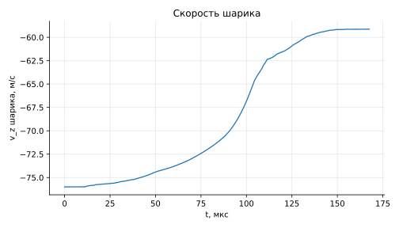
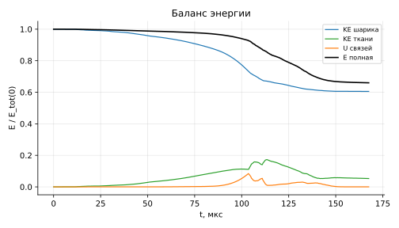
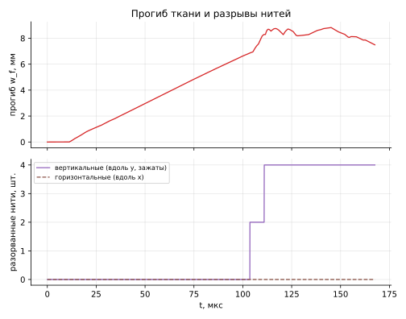
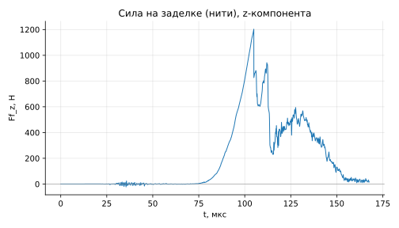
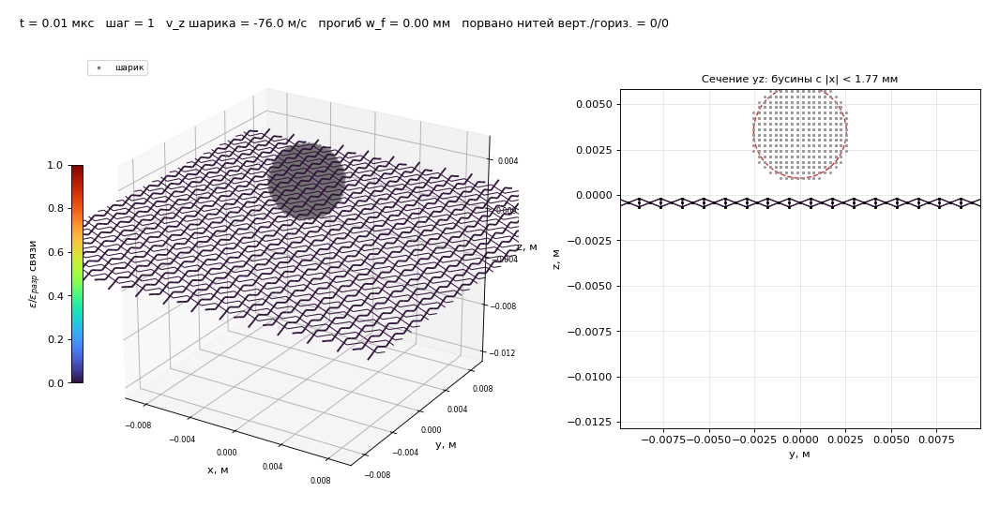
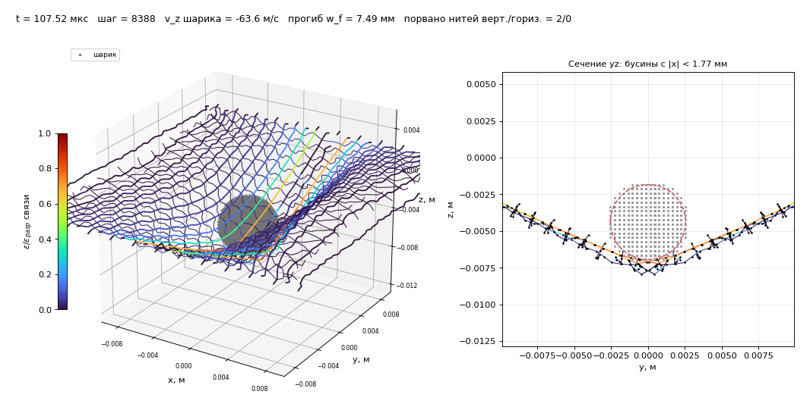
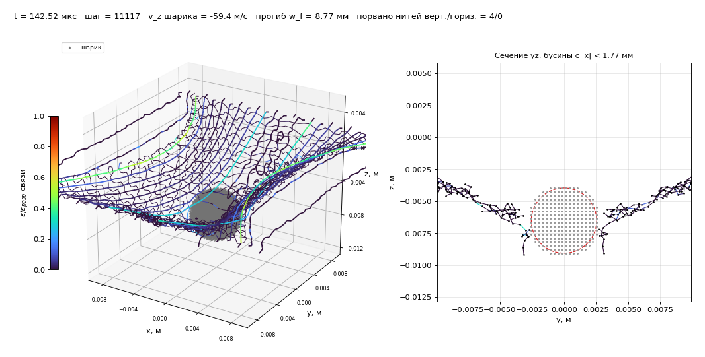
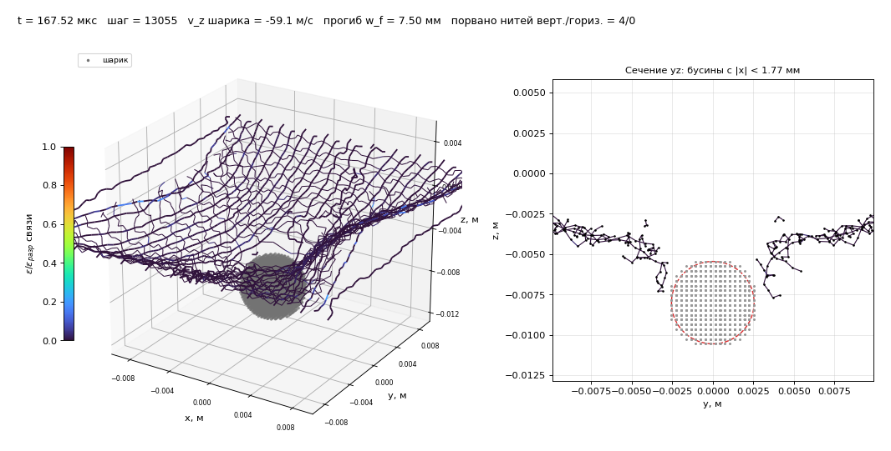

# Guo 2019, конфигурация 1T, уровень `scaled`: одиночный выстрел 76 м/с и его анимация

- **Дата:** 2026-10-01
- **Кейс:** guo2019 (конфигурация 1T — один слой ткани без пластины, уровень `scaled`)
- **Ветка:** `fiber_new`
- **Коммит HEAD:** `e6e2d218ca2b837dfbbe6f5c64b05e99c6b286ab` (Merge pull request #2 from smarry-code/weave) **+ 6 незакоммиченных патчей** (`repro-diff.zip`, см. `REPRO.md`): весь код Guo 2019 (сцена, монитор, инструмент `guo2019_shot`, опция `sph_same_body_only`, цели CMake, документация) лежит в рабочем дереве; владелец коммитит по своей команде
- **Прогонов:** 2 (один и тот же выстрел V0 = 76 м/с; прогон 1 — кадры раз в 25 мкс, прогон 2 — кадры раз в 2,5 мкс для анимации; прогон 2 заодно служит повтором, расчёт с OpenMP побитово не воспроизводится)
- **Статус:** завершён; размер каталога 1,32 МБ (PNG 0,84 МБ) — в пределах 2,5 МБ (`experiments/README.md` §3); анимация `anim_1t.gif` (1,52 МБ) не хранится, пересчёт — `scripts/rebuild_artifacts.sh`
- **Правка 2026-10-02:** каталог приведён к правилу объёма `experiments/README.md` §3 (лимит 2,5 МБ, персональные исключения отменены): `anim_1t.gif` (1,52 МБ) снят с учёта git (`git rm --cached`, `experiments/.gitignore`; файл на диске сохранён), добавлен `scripts/rebuild_artifacts.sh`; числа и выводы не менялись. Код, бывший в патчах `repro-diff.zip`, с 2026-10-02 закоммичен в `fiber_new` (`841300c`)

## Вопрос

Что даёт модель для одиночного выстрела 1T на масштабированной постановке `scaled` при V0 = 76 м/с (V_BL статьи для 1T) на всём времени процесса: исход, остаточная скорость V_R, порванные нити, прогиб, баланс энергии, стоимость, и как это выглядит (анимация).

## Постановка

Уровень `scaled` — решение владельца от 2026-10-01: серии Guo 2019 считаются не на геометрии статьи (`base`: 53–76 ч на выстрел), а на уменьшенной сцене. Это **отступления от ТЗ**, перечень О1–О14 — в `fiber/guo2019-e2e.md` §8.2 (в каталог не копируется); результаты с опытом (Guo et al., IJIE 127 (2019) 1–16) напрямую не сравниваются. Основные отступления:

| № | Что | ТЗ эксперименты Guo 2019 | `scaled` |
|---|---|---|---|
| О1 | диаметр шара D_s | 12 мм | 6 мм |
| О2–О3 | плотность / масса шара | 7736 кг/м³ / 7,000 г | ×2 (15 472 кг/м³ для сплошного шара; по решётке в логе 18 289 кг/м³) / 1,750 г |
| О4 | шаг решётки шара dx_s | 0,6 мм | 0,3 мм (3544 частицы) |
| О6, О8 | окно ткани | 102 × 102 нити, ≈119 мм | 26 × 26 нитей, 29,5 мм |
| О7 | зажим | 5 мм (оценка ТЗ) | 1,25 мм (вертикальные нити, вдоль y, закреплены при \|y\| ≥ 15 мм) |
| О9 | нить (d, p, A, E, ρ, ε_b, μ) | пресет `twaron_ct717` | **не масштабирована**: ткань относительно шара вдвое «крупнее» |
| О10 | потолок времени t_max | 1000 мкс (оценка ТЗ) | 500 мкс (×1/2) |
| О13 | стартовый зазор g_0 | 0,5 мм | 0,5 мм (без изменений) |

Постоянное для обоих прогонов (значения из `data/shot_run*.log`):

- Шар: D_s = 6 мм, m_s = 1,75 г, 3544 частицы, E = 2,057·10¹¹ Па, ν = 0,2857; E_tot(0) = ½·m_s·V0² = 5,054 Дж; z_c0 = 3,476 мм, g_0 = 0,5 мм.
- Ткань (пресет twaron, не масштабирована): d = 0,39 мм, шаг p = 1,18 мм, амплитуда A = 0,6·d = 0,234 мм, толщина полотна 2A + d = 0,858 мм; E = 85 ГПа, ρ = 1440 кг/м³, ε_b = 0,03 (пресет `twaron_ct717`; в логах эти три величины не печатаются); μ_ff = μ_fs = 0,3. 26 × 26 нитей, 2808 бусин, 2756 связей, k = 2; зажаты 104 бусины (по 2 с каждого конца у 26 нитей вдоль y; горизонтальные нити свободны). Плиты в 1T нет.
- Решатель PC, `contact_force_type = 1`, `sph_same_body_only = 1`, t_max = 500 мкс; расчёт оба раза остановлен сторожем монитора (`guard_reason=Monitor`) на t_end ≈ 168 мкс.
- Прогон 1: кадры раз в 25 мкс (`--frames=camera`, 7 + 7 кадров). Прогон 2: кадры раз в 2,5 мкс (`--save-t=2.5e-6`, 68 + 68 кадров); по ним собрана анимация.

## Результат

Числа — из `data/shot_run1.log`, `data/shot_run2.log`, `data/metrics_run1.txt`, `data/metrics_run2.txt` и `data/shot_run1.txt`, `data/shot_run2.txt` (строки `shot.txt` обоих прогонов). Эталон — Guo et al., IJIE 127 (2019) 1–16 (1T, шар 12 мм, 7 г, окно 120 мм); из-за отступлений О1–О14 он **только качественный**, «доли от эталона» по величинам не считаются, кроме отношений, не зависящих от масштаба (V_R/V0).

| Величина | Прогон 1 | Прогон 2 | Разброс 1–2 | Статья (1T) |
|---|---|---|---|---|
| Исход | пробита | пробита | — | V_BL = 76 ± 3 м/с; при V0 ≈ 78 м/с пробита с V_R ≈ 15 и 20 м/с |
| V0, м/с | 76,000 | 76,000 | — | — |
| V_R, м/с | 59,111 | 59,131 | 0,02 м/с (0,03 %) | 15–20 при 78 м/с |
| V_R/V0 | 0,778 | 0,778 | — | ≈ 0,19–0,26 (15–20 из 78; оценка по двум выстрелам) |
| Энергия, поглощённая шаром, e = KE_0 − KE_конец, Дж | 1,9967 | 1,9946 | 0,10 % | ≈ 20 Дж при V_BL (шар 7 г) |
| e / KE_0 (KE_0 = 5,054 Дж) | 39,5 % | 39,5 % | — | — |
| Конец расчёта t_end, мкс | 167,95 | 167,56 | 0,23 % | — |
| Шагов | 13 088 | 13 058 | — | — |
| Первый разрыв нити, мкс | 103,614 | 103,614 | 0 | — |
| Прогиб w_f в момент первого разрыва, мм | 6,872 | 6,872 | 0 | 25–27 (до первого разрыва) |
| Максимальный прогиб w_f, мм | 8,754 (143,2 мкс) | 8,829 (145,1 мкс) | 0,9 % | — |
| Порвано нитей, вертикальных / горизонтальных | 4 / 0 | 4 / 0 | — | 3 вертикальных / 0 горизонтальных |
| Связей в конце (из 2756) | 2749 | 2748 | — | — |
| Макс. реакция заделки ткани \|F_z\|, Н | 1204,0 | 1202,9 | 0,1 % | — |
| E_tot,max / E_tot,0 | 1 | 1 | — | роста энергии нет |
| E_tot,конец / E_tot,0 | 0,6607 | 0,6599 | 0,1 % | — |
| Стоимость (стенное время, 8 потоков) | 1334,6 с (0,102 с/шаг) | 1361,7 с (0,104 с/шаг) | 2 % | — |
| Доля времени монитора | 1,9 % | 1,8 % | — | — |
| Кадры (на диске, не хранятся) | 7 + 7, 7,2 МБ | 68 + 68, 72,2 МБ | — | — |

Из `data/shot_run*.txt`: `n_tunnel` = 0; макс. проникание волокно–волокно 0,093 d (прогон 1) / 0,092 d (прогон 2), волокно–твёрдое 0,099 d / 0,098 d; `contacts_per_crossing` (макс.) 2,66 / 2,67 — это больше 1 («седло», FRICTION_REPORT §10 п. 1).

### Баланс энергии по времени

Пересчитано из `data/monitor_run1_thin.csv` (прогон 2 — `data/monitor_run2_thin.csv`: на 50 мкс совпадает до 4 знаков, позже расходится, например при 120 мкс KE_f = 0,742 Дж, U_b = 0,081 Дж, E_tot/E_tot,0 = 0,819). Строки CSV прорежены (каждая 40-я), поэтому моменты — ближайшие к указанным. E_tot = KE_s + KE_p + KE_f + U_b + U_int (по `tests/guo2019_monitor.hpp`; KE_p = 0, U_int — внутренняя энергия частиц Solid, здесь только шара, на t_end 0,0055 Дж; в таблице не выписана, ≤ 0,2 % E_tot,0). Энергия контакта и энергия разорванных связей в E_tot не входят (известная неполнота, там же).

| t, мкс (ближайшая строка) | v_z шара, м/с | KE_s, Дж | KE_f, Дж | U_b, Дж | E_tot/E_tot,0 | связей | порвано верт. |
|---|---|---|---|---|---|---|---|
| 50 (49,85) | −74,42 | 4,846 | 0,145 | 0,0021 | 0,988 | 2756 | 0 |
| 100 (100,06) | −66,81 | 3,906 | 0,572 | 0,270 | 0,940 | 2756 | 0 |
| 104 (104,12) | −64,76 | 3,670 | 0,614 | 0,388 | 0,925 | 2754 | 2 |
| 120 (119,99) | −61,55 | 3,314 | 0,749 | 0,079 | 0,820 | 2749 | 4 |
| 150 (149,79) | −59,16 | 3,063 | 0,298 | 0,016 | 0,669 | 2749 | 4 |
| 167 (166,83) | −59,11 | 3,057 | 0,276 | 0,0016 | 0,661 | 2749 | 4 |

Максимум U_b = 0,422 Дж достигается на первом разрыве (103,6 мкс); максимум KE_f = 0,880 Дж при 113,3 мкс.

Разложение на t_end (прогон 1 / прогон 2, из логов):

| Часть | Прогон 1, Дж (% от E_tot,0) | Прогон 2, Дж (% от E_tot,0) |
|---|---|---|
| Шар KE_s | 3,0573 (60,49 %) | 3,0594 (60,53 %) |
| Ткань KE_f + U_b | 0,2764 (5,47 %) | 0,2703 (5,35 %) |
| «Пластина» (KE_p + U_int; плиты нет, KE_p = 0, U_int — внутренняя энергия шара) | 0,0055 (0,11 %) | 0,0054 (0,11 %) |
| Невязка E_tot(t_end) − E_tot(0) | −1,7148 (−33,93 %) | −1,7190 (−34,01 %) |

Невязка — энергия, ушедшая из E_tot (≈ треть начальной).

Оценка энергии разорванных связей: на одну связь ½·E·A·l0·ε_b² при E = 85·10⁹ Па, A = π·(0,39·10⁻³)²/4 = 1,19·10⁻⁷ м², l0 ≈ 0,6 мм (оценка: шаг по нити 1,18 мм, k = 2 бусины на период), ε_b = 0,03 даёт ≈ 2,7·10⁻³ Дж; на 7 связей (прогон 1, 2756 → 2749) ≈ 0,019 Дж, на 8 (прогон 2, → 2748) ≈ 0,022 Дж, то есть ≈ 0,4 % от E_tot,0 против невязки 34 %. Это оценка по порядку величины, а не расчёт; она показывает, что энергия самих разорванных связей невязку не объясняет.

## График

Графики построены `scripts/plot_monitor.py` по полному `monitor.csv` прогона 2 (13 058 строк); в `data/` лежат прореженные копии обоих прогонов. Числа в разборе ниже — по прогону 1, если не сказано иное; кривые прогонов 1 и 2 различаются в пределах разброса из таблицы «Результат». Время по оси — мкс от начала расчёта (шар стартует с зазором g_0 = 0,5 мм).

### Скорость шара

Шар стартует со 76,0 м/с и замедляется плавно: −74,4 м/с на 50 мкс, −66,8 на 100 мкс, −64,8 на 104 мкс (первый разрыв), −61,5 на 120 мкс; с ≈ 138 мкс (по тонкой выборке) скорость в пределах 0,5 м/с от конечной −59,1 м/с и дальше почти не меняется. Прогон 2 совпадает с прогоном 1 (V_R 59,131 против 59,111 м/с).

### Баланс энергии

KE шара падает с 1,0 до 0,605 E_tot,0. KE ткани растёт до 0,880 Дж (0,174 E_tot,0) на 113,3 мкс и затем падает до 0,28 Дж, U_b набирает 0,42 Дж к первому разрыву (103,6 мкс) и сбрасывается почти до нуля после разрыва. E_tot медленно убывает до 0,925 к первому разрыву, затем падает до 0,669 к 150 мкс и выходит на 0,661. Рост E_tot выше начального нигде нет (E_tot,max/E_tot,0 = 1). Сумма KE_s + KE_f + U_b не сохраняется: главное падение E_tot (с 0,925 до 0,67, то есть ≈ 1,3 Дж) приходится на 104–150 мкс, где шар отдаёт ткани лишь ≈ 0,6 Дж (KE_s 3,670 → 3,063 Дж), а KE_f из 0,75 Дж (120 мкс) падает до ≈ 0,28 Дж.

### Прогиб и разрывы

Прогиб w_f растёт до 6,87 мм на первом разрыве (103,6 мкс), далее до максимума 8,75 мм (прогон 2: 8,83 мм) около 143–145 мкс; к t_end он спадает до ≈ 7,5–8,0 мм (в точках 150 и 167 мкс тонкой выборки: 8,50 → 8,03 мм у прогона 1, 8,44 → 7,55 у прогона 2). Нити рвутся только вертикальные (вдоль y, зажатые): первые две на 103,61 мкс, ещё две — к 111,25 мкс (граница выборки ≈ 0,5 мкс); всего 4. Горизонтальные (вдоль x, свободные) целы. Оба прогона идентичны по этой кривой.

### Реакция заделки

Реакция заделки на 50 мкс ещё 0,8 Н, к 100 мкс ≈ 820 Н, максимум 1204 Н (по полной кривой, `metrics_run1.txt`; в прореженной выборке максимум ниже — 1177 Н при 104,6 мкс) приходится на ≈ 1 мкс после первого разрыва, затем реакция спадает до ≈ 22 Н (прогон 2: 20 Н) на 167 мкс. Максимум реакции — у разрыва вертикальных нитей, а не у максимума прогиба (143 мкс).

### Анимация и снимки

Анимация `anim_1t.gif` (1,52 МБ) в каталоге не хранится (правило объёма, `experiments/README.md` §3). Получить: `bash scripts/rebuild_artifacts.sh <корень репозитория> <рабочий каталог>` — прогон 2 заново (Linux, 8 потоков, ≈ 23 мин, кадры 72 МБ) и анимация, результат — `<рабочий каталог>/artifacts/anim_1t.gif`; расчёт с OpenMP побитово не повторяется, кадры совпадут с прежними качественно. Снимки ниже — кадры этой анимации, они хранятся.

Анимация `anim_1t.gif` — 34 кадра из 68 кадров прогона 2 (каждый второй, шаг ≈ 5 мкс), масштаб ±9 мм по x, y; слева — 3D-вид нитей, окрашенных деформацией ε/ε_разр, справа — сечение yz по бусинам с \|x\| < 1,77 мм и шар. Время в заголовках кадра берётся из строки `monitor.csv` с номером шага кадра.

| Кадр | Снимок | Что видно |
|---|---|---|
| 0, t ≈ 0,01 мкс, шаг 1, v_z = −76,0 м/с, w_f = 0, порвано 0/0 |  | Плоское полотно (волна нитей вдоль x и y), шар над ним на g_0, деформации нулевые (все нити тёмные) |
| 21, t = 107,52 мкс, шаг 8388, v_z = −63,6 м/с, w_f = 7,49 мм, порвано 2/0 |  | Шар вдавлен в полотно, ткань натянута «чашей»; наибольшие деформации (оранжевые, ε/ε_разр ≈ 0,6–0,8) на нитях, идущих по краям шара; в сечении yz видны разорванные нити у кромки шара |
| 28, t ≈ 142,5 мкс, шаг 11 117, v_z = −59,4 м/с, w_f = 8,77 мм, порвано 4/0 |  | Шар проходит через полотно; в сечении yz нити расходятся в стороны от шара (4 вертикальные порваны), оборванные концы нитей отгибаются вверх |
| 33, t ≈ 167,5 мкс, шаг 13 055, v_z = −59,1 м/с, w_f = 7,50 мм, порвано 4/0 |  | Шар ниже полотна и уходит; полотно с вытянутой воронкой и порванными концами нитей, деформации малы (все нити тёмные, кроме нескольких синих), остаточная скорость ≈ 59 м/с |

(Деформации в кадре 21 прочитаны с рисунка и приведены качественно, как «оранжевые» по цветовой шкале; числа ε/ε_разр по кадрам не снимались.)

## Вывод

На масштабированной постановке `scaled` модель при V0 = 76 м/с даёт **пробитие с остаточной скоростью 59,1 м/с** (V_R/V0 = 0,778; шар отдаёт ткани 39,5 % начальной энергии, 2,0 Дж); в статье при 78 м/с на полноразмерной постановке остаточная скорость 15–20 м/с. Качественно механизм разрушения совпадает со статьёй: рвутся только вертикальные (закреплённые) нити — 4 против 3 в статье, — горизонтальные целы. Количественно сравнивать нечего: шар 6 мм и 1,75 г против 12 мм и 7 г, окно 29,5 мм против ≈ 120 мм, нить не масштабирована — отступления О1–О14 разрывают подобие, и прогиб 6,9 мм до первого разрыва нельзя сопоставлять с 25–27 мм статьи. Повторяемость расчёта с OpenMP: V_R расходится на 0,03 %, максимальный прогиб на 0,9 %, момент первого разрыва совпадает. Отдельная находка: **около трети начальной энергии (−34 %) не учтено в E_tot** — энергия E_tot на t_end составляет 0,66 начальной, а сумма шар + ткань не включает ни энергию контакта, ни энергию разорванных связей; гипотеза (диссипация трением μ = 0,3 при уходе порванных нитей) **не доказана**, прогон с μ = 0 не запускался.

## Что осталось неясным

- **Куда уходит −34 % энергии.** Падение E_tot приходится в основном на 104–150 мкс (после первого разрыва). Гипотеза: трение μ = 0,3 (нить–нить и нить–шар) при втягивании порванных нитей; E_tot не включает энергию контакта и энергию разорванных связей (по оценке выше последняя ≈ 0,02 Дж, то есть ≈ 0,4 %, невязки не объясняет). Проверка — выстрел с μ = 0 (ТЗ эксперименты Guo 2019, §8.4 п. 5) — **не запускалась**.
- **`contacts_per_crossing` = 2,66 (> 1)** — «седло» (FRICTION_REPORT §10 п. 1): на перекрёстке нитей в среднем больше одного контакта; на что влияет — не изучено.
- **V_BL уровня `scaled`.** Шла одна скорость (76 м/с, пробито); нижний предел не искали (`V_BL не определён`). Ниже ли он 76 м/с — неизвестно.
- **Влияние ненормированной ткани (О9).** Нить в `scaled` та же, что в статье, поэтому относительно шара ткань вдвое «крупнее»; сколько из разницы V_R (59 против 15–20 м/с) даёт именно это, а сколько — окно, зажим 1,25 мм, масса шара, — не разделено (нужны отдельные прогоны).
- **Подпись времени на кадрах.** Заголовок кадра берёт время из строки `monitor.csv` с номером шага кадра, а не из `TIME` в заголовке файла кадра: при отладке скрипта на частичном прогоне 1 они расходились на один шаг dt (0,013 мкс; кадр пишется после шага, но до `time += dt`, как в `clamp-fiber-viz`). На полном прогоне 2 сверка отдельно не печаталась.
