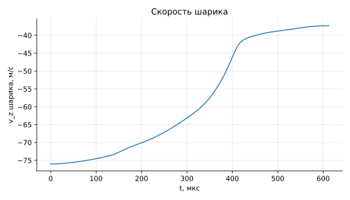
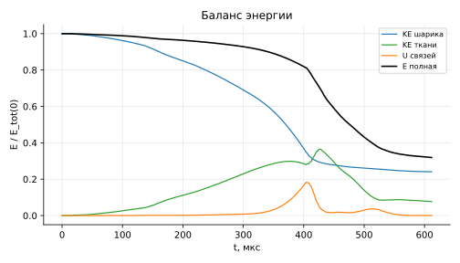
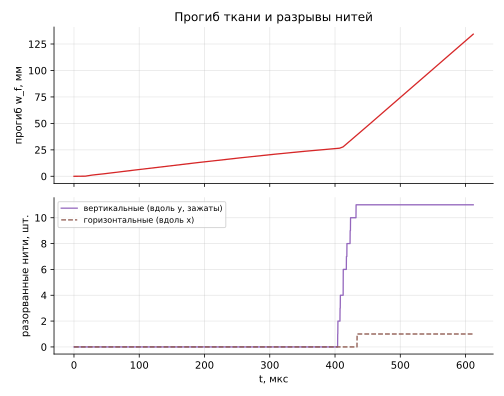
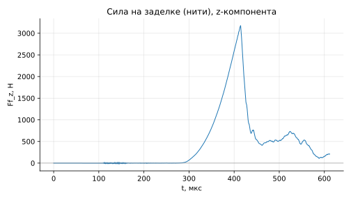
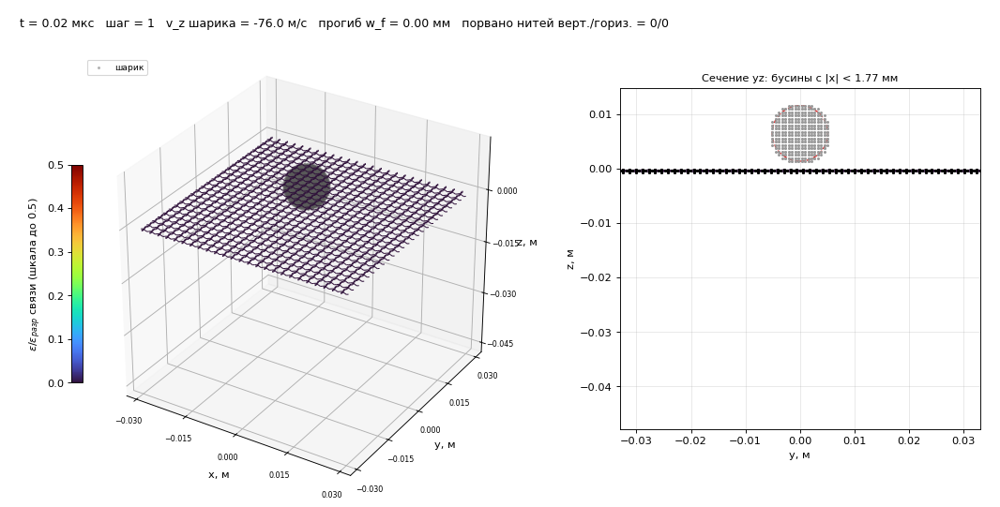
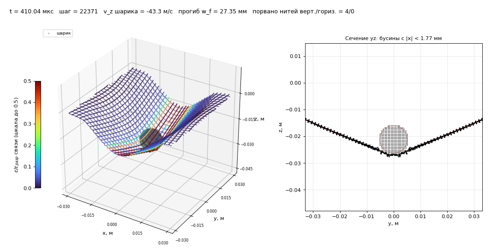
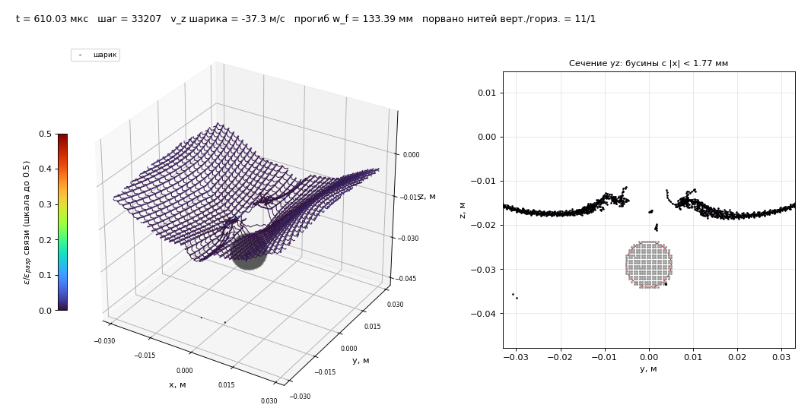
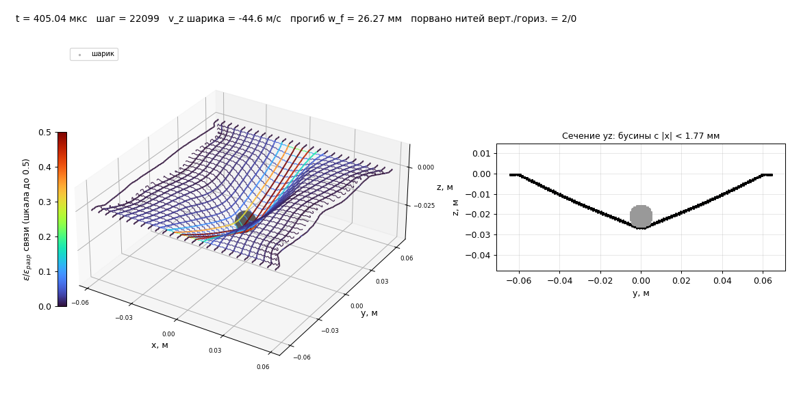
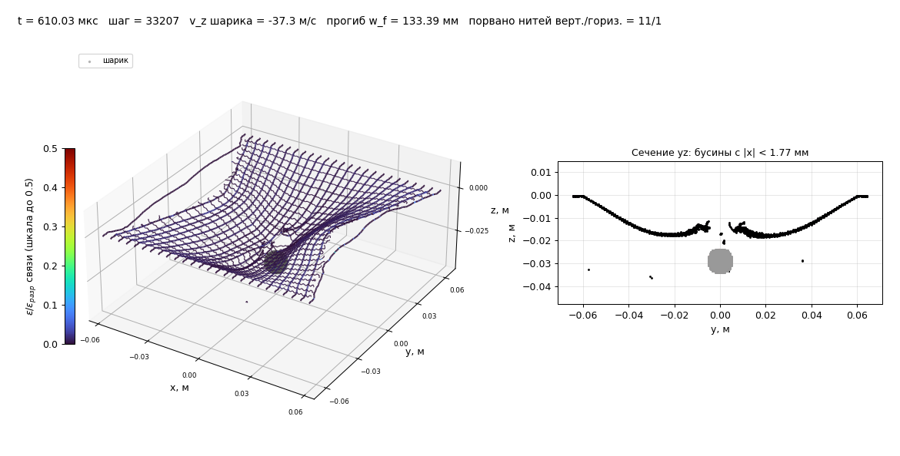

# Guo 2019, конфигурация 1T, уровень `base`: одиночный выстрел 76 м/с на геометрии статьи и его анимация

- **Дата:** 2026-10-02
- **Кейс:** guo2019 (конфигурация 1T — один слой ткани без пластины, уровень `base` — геометрия статьи)
- **Ветка:** `fiber_new`
- **Коммит HEAD:** `e6e2d218ca2b837dfbbe6f5c64b05e99c6b286ab` (Merge pull request #2 from smarry-code/weave) **+ 6 незакоммиченных патчей** (`repro-diff.zip` — тот же архив, что у `2026-10-01-guo2019-1t-scaled`, sha256 совпадает: код между прогонами не менялся; см. `REPRO.md`)
- **Прогонов:** 1 (выстрел V0 = 76 м/с; повтора нет, разброс многопоточного счёта на `base` не измерен)
- **Статус:** завершён; размер каталога 1,24 МБ (PNG 0,85 МБ) — в пределах 2,5 МБ (`experiments/README.md` §3); анимация `anim_1t_base.gif` (1,84 МБ) не хранится, пересчёт — `scripts/rebuild_artifacts.sh`
- **Правка 2026-10-02:** каталог приведён к правилу объёма `experiments/README.md` §3 (лимит 2,5 МБ, персональные исключения отменены): `anim_1t_base.gif` (1,84 МБ) снят с учёта git (`git rm --cached`, `experiments/.gitignore`; файл на диске сохранён), добавлен `scripts/rebuild_artifacts.sh`; числа и выводы не менялись. Код, бывший в патчах `repro-diff.zip`, с 2026-10-02 закоммичен в `fiber_new` (`841300c`)

## Вопрос

Что даёт модель для одиночного выстрела 1T при V0 = 76 м/с (V_BL статьи для 1T) на геометрии статьи (`base`: шар 12 мм, 7 г, окно ткани ≈ 119 мм): исход, остаточная скорость V_R, порванные нити, прогиб, баланс энергии, стоимость — и как это согласуется с Guo et al., IJIE 127 (2019) 1–16.

## Постановка

Уровень `base` — геометрия и масса шара по ТЗ, без отступлений О1–О14 (они относятся только к `scaled`). Отступления от ТЗ, которые остаются: (а) это **один** выстрел, а не серия §8.4 (V_BL не определяется); (б) кадры раз в 5 мкс (`--save-t=5e-6`) вместо камеры раз в 25 мкс — для анимации.

Постоянное (значения из `data/shot.log`, `data/shot.txt`):

- Шар: сталь, D_s = 12 мм, m_s = 7 г, 3544 частицы, dx_s = 0,6 мм, E = 2,057·10¹¹ Па, ν = 0,2857; V0 = 76 м/с, E_tot(0) = ½·m_s·V0² = 20,216 Дж; z_c0 = 6,452 мм, g_0 = 0,5 мм. Плотность по решётке 9144 кг/м³ против 7736 для сплошного шара (+18,2 %); масса при этом ровно 7 г (лог).
- Ткань (пресет `twaron`): 102 × 102 нити, окно 119,18 мм, k = 2, 43 248 бусин, 43 044 связи; d = 0,39 мм, шаг p = 1,18 мм, амплитуда A = 0,6·d = 0,234 мм, толщина полотна 2A + d = 0,858 мм; μ_ff = μ_fs = 0,3. Вертикальные нити (вдоль y) закреплены при \|y\| ≥ 60 мм с выступом 5 мм, зажато 1632 бусины; горизонтальные (вдоль x) свободны. Плиты нет. Поверхностная плотность в окне 0,3168 кг/м² (статья 0,28; ожидание модели 0,317).
- Решатель PC, `contact_force_type = 1`, `sph_same_body_only = 1`, t_max = 1000 мкс; расчёт остановлен сторожем монитора (`guard_reason=Monitor`) на t_end = 611,8 мкс.
- Кадры раз в 5 мкс: 123 + 123 (Solid + нити), 749 МБ на диске, не хранятся. Анимация — 62 кадра (каждый второй, шаг ≈ 10 мкс).

## Результат

Числа — из `data/shot.txt`, `data/shot.log`, `data/metrics.txt`, `data/timing.txt`. Эталон — Guo et al., IJIE 127 (2019) 1–16 (1T). Постановка совпадает с опытом по геометрии, но параметры нити (ε_b, μ, d) — оценки, поэтому сравнение остаётся предварительным.

| Величина | Модель (`base`) | Статья (1T) |
|---|---|---|
| Исход | пробита | V_BL = 76 ± 3 м/с; при V0 ≈ 78 м/с пробита с V_R ≈ 15 и 20 м/с |
| V0, м/с | 76,000 | — |
| V_R, м/с | 37,288 | 15–20 при 78 м/с |
| V_R/V0 | 0,491 | ≈ 0,19–0,26 (15–20 из 78) |
| Поглощённая шаром энергия e = KE_0 − KE_конец, Дж | 15,350 (75,9 % от E_0 = 20,216 Дж) | ≈ 20,2 при V_BL |
| Конец расчёта t_end, мкс | 611,78 | — |
| Шагов; dt, с | 33 302; 1,83·10⁻⁸ | — |
| Первый разрыв нити, мкс | 403,95 (шаг 22 040) | — |
| Прогиб w_f в момент первого разрыва, мм | 26,24 | 25–27 (до первого разрыва) |
| Порвано нитей, вертикальных / горизонтальных (на t_end) | 11 / 1 | 3 вертикальных / 0 горизонтальных |
| Связей в конце (из 43 044) | 43 019 (порвано 25) | — |
| Макс. реакция заделки ткани \|F_z\|, Н | 3177 (в тонкой выборке 414,3 мкс) | — |
| E_tot,max / E_tot,0 | 1 (роста энергии нет) | — |
| E_tot,конец / E_tot,0 | 0,319 (невязка −68,1 %) | — |
| n_tunnel | 0 | — |
| Макс. проникание, доли d: волокно–волокно / волокно–твёрдое | 0,151 / 0,127 | — |
| `contacts_per_crossing` (макс.) | 2,89 | — |
| Стоимость (8 потоков) | 8499,9 с (2,36 ч), 0,255 с/шаг | — |
| Доля времени монитора | 11,25 % (956 с) | — |

**Прогиб после первого разрыва — не прогиб ткани.** `w_f` в мониторе — максимум по всем бусинам ткани от z0 − z (`tests/guo2019_monitor.hpp`), поэтому после разрывов в него попадают свободные концы порванных нитей. Максимум `w_f` в `metrics.txt` (134,3 мм при t_end) принадлежит такой бусине (на кадре 610 мкс отдельные бусины видны далеко ниже основной ткани). За первым разрывом `w_f` растёт почти линейно (26,2 мм на 404 мкс, 47,4 на 449, 74,0 на 499, 134,3 на 612; около 0,5 мм/мкс), а чаша ткани на кадрах остаётся около 17–27 мм. Поэтому «w_f,max = 134 мм» как прогиб не используется; осмысленное число — **w_f при первом разрыве, 26,24 мм** (на кадре 410 мкс чаша ≈ 27 мм).

Замечание о стоимости: доля монитора 11,25 % выше цели 5 % ТЗ (§6.1).

### Баланс энергии по времени

Пересчитано из `data/monitor_thin.csv` (каждая 100-я строка, 335 строк, шаг ≈ 1,83 мкс); берётся ближайшая строка. E_tot = KE_s + KE_p + KE_f + U_b + U_int (по `tests/guo2019_monitor.hpp`; KE_p = 0, U_int — внутренняя энергия Solid, на t_end 0,013 Дж, в таблице не выписана). Энергия контакта и энергия разорванных связей в E_tot не входят (известная неполнота).

| t, мкс (строка) | v_z шара, м/с | z_c, мм | KE_s, Дж | KE_f, Дж | U_b, Дж | E_tot/E_tot,0 | связей | порвано верт./гориз. |
|---|---|---|---|---|---|---|---|---|
| 50 (49,5) | −75,56 | 2,70 | 19,983 | 0,149 | 0,0020 | 0,996 | 43 044 | 0 / 0 |
| 200 (199,6) | −70,10 | −8,32 | 17,198 | 2,253 | 0,027 | 0,964 | 43 044 | 0 / 0 |
| 300 (300,4) | −63,11 | −15,07 | 13,940 | 4,667 | 0,155 | 0,928 | 43 044 | 0 / 0 |
| 400 (399,6) | −46,27 | −20,68 | 7,493 | 5,765 | 3,321 | 0,820 | 43 044 | 0 / 0 |
| 404 (403,2) | −45,15 | −20,85 | 7,135 | 5,674 | 3,638 | 0,814 | 43 044 | 0 / 0 |
| 420 (419,8) | −41,74 | −21,56 | 6,098 | 6,950 | 1,829 | 0,736 | 43 025 | 8 / 0 |
| 450 (449,3) | −40,12 | −22,76 | 5,633 | 6,001 | 0,337 | 0,593 | 43 020 | 11 / 1 |
| 500 (499,1) | −38,86 | −24,72 | 5,284 | 2,874 | 0,598 | 0,434 | 43 019 | 11 / 1 |
| 611 (611,8) | −37,29 | −28,99 | 4,867 | 1,558 | 0,012 | 0,319 | 43 019 | 11 / 1 |

Тонкая выборка пропускает точный момент первого разрыва (403,95 мкс по `metrics.txt`): первая строка с порванными нитями — 405,07 мкс (2 вертикальные). Максимум U_b в выборке 3,678 Дж при 405,07 мкс; максимум KE_f 7,381 Дж при 427,2 мкс. Число порванных вертикальных нитей по выборке: 2 на 405,1 мкс; 4 на 408,7; 6 на 414,3; 7 на 418,0; 8 на 419,8; 9 на 423,5; 10 на 425,3; 11 на 432,7; горизонтальная порвана на 434,5 мкс. Скорость шара в пределах 0,5 м/с от конечной (−37,29 м/с) — с 556 мкс.

Разложение на t_end (из `data/shot.log`):

| Часть | Дж | % от E_tot,0 |
|---|---|---|
| Шар KE_s | 4,867 | 24,08 |
| «Пластина» (KE_p + U_int; плиты нет, U_int — внутренняя энергия шара) | 0,0134 | 0,07 |
| Ткань KE_f + U_b | 1,570 | 7,77 |
| Невязка E_tot(t_end) − E_tot(0) | −13,766 | −68,09 |

Картина та же, что в `scaled`: E_tot медленно снижается до ≈ 0,81 к первому разрыву, затем падает до ≈ 0,32, при этом KE_f уменьшается с ≈ 7 Дж (427 мкс) до ≈ 1,6 Дж. За 404–611 мкс KE_s уменьшается лишь на 2,27 Дж (7,135 → 4,867), а E_tot — с 0,814 до 0,319 E_tot,0, то есть на ≈ 10,0 Дж. Гипотеза — диссипация трением μ = 0,3 (нить–нить, нить–шар) при уходе порванных нитей; **не установлена**, выстрел с μ = 0 не запускался.

## График

Графики построены `scripts/plot_monitor.py` по полному `monitor.csv` (33 302 строки); в `data/monitor_thin.csv` — каждая 100-я строка. Время по оси — мкс от начала расчёта (шар стартует с зазором g_0 = 0,5 мм). Числа в разборе — из тонкой выборки и `metrics.txt`.

### Скорость шара

Шар стартует со 76,0 м/с и первые ≈ 50 мкс почти не замедляется (−75,6 м/с на 50 мкс); затем скорость падает: −70,1 м/с на 200 мкс, −63,1 на 300, −46,3 на 400 мкс (самое крутое падение — последние ≈ 100 мкс до разрыва, пока ткань натягивается) и −45,2 на первом разрыве. После разрывов замедление мягкое: −41,7 на 420, −40,1 на 450, −38,9 на 500 мкс; к 556 мкс скорость в пределах 0,5 м/с от конечной −37,29 м/с.

### Баланс энергии

KE шара снижается с 20,2 до 4,87 Дж. KE ткани растёт до 7,38 Дж (427 мкс), то есть уже после первого разрыва, и затем падает до 1,56 Дж; U_b копится до 3,68 Дж к первому разрыву (403,95 мкс) и сбрасывается почти до нуля после разрывов. E_tot плавно спадает до 0,81 E_tot,0 к первому разрыву, затем падает до 0,59 к 450 мкс и до 0,32 к концу; превышения начального значения нет (E_tot,max/E_tot,0 = 1). Сумма KE_s + KE_f + U_b не сохраняется: основное падение (≈ 10 Дж) приходится на 404–611 мкс, где шар отдаёт 2,3 Дж, а KE_f с максимума уменьшается на ≈ 5,8 Дж.

### Прогиб и разрывы

Прогиб w_f растёт монотонно до 26,2 мм на первом разрыве (13,6 мм на 200 мкс, 20,4 на 300, 26,0 на 400). Дальше кривая продолжает расти линейно до 134 мм — это улетающие концы порванных нитей (см. выше), а не прогиб; осмысленна только часть до первого разрыва. Рвутся 11 вертикальных нитей (вдоль y, зажатые) за 405–433 мкс и одна горизонтальная на 434,5 мкс.

### Реакция заделки

Реакция заделки ткани мала до 300 мкс (71 Н на 300), 2564 Н на 400 мкс, 2730 Н на 404 мкс, максимум 3177 Н (по тонкой выборке 414,3 мкс — в разгар разрывов, между 6-й и 7-й порванной нитью); затем спад: 2295 Н на 420, 544 на 450, 512 на 500 и 209 Н на 612 мкс.

### Анимация и снимки

Анимация `anim_1t_base.gif` (1,84 МБ) в каталоге не хранится (правило объёма, `experiments/README.md` §3). Получить: `bash scripts/rebuild_artifacts.sh <корень репозитория> <рабочий каталог>` — прогон заново (Linux, 8 потоков, ≈ 2,4 ч, кадры 749 МБ), анимация и снимки, результат — `<рабочий каталог>/artifacts/`; расчёт с OpenMP побитово не повторяется, кадры совпадут с прежними качественно. Снимки ниже — кадры этого прогона, они хранятся.

`anim_1t_base.gif` — 62 кадра из 123 (каждый второй, шаг ≈ 10 мкс, 6 кадров/с). Слева — 3D-вид нитей (каждая вторая нить, окно ±30 мм по x, y), окрашенных деформацией ε/ε_разр (шкала до 0,5); справа — сечение yz по бусинам с \|x\| < 1,77 мм и шар. Время в заголовке берётся из строки `monitor.csv` с номером шага кадра.

Кадры в окне ±30 мм:

| Кадр | Снимок | Что видно |
|---|---|---|
| 0, t = 0,02 мкс, шаг 1, v_z = −76,0 м/с, w_f = 0, порвано 0/0 |  | Плоское полотно, шар над ним на g_0, все нити тёмные (деформации нулевые); в сечении шар (диаметр ≈ 12 мм) над линией ткани |
| 41, t = 410,04 мкс, шаг 22 371, v_z = −43,3 м/с, w_f = 27,35 мм, порвано 4/0 |  | Ткань вдавлена в глубокую V-образную чашу вокруг шара; наибольшие деформации (красные и оранжевые нити, около 0,4–0,5 шкалы) на нитях, идущих вдоль y по краям шара; в сечении yz два прямых «крыла» ткани сходятся под шаром на глубине ≈ 27 мм |
| 61, t = 610,03 мкс, шаг 33 207, v_z = −37,3 м/с, w_f = 133,39 мм, порвано 11/1 |  | Шар (центр ≈ −30 мм) ниже полотна и уходит; в сечении yz в центре разрыв, края порванных нитей загнуты вверх и в стороны; деформации малы (все нити тёмные), ниже полотна видны отдельные бусины — свободные концы |

Кадры в полном окне ±60 мм (`full_field`):

| Кадр | Снимок | Что видно |
|---|---|---|
| 81, t = 405,04 мкс, шаг 22 099, v_z = −44,6 м/с, w_f = 26,27 мм, порвано 2/0 |  | Весь клин ткани до зажимов: чаша по всему окну, наибольшая деформация (красные нити, до ≈ 0,5 шкалы) вдоль линий y от шара к зажимам, остальные нити заметно слабее; в сечении ткань идёт от зажима (z = 0 при y = ±60 мм) к шару прямыми «крыльями», дно ≈ −27 мм |
| 122, t = 610,03 мкс, шаг 33 207, v_z = −37,3 м/с, w_f = 133,39 мм, порвано 11/1 |  | Ткань провисает неглубокой чашей ≈ 17–18 мм, в центре отверстие, шар ниже (центр ≈ −30 мм); у края отверстия порванные нити, отдельные бусины далеко ниже ткани (отсюда w_f = 133 мм) |

(Интенсивность деформации на кадрах прочитана с рисунков качественно по цветовой шкале; числа ε/ε_разр по кадрам не снимались.)

## Сравнение с `scaled`

| Величина | `scaled` (2026-10-01) | `base` (этот каталог) |
|---|---|---|
| Шар D_s, масса | 6 мм, 1,75 г (О1–О3) | 12 мм, 7 г |
| Окно ткани | 26 × 26 нитей, 29,5 мм (О6, О8) | 102 × 102 нити, 119,18 мм |
| Зажим | 1,25 мм (О7) | 5 мм |
| E_tot,0, Дж | 5,054 | 20,216 |
| V_R, м/с (V_R/V0) | 59,1 (0,778) | 37,3 (0,491) |
| Поглощённая энергия e (доля E_0) | 1,997 Дж (39,5 %) | 15,35 Дж (75,9 %) |
| Первый разрыв | 103,6 мкс, w_f = 6,87 мм | 403,95 мкс, w_f = 26,24 мм |
| Порвано верт./гориз. | 4 / 0 | 11 / 1 |
| E_tot,конец / E_tot,0 | 0,66 | 0,319 |
| Стоимость | 1334,6 с, 0,102 с/шаг | 8499,9 с, 0,255 с/шаг |

`scaled` содержит отступления О1–О14 (`fiber/guo2019-e2e.md` §8.2), поэтому колонки сопоставимы лишь качественно. Общее: рвутся прежде всего вертикальные закреплённые нити, E_tot падает после первого разрыва, причина падения не установлена.

## Вывод

На геометрии статьи (`base`) модель при V0 = 76 м/с даёт **пробитие с остаточной скоростью 37,3 м/с** (V_R/V0 = 0,491; шар отдаёт ткани 75,9 % начальной энергии, 15,35 Дж). В статье V_BL = 76 ± 3 м/с, а при 78 м/с шар вылетает со скоростью 15 и 20 м/с; модель при 76 м/с пробивает с заметно большим остатком, то есть модельный V_BL **ниже 76 м/с**. Оценка по одному выстрелу по ур. 2 статьи, V_BL ≈ √(2e/m_s) = √(2·15,35/0,007) = 66,2 м/с, — **оценка по одному выстрелу**: методика требует нескольких пробивных выстрелов в пределах 15 м/с выше наибольшего непробитого, здесь непробитых нет (V_BL не определён).

Прогиб до первого разрыва 26,2 мм **лежит в диапазоне 25–27 мм статьи** — согласие по главной механической величине, хотя параметры нити (ε_b, μ, d) — оценки. Число порванных нитей не совпадает: 11 вертикальных и 1 горизонтальная против 3 вертикальных и целых горизонтальных в статье. Качественно разрыв начинается с закреплённых (вертикальных) нитей, как в статье, но в модели их почти вчетверо больше, и разрыв доходит до горизонтальной. Около 68 % начальной энергии (13,8 Дж) к концу расчёта вне E_tot, как и в `scaled` (там 34 %); гипотеза трения не проверена.

## Что осталось неясным

- **V_BL модели.** Один выстрел (76 м/с, пробит); непробитых нет, серия §8.4 не запускалась. Оценка 66,2 м/с — по одному выстрелу, не V_BL.
- **Почему рвётся 11 + 1 нитей вместо 3 + 0.** Не исследовано. Кандидаты — ε_b, жёсткость и трение в пресете (оценки), `contacts_per_crossing` = 2,89 > 1 («седло», FRICTION_REPORT §10 п. 1), схема закрепления. Не разделено.
- **Куда уходит −68 % энергии.** Падение E_tot — после первого разрыва (0,814 → 0,319 на 404–611 мкс). Гипотеза — трение μ = 0,3 при втягивании порванных нитей; E_tot не включает энергию контакта и разорванных связей. Выстрел с μ = 0 (ТЗ §8.4 п. 5) не запускался.
- **Разброс многопоточного счёта на `base`.** Прогон один; на `scaled` V_R расходился на 0,03 %, на `base` не измерено (OpenMP побитово не воспроизводится).
- **Доля монитора 11,25 %** выше цели 5 % ТЗ §6.1 — не оптимизировалась.
- **`w_f` после разрыва** (134 мм) — траектория свободных концов; метрика прогиба ткани без свободных бусин не введена.
