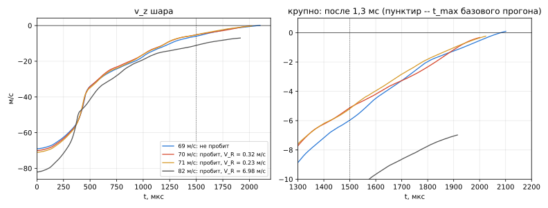
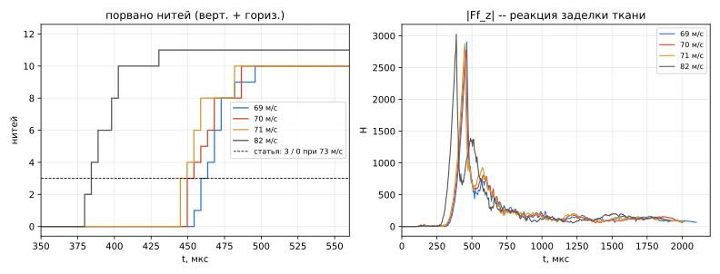
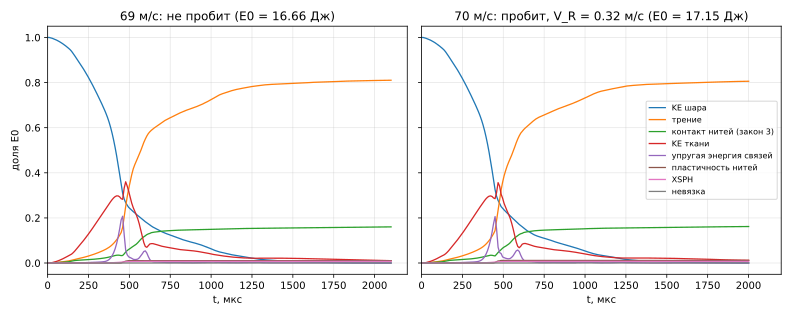

# Guo 2019, 1T `base`: окно непробитие / пробитие при законе 3 + выталкивание, μ = 0,27, на детерминированном коде

- **Дата:** 2026-11-08
- **Кейс:** guo2019 (конфигурация 1T — один слой ткани без пластины, уровень `base` — геометрия статьи)
- **Ветка:** `guo1t_law3push_mu027` (от `fiber_new` `ec2439f`)
- **Коммит HEAD:** `9437d7d627db2621f05fbcb15a7f46a1bc0ab26a` (guo2019 1T mu 0,27: данные для анимаций во всех выстрелах, кадры _long жёсткими ссылками) — из него собран бинарник; код расчёта совпадает с `fiber_new` `ec2439f` (`git diff ec2439f 9437d7d` вне `experiments/` пуст). Незакоммиченных изменений нет, `repro-diff.zip` патчей не содержит. Скрипты драйвера на сервере — версии `e51ed6c` (71 / 82) и `3ae6e18` (69 / 70): отличаются от `9437d7d` только допуском выстрелов по свободным потокам сервера, команды `guo2019_shot` те же (`REPRO.md` §3)
- **Прогонов:** 4 выстрела (V0 = 69, 70, 71, 82 м/с), у каждого базовый прогон до 1,5 мс и продолжение из его финального чекпоинта до исхода (≤ 3 мс) — 8 запусков `guo2019_shot`, по 4 потока OpenMP
- **Статус:** завершён; размер каталога в git 0,90 МБ — в пределах 2,5 МБ (`experiments/README.md` §3). Анимации и PNG (каталог `anim/`, 37 МБ) в git не хранятся, пересчёт — `scripts/rebuild_artifacts.sh`

## Вопрос

Где при законе контакта 3 (импульсный) с выталкиванием τ = 0,5 мкс и μ = 0,27 лежит граница непробитие / пробитие одного слоя ткани (1T `base`) на детерминированном коде `fiber_new` (суммирование OpenMP не зависит от числа потоков) — и совпадает ли она с окном [79; 80,5] м/с, полученным на той же постановке на недетерминированном коде (`2026-10-26-guo2019-damage-summary`).

## Постановка

Подбор окна драйвером `scripts/window_bisect.py` + `scripts/window_pinball.py` (деление диапазона на трети, шаг 0,5 м/с, стоп при hi − lo ≤ 1,5 м/с) на claude-compute-8t в две серии:

1. **[71; 82] м/с** (задача `mu027_window`): пара 71 / 82. Обе пробиты → по правилу драйвера «непробития в диапазоне нет», серия закончена после одного раунда.
2. **пара 69 / 70** (задача `mu027_v69_70`, по слову владельца после серии 1): 69 не пробит, 70 пробит → окно [69; 70], hi − lo = 1 ≤ 1,5 — конец.

Постоянное во всех выстрелах (ключи — `REPRO.md` §4, значения — `data/shot_v*_long.txt`):

| Параметр | Значение |
|---|---|
| Сцена | `--config=1T --level=base`: шар 12 мм, 7 г, 3544 частицы; ткань 102 × 102 нити, 43 248 бусин, 43 044 связи; вертикальные нити зажаты (1632 бусины) |
| Контакт | закон 3 (импульсный) на нить-нить и нить-шар (`--fs-contact=3 --ff-contact=3`), выталкивание τ = 0,5 мкс (`--impulse-push-tau=5e-7`, глубина 0,1, γ = 1), шаг ×0,5 (`--dt-scale=0.5`, dt ≈ 9,31·10⁻⁹ с) |
| Трение | μ_ff = μ_fs = 0,27 |
| Нить | `twaron_s25_dmg0.00415.fib`: σ_y = 2,04 ГПа, H = 100 ГПа, σ_u = 2,5 ГПа, повреждённость DEPS_F = 0,00415 (полный разрыв при ≈ 4 %), E = 80 ГПа, страховочный eps_break 5 % |
| Время | t_max = 1,5 мс; исход «не определён» → продолжение до 3 мс из финального чекпоинта базового прогона (`--restart`) |
| Вердикт | по шару (`--verdict-ball`): «не пробит» = `not_perforated`, V_R = 0; разрывы нитей — отдельная метрика. Исход ставит монитор (`tests/guo2019_monitor.hpp:997-1018`): «пробит» — центр шара ниже z_b − R_eff (z_b — исходная тыльная плоскость ткани) и \|Δv_z\| < 0,1 м/с на окне 20 мкс при v_z < 0; «не пробит» — v_z ≥ 0 непрерывно 20 мкс. Оба порога в коде помечены «оценка» (`tests/guo2019_case.hpp:373-374`) |
| Вывод | кадры каждые 20 мкс, монитор каждые 10 шагов, лог энергии каждые 100 шагов, чекпоинт каждые 20 000 шагов |

## Результат

Числа — из `data/shot_v*_base.txt` (базовый прогон до 1,5 мс), `data/shot_v*_long.txt` (продолжение, полный итог) и `data/metrics.txt` (по `data/monitor_v*.csv`, `data/energy_v*.csv`, `scripts/plot_series.py`). Эталон — Guo et al., IJIE 127 (2019) 1–16, 1T: при 73 м/с не пробит, при 79 м/с пробит (V_R ≈ 20 м/с), V_BL = 76 (+3/−3) м/с, порвано 3 вертикальных / 0 горизонтальных нитей, прогиб к первому разрыву 25–27 мм.

| V0, м/с | Исход к 1,5 мс | Исход (продолжение) | t_end, мкс | V_R, м/с | Порвано верт. / гориз. | 1-й разрыв, мкс | Прогиб при 1-м разрыве, мм | v_z(1,5 мс), м/с |
|---|---|---|---|---|---|---|---|---|
| 69 | не определён | **не пробит** (v_z = 0 при 2085 мкс) | 2100,8 | 0 | 10 / 0 | 454,1 | 26,83 | −5,99 |
| 70 | не определён | **пробит** | 2001,4 | 0,32 | 10 / 0 | 448,4 | 26,88 | −5,14 |
| 71 | не определён | пробит | 2023,8 | 0,23 | 10 / 0 | 441,4 | 26,86 | −5,22 |
| 82 | не определён | пробит | 1914,6 | 6,98 | 11 / 1 | 378,2 | 26,79 | −11,11 |

Окно непробитие / пробитие: **[69; 70] м/с**.

| Величина | Модель | Эталон | Доля от эталона |
|---|---|---|---|
| Граница пробития (середина окна), м/с | 69,5 | V_BL = 76 (+3/−3) | 0,914 |
| Наибольшая скорость без пробития, м/с | 69 | 73 (не пробит) | 0,945; при 70 и 71 модель пробита там, где опыт — нет |
| Порвано нитей у границы (69, 70 м/с), верт. / гориз. | 10 / 0 | 3 / 0 (73 м/с) | 3,3 по вертикальным |
| Прогиб при первом разрыве, мм | 26,79–26,88 | 25–27 | внутри диапазона |
| V_R при 82 м/с, м/с | 6,98 | ≈ 20 при 79 м/с | скорости разные, прямого сравнения нет |

Сравнение с той же постановкой на недетерминированном коде (`2026-10-26-guo2019-damage-summary`, таблица «Закон 3 с выталкиванием»):

| | Недетерминированный код (2026-10-26) | Этот каталог |
|---|---|---|
| Окно | [79; 80,5] м/с | [69; 70] м/с — на 10 м/с ниже |
| 79 м/с | шар остановлен, 11/0, 1-й разрыв 387 мкс | не считался |
| 82 м/с | пробит, V_R = 16,1 м/с, 13/1, 1-й разрыв 377 мкс | пробит, V_R = 6,98 м/с, 11/1, 1-й разрыв 378,2 мкс |

Куда уходит энергия шара (на t_end, доли E0 = ½·m·V0², `data/metrics.txt`):

| V0, м/с | E0, Дж | Трение | Контакт нитей (закон 3) | KE ткани | Пластичность нитей | XSPH | KE шара | Невязка |
|---|---|---|---|---|---|---|---|---|
| 69 | 16,66 | 0,810 | 0,160 | 0,010 | 0,011 | 0,007 | 0,000 | 0,0004 |
| 70 | 17,15 | 0,806 | 0,162 | 0,012 | 0,012 | 0,007 | 0,000 | 0,0004 |
| 71 | 17,64 | 0,807 | 0,162 | 0,011 | 0,012 | 0,007 | 0,000 | 0,0004 |
| 82 | 23,53 | 0,824 | 0,143 | 0,010 | 0,009 | 0,006 | 0,007 | 0,0003 |

Прочее (`data/shot_v*_long.txt`): n_tunnel = 0 во всех выстрелах; max δ_ff/d = 0,101–0,102, max δ_fs/d = 0,128; E_tot,max/E_tot,0 = 1. `E_tot_end/E_tot_0` монитора 0,012–0,018 — это механическая энергия без каналов диссипации; баланс с ними (energy_log) сходится до невязки 0,04 % E0.

После `--restart` монитор считает шаги заново с 1, а кадры — сквозные; в склеенных драйвером `monitor.csv` сквозной шаг восстановлен (`scripts/fix_monitor_steps.py`, 2026-11-08, коммит `59f9a87`; исходник — `monitor.steps_raw.csv` на сервере). Числа в таблицах от этого не зависят: они по времени, а не по шагу. `t_first_break` в `shot_v*_long.txt` пересчитан драйвером по строкам монитора (шаг 10 шагов) и отличается от точного значения базового прогона на ≤ 0,06 мкс; в таблице — точное значение из `shot_v*_base.txt`.

## График

Графики — `scripts/plot_series.py` по `data/monitor_v*.csv` (каждая 50-я строка монитора, шаг ≈ 4,7 мкс) и `data/energy_v*.csv` (каждая 10-я строка лога энергии, шаг ≈ 9,3 мкс).

### Скорость шара

69, 70 и 71 м/с идут почти одной кривой: −34…−35 м/с к 500 мкс (после разрывов), около −5…−6 м/с к 1,5 мс, где кончается базовый прогон (пунктир), — поэтому все три к 1,5 мс «не определены». На правой панели видно, что решает исход: 69 м/с пересекает ноль на 2085 мкс и отскакивает (+0,095 м/с на t_end), 70 и 71 м/с подходят к нулю, но монитор фиксирует «свободный полёт» на −0,32 и −0,23 м/с. Порядок V_R не монотонен по V0 (70 → 0,32, 71 → 0,23). 82 м/с к 1,5 мс ещё −11,1 м/с, выход на −6,98 м/с.

### Разрывы и реакция заделки

Рвутся 10 вертикальных нитей за ≈ 40 мкс: 69 м/с — с 454 мкс, 70 — с 448, 71 — с 441; 82 м/с — с 378 мкс, 11 вертикальных и одна горизонтальная. Горизонтальная линия — 3 нити статьи при 73 м/с. Реакция заделки ткани \|Ff_z\| достигает 2,8–3,0 кН в разгар разрывов (по выборке: 2901 Н при 464 мкс у 69, 2769 Н при 454 мкс у 70) и после 1 мс держится в пределах 55–240 Н (по выборке).

### Энергия

У 69 и 70 м/с картина одинакова: кинетическая энергия шара уходит в трение (0,81 E0) и в диссипацию контакта нитей закона 3 (0,16 E0); пик упругой энергии связей 0,21 E0 — на 450–459 мкс, кинетической энергии ткани 0,36 E0 — на 468–477 мкс (в разгар разрывов), потом обе гаснут. Пластичность нитей — 0,01 E0. Невязка баланса 0,04 % E0.

### Анимации

GIF ткани с двух сторон, v_z(t), PNG энергии и сводка для 69 и 70 м/с (каталог `anim/`, 37 МБ: `anim2_*.gif` по 13 МБ, 40 кадров из 53–54 скачанных — каждый второй из 106–107; PNG-снимки кадров по 1,2 МБ) в git не хранятся (правило объёма, `experiments/README.md` §3; файлы на диске сохранены, пути — в `experiments/.gitignore`). Получить: `bash scripts/rebuild_artifacts.sh <корень репозитория> <рабочий каталог>` — сборка и пара 69 / 70 заново (Linux, 8 ядер, около 5 ч, кадры ≈ 1,6 ГБ), затем анимации (≈ 2 мин) в `<рабочий каталог>/anim/`. Только анимации по готовым кадрам — `scripts/viz/make_viz_69_70.sh` (`REPRO.md` §4).

## Вывод

На детерминированном коде при законе 3 + выталкивание τ = 0,5 мкс и μ = 0,27 окно непробитие / пробитие для 1T `base` — **[69; 70] м/с**, на 10 м/с ниже окна [79; 80,5] м/с, полученного на той же постановке на недетерминированном коде; прежний результат на новом коде не воспроизводится (при 82 м/с V_R 6,98 вместо 16,1 м/с, 11/1 нитей вместо 13/1). Модельная граница ниже V_BL статьи (0,914 от 76 м/с) и ниже наибольшей скорости непробития в опыте (73 м/с): при 70 и 71 м/с модель пробита. Нитей рвётся втрое больше, чем в статье (10 / 0 против 3 / 0), прогиб к первому разрыву (26,8 мм) совпадает со статьёй.

## Что осталось неясным

- **Устойчивость окна к критерию исхода.** У границы шар выходит со скоростью 0,23–0,32 м/с — того же порядка, что порог «свободного полёта» \|Δv_z\| < 0,1 м/с на 20 мкс, а оба порога — оценки. Другие пороги могут сдвинуть границу; влияние не проверялось.
- **V_R не монотонна по V0:** 0,32 м/с при 70 и 0,23 м/с при 71. Причина не выяснялась; на этом уровне V_R исход, возможно, чувствителен к мелким деталям счёта.
- **Причина сдвига на 10 м/с относительно 2026-10-26** не установлена. Между прогонами отличается код (детерминированное суммирование OpenMP `6f1b63f` и слияние `fiber_divergence_diag` `cd25e5f`); какое изменение сдвинуло окно и не было ли прежнее окно случайным исходом недетерминированного счёта — не проверялось.
- **Повтор:** каждый выстрел посчитан один раз. Счёт детерминирован (побитовый повтор `energy_log.csv` и кадров после рестарта проверен на дымовом прогоне), но независимого повтора выстрелов 69 и 70 нет.
- **Прогиб в мониторе после разрывов** (`w_f`, в заголовках GIF 135–181 мм) — максимум по всем бусинам, включая концы порванных нитей, а не прогиб под шаром (≈ 46–47 мм по `ball_defl.py`); как прогиб не используется.
- Скорости между 70 и 82 м/с, кроме 71, не считались; монотонность исхода выше 71 м/с не проверена.
