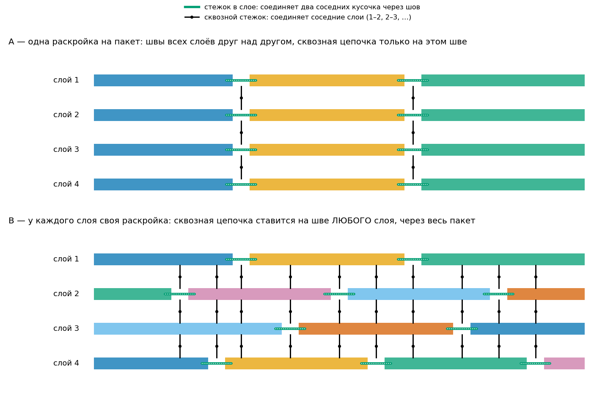
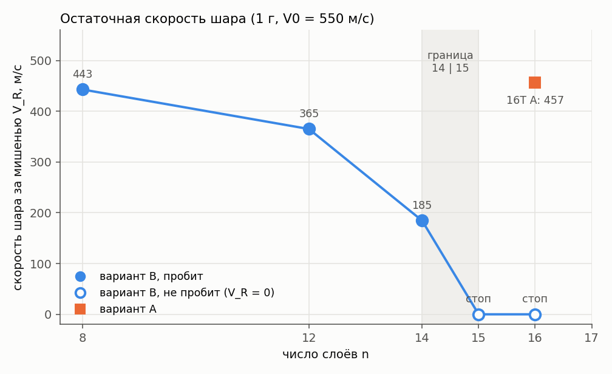
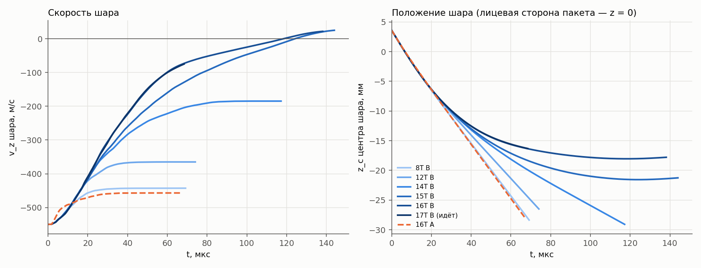
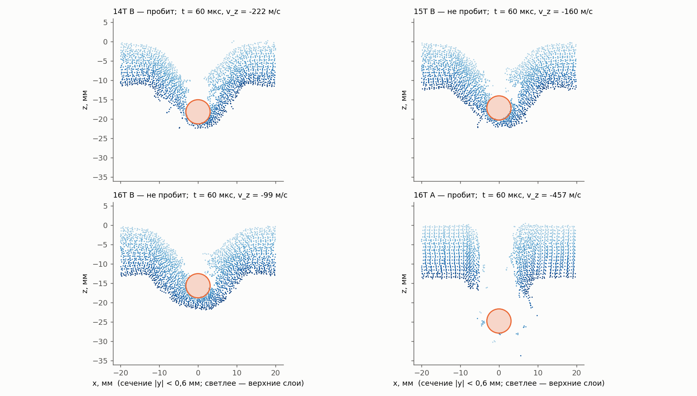
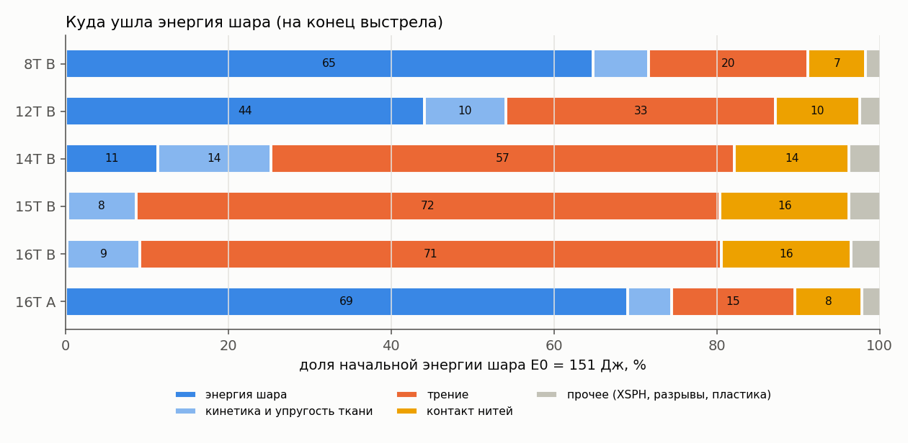
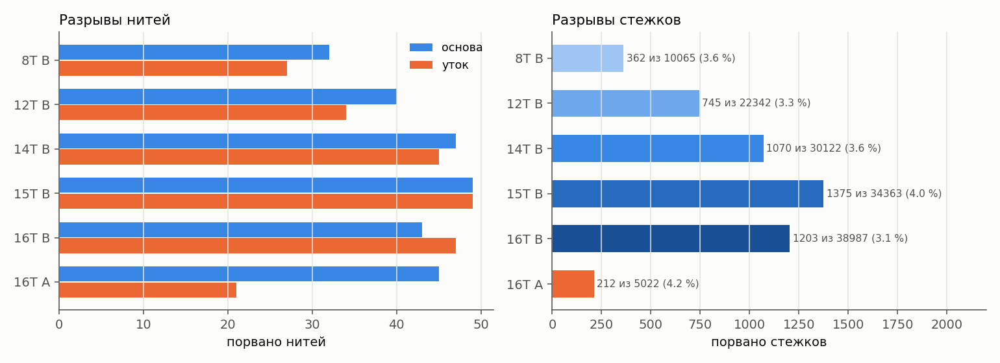

# Мозаика kT: шар 1 г, 550 м/с, поиск границы пробития по числу слоёв (2026-11-15)

Решение владельца 2026-11-15:

- ткань уменьшена: свободная часть 50 × 50 мм, по 10 мм на закрепление с двух сторон;
- на поле расположена мозаика из 7 кусочков;
- 16T считается в двух вариантах сшивки, A и B. Тот вариант, что держит лучше, применяется ко всем следующим выстрелам;
- граница пробит / не пробит по числу слоёв ищется делением отрезка пополам: 16T, при пробое 24T, при непробитии 24T —
  20T и далее;
- всё считается локально, потому что серверы заняты.

## Отчёт сессии 2026-11-14 – 15

Полный отчёт с рисунками: `report.html`, опубликован как приватный артефакт. Рисунки лежат в `fig/` и пересобираются
командами `python scripts/report_figs.py` и `python scripts/variants_fig.py`.

**Итог: в варианте B 14 слоёв пробиваются (V_R = 185 м/с), 15 держат.** В варианте A даже 16T пробит, V_R = 457 м/с.

### Что сделано за сессию

- Guo 2T, мозаика, 147 м/с (`experiments/2026-11-14-guo2019-2t-mosaic`):
  - выстрел k = 2: пробит, V_R = 116 м/с;
  - выстрел k = 1: пробит, V_R = 112 м/с;
  - шар оба раза проходит по шву, нити целы; сделаны анимации.
- В `guo2019_shot` добавлены ключи `--cut-size=WxH` и `--cut-clamp-edge`. Поле 50 × 70 мм, зажим |y| ≥ 25 мм.
- Очередь `queue.py`:
  - 16T A и 16T B;
  - выбор лучшего варианта;
  - деление пополам только выбранным вариантом;
  - сверх поиска 17T.
- Посчитано 7 выстрелов kT; 17T ещё идёт.

### Варианты сшивки

- Стежок в слое соединяет соседние кусочки одного слоя через шов, с шагом 1,18 мм. Сквозной стежок соединяет только соседние
  слои. В одной точке сквозные стежки идут подряд, 1–2, 2–3, …, и образуют цепочку через весь пакет.
- **A** — одна раскройка на весь пакет. Швы всех слоёв друг над другом, цепочки только на них: 162 сквозных стежка на пару слоёв.
- **B** — у каждого слоя своя раскройка. Цепочка ставится на шве любого из 16 слоёв: около 2440 сквозных стежков на пару слоёв,
  в 15 раз больше, чем в A.
- По реальной сцене 16T: [вариант A](fig/variant_A.png), [вариант B](fig/variant_B.png).

### Выстрелы

| Выстрел | Исход | V_R, м/с | z_c min, мм | Нити о/у | Стежки порв. / всего | δ_ff/d | Счёт, ч |
|---|---|---|---|---|---|---|---|
| 16T A | пробит | 457 | −28,1 | 45/21 | 212 / 5 022 | 0,67 | 1,7 |
| 8T B | пробит | 443 | −28,4 | 32/27 | 362 / 10 065 | 0,43 | 0,9 |
| 12T B | пробит | 365 | −26,5 | 40/34 | 745 / 22 342 | 0,80 | 1,5 |
| 14T B | пробит | 185 | −29,1 | 47/45 | 1 070 / 30 122 | 0,65 | 2,6 |
| **15T B** | **не пробит** | 0 | −21,6 | 49/49 | 1 375 / 34 363 | 0,68 | 4,0 |
| 16T B | не пробит | 0 | −18,0 | 43/47 | 1 203 / 38 987 | 0,86 | 4,3 |
| 17T B | идёт | | | | | | |

- Порядок выстрелов: 16T A, 16T B, выбран B, затем 8, 12, 14, 15 и 17 сверх поиска.
- «Не пробит» значит, что шар остановлен и отскочил назад со скоростью 22–25 м/с.
- Баланс энергии сходится, невязка ≤ 0,1 Дж при E0 = 151 Дж.

### Почему B держит лучше

- В A кусочек — это стопка из 16 слоёв со стыками друг над другом. Шар попадает рядом со стыком трёх кусочков и проходит по
  шву. Порвано 212 стежков, наибольшая сила на зажиме 0,12 кН, трение забирает 15 % E0.
- В B швы слоёв не совпадают, пакет простёган почти сплошь и прогибается как одно целое. Наибольшая сила на зажиме 7,3 кН. В 15T
  и 16T трение забирает 71–72 % E0.

### Анимации пороговых выстрелов

- `anim/mosaic_14T_B.gif` — 14T B, пробит.
- `anim/mosaic_15T_B.gif` — 15T B, не пробит.
- Есть ещё `anim/mosaic_16T_A.gif`.
- Снимки — `anim/*_frame*.png`. Скрипт — `scripts/animate_mosaic.py`, ключи
  `--no-stitches --section xz --yarn-stride 2 --fps 3`.
- Кадры записаны с шагом 10 мкс.

Отчёт одним файлом, с встроенными рисунками и анимациями: `report_session.html`. Собирается командой
`python scripts/build_report_file.py`.

### Ограничения

- δ_ff/d до 0,86 при пороге 0,5, то есть нити заходят друг в друга слишком глубоко. Сравнение A и B надёжно качественно, а
  граница 14 | 15 — оценка.
- Посчитана одна раскройка (seed = 1) и одна точка удара (0, 0). При другом seed граница может сдвинуться, особенно в A.
- В B каждая пара слоёв сшита по швам всех 16 раскроек. Вариант, где пару сшивают только по швам двух соседних слоёв, не
  считался; стежков в нём примерно в 8 раз меньше.
- Код не закоммичен: патч — `source.patch`, бинарник — `bin/`.

## Постановка

- Шар и контакт — как в серии kT (`experiments/2026-11-09-fabric-kT-ball1g-v550`):
  - шар 1 г, D = 6,253 мм, dx = 0,3 мм, V0 = 550 м/с;
  - закон 3 как проекция скорости (K = 8, тёплый старт), без выталкивания;
  - μ = 0,27, dt-scale 0,5 (dt ≈ 4,13 нс).
- Нить: `twaron_s25_dmg0.00415.fib`, E = 8e10, ε_b = 5 %.
- Ткань: мозаика `--random-cut=7 --cut-seed=1 --cut-size=0.05x0.07 --cut-clamp-edge=0.025`.
  - Поле 50 × 70 мм, зажаты все бусины с |y| ≥ 25 мм. Края по x свободные.
  - Стежки — материал стёжки «одеяла»: E = 8,5e10, d = 0,2 мм, ε_b = 3 %, работают только на растяжение. Шаг вдоль шва
    1,18 мм.
  - Шаг слоёв 0,859 мм.
- Варианты сшивки:
  - **A** — одна раскройка на весь пакет. Кусочек — стопка из всех слоёв, прошитая насквозь по своим швам.
    16T: 5022 стежка, 2592 в слоях и 2430 сквозных.
  - **B** — своя раскройка у каждого слоя (k = 1). Сквозные стежки ставятся по швам всех раскроек пакета: в каждой точке
    шва любой раскройки сшита каждая пара соседних слоёв. В пробе 16T: 38 987 стежков, 2619 в слоях и 36 368 сквозных.
- Удар в (0, 0). При seed = 1 точка удара у слоя раскройки 1 рядом со стыком кусочков 3, 4, 6.

## Код

- В `guo2019_shot` добавлены ключи `--cut-size=WxH` и `--cut-clamp-edge=`.
  - Сцена: `MosaicSpec::size_x/size_y/clamp_edge`. Окно плотности при своём поле — (W − p) × (2c_e − p).
  - К имени каталога добавляется `_f50x70c25`, поле и c_e пишутся в `scene_id.txt` и `shot.txt`.
- Код не закоммичен. Патч — `source.patch` от `source_head.txt`. Бинарник заморожен в `bin/guo2019_shot.exe`.

## Очередь

- `queue.py`; запуск в фоне — `run_queue.ps1`. Журнал — `queue.log`, состояние — `queue_state.json`.
- Повторный запуск продолжает с места остановки: готовые выстрелы не повторяются, незаконченный идёт из чекпоинта.
- Выбор варианта:
  - не пробит лучше, чем пробит;
  - если оба пробиты, лучше тот, у кого меньше V_R;
  - если оба не пробиты, лучше тот, у кого меньше наибольшая глубина шара.
- Вердикт по шару:
  - perforated — пробит;
  - not_perforated — не пробит, если V_R = 0;
  - если к t_max = 400 мкс исход не определён, выстрел продолжается из чекпоинта до 600, 900, 1200 мкс;
  - если и тогда не определён: |v_z| < 5 % V0 — «не пробит (оценка)», иначе «пробит (оценка)».
- Деление пополам:
  - нет непробитого n — следующее n + 8;
  - нет пробитого n — следующее n − 8;
  - иначе берётся середина, пока непробитое и пробитое n не станут соседними.
- Проба 16T: 0,27 с на шаг на 6 потоках, до 400 мкс около 7 ч.

## Результаты

### 16T, вариант A — пробит

- V_R = 457 м/с: шар потерял 31 % энергии. Исход ясен уже к t = 67 мкс, 1,7 ч счёта.
- Нити порваны во всех слоях, кроме 15-го: 45 основы и 21 утка. Первый разрыв на 2,2 мкс; разрывы идут по слоям сверху вниз до 10 мкс.
- Стежков порвано 212 из 5022.
- Наибольшая глубина шара z_c = −28 мм.
- δ_ff/d до 0,67, δ_fs/d до 0,03.
- Баланс энергии на конец, Дж:
  - E0 = 151,25;
  - механическая энергия 112,6;
  - трение 22,9;
  - контакт нитей 12,5;
  - XSPH 2,8;
  - разрывы 0,16;
  - невязка 0,05.

### 16T, вариант B — не пробит

- Шар остановлен на 115 мкс на глубине z_c = −18 мм и отскочил назад: к 138 мкс v_z = +22 м/с. Счёт 4,25 ч.
- Нити порваны: 43 основы и 47 утка. Слои 14–16 целы.
- Стежков порвано 1203 из 38 987.
- δ_ff/d до 0,86, δ_fs/d до 0,23. Нарушений порядка слоёв нет (в A их было 443).
- Наибольшая сила на зажиме нитей — 7,3 кН, в A — 0,12 кН. Пакет работает как единое целое и передаёт нагрузку на зажим.
- Баланс энергии на конец, Дж:
  - механическая энергия 13,8;
  - трение 108,1;
  - контакт нитей 24,1;
  - XSPH 3,4;
  - разрывы 1,2;
  - невязка 0,09.

### Выбор варианта: B

- При 16T вариант A пробит с V_R = 457 м/с, а вариант B шар останавливает. Очередь выбрала B, дальше считается только он.
- Почему B держит лучше. В A кусочек — стопка из 16 слоёв со стыками точно друг над другом. Шар попадает рядом со стыком
  трёх кусочков и проходит по шву сквозь весь пакет: рвётся мало нитей, стежков порвано 212.
- В B у каждого слоя своя раскройка, швы слоёв не совпадают. Сквозных стежков в 15 раз больше, 36 368 против 2430. Пакет
  стёган почти сплошь и работает как единое целое. Почти всю энергию шара забирает трение: 108 Дж из 151.
- Оговорка: δ_ff/d = 0,86 > 0,5, то есть нити глубоко заходят друг в друга. Это известное ограничение закона 3, на нём
  ветку контактов и поставили на паузу. Абсолютные числа поэтому нужно сверить; сравнение A и B качественное.
- Дальше: 16T не пробит, поэтому очередь считает 8T (16 − 8).

### 8T, вариант B — пробит

- V_R = 443 м/с. Исход ясен к 69 мкс, счёт 0,92 ч.
- Нити порваны: 32 основы и 27 утка. Стежков порвано 362 из 10 065.
- Наибольшая глубина шара z_c = −28 мм. δ_ff/d до 0,43.
- E_mech/E0 на конец 0,72.
- Граница лежит между 8T и 16T. Следующий выстрел 12T.

### 12T, вариант B — пробит

- V_R = 365 м/с. Исход ясен к 74 мкс, счёт 1,5 ч.
- Нити порваны: 40 основы и 34 утка. Стежков порвано 745 из 22 342.
- Наибольшая глубина шара z_c = −26,5 мм. δ_ff/d до 0,80.
- E_mech/E0 на конец 0,54.
- V_R по числу слоёв: 8T — 443 м/с, 12T — 365 м/с, 16T — 0. Граница между 12T и 16T, следующий выстрел 14T.

### 14T, вариант B — пробит

- V_R = 184,6 м/с. Исход ясен к 117 мкс, счёт 2,55 ч.
- Нити порваны: 47 основы и 45 утка. Стежков порвано 1070 из 30 122.
- Наибольшая глубина шара z_c = −29 мм. δ_ff/d до 0,65.
- E_mech/E0 на конец 0,25.
- Граница между 14T и 16T. Следующий выстрел 15T, на нём поиск заканчивается.

### Дополнительно: 17T (решение владельца 2026-11-15)

- После 15T считается 17T, вариант B. На границу он не влияет: нужен для формы зависимости V_R(n) за границей.
- В `queue.py` добавлен список `EXTRA = [17]`. Работающий процесс очереди этот код не видит.
- Поэтому запущен `chain_after.ps1`: он ждёт, пока процесс очереди завершится, и запускает `run_queue.ps1` заново.
  Новая очередь видит, что поиск завершён, и считает EXTRA.

### 15T, вариант B — не пробит

- Шар остановлен на 125 мкс на глубине z_c = −21,6 мм и отскочил назад: к 144 мкс v_z = +25 м/с. Счёт 4,04 ч.
- Нити порваны: 49 основы и 49 утка. Стежков порвано 1375 из 34 363.
- δ_ff/d до 0,68. E_mech/E0 на конец 0,086.

### Граница (вариант B, шар 1 г, 550 м/с)

- **14T пробит (V_R = 185 м/с), 15T не пробит.** Наименьшее непробитое число слоёв — 15.

| n | Исход | V_R, м/с | z_c min, мм | Порвано нитей (о/у) | Порвано стежков |
|---|---|---|---|---|---|
| 8 | пробит | 443 | −28,4 | 32/27 | 362 из 10 065 |
| 12 | пробит | 365 | −26,5 | 40/34 | 745 из 22 342 |
| 14 | пробит | 185 | −29,1 | 47/45 | 1070 из 30 122 |
| 15 | не пробит | 0 | −21,6 | 49/49 | 1375 из 34 363 |
| 16 | не пробит | 0 | −18,0 | 43/47 | 1203 из 38 987 |
| 16 (вариант A) | пробит | 457 | −28,1 | 45/21 | 212 из 5022 |

- После поиска считается 17T (EXTRA).
